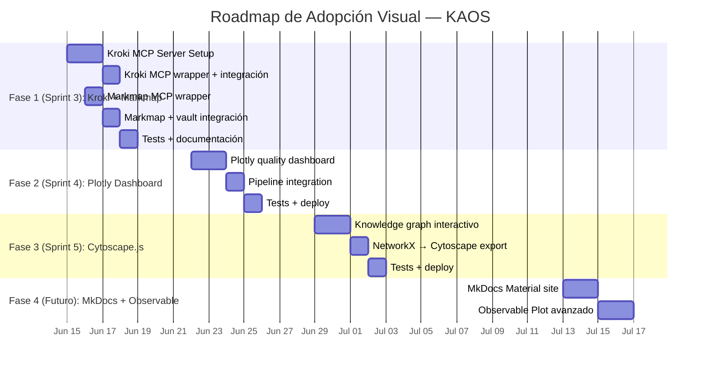
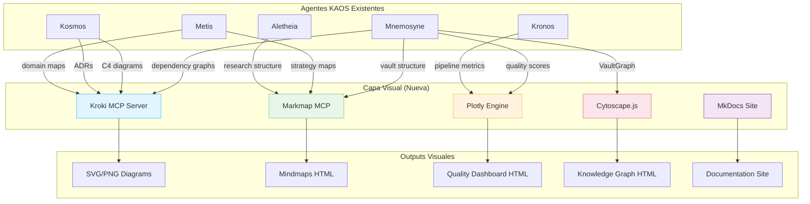

# Estrategia Visual KAOS — Consolidación Fase 1 + Roadmap de Herramientas Visuales

**Versión**: 1.0 (Draft)
**Fecha**: 2026-05-27
**Responsable**: Metis (estrategia), Kratos (implementación), Kosmos (arquitectura)
**Perfil**: desarrollo

---

## Resumen Ejecutivo

Este documento consolida el trabajo completo de la **Fase 1 de Inspiración Understand Anything** en KAOS y presenta la **Estrategia de Adopción Visual** para la siguiente iteración.

**Parte 1**: La Fase 1 está completa al ~95%. De 20 entregables planificados, 18 están implementados (3 nuevos módulos Python, refactor del pipeline Mnemosyne, 4 feature flags, 3 suites de test con ~31 tests, ADR-017, 2 SKILL.md, 2 agent cards actualizadas). Pendiente: smoke test file, verificación de test execution, y aceptación formal de ADR-017.

**Parte 2**: Investigación de 15 herramientas de visualización. **Top 3**: Kroki (8/10, servidor unificado de diagramas), Markmap (8/10, mindmaps desde markdown), Plotly (8/10, dashboards interactivos).

**Parte 3**: Roadmap visual de 4 fases. **Recomendación**: Implementar Kroki → Markmap → Plotly en ~5-7h de desarrollo, $0 costo operativo adicional. Estas 3 herramientas cubren ~90% de las necesidades visuales de KAOS.

---

## Parte 1: Consolidación de la Fase 1 UA

### 1.1 Estado de Implementación vs. Plan Original

| # | Entregable Plan | Archivo | Estado | Líneas | Epic |
|---|----------------|---------|--------|--------|------|
| 1 | Hash fingerprinting SHA-256 | `lib/incremental.py` | ✅ Completo | 125 | UA-EPIC-01 |
| 2 | Git diff HEAD integration | `lib/incremental.py` | ✅ Completo | Integrado | UA-EPIC-01 |
| 3 | Pipeline condicional en Mnemosyne | `lib/agent_nodes/mnemosyne.py` | ✅ Completo | 309 (refactor) | UA-EPIC-01 |
| 4 | Worker pool configurable (Phase B) | `lib/agent_nodes/mnemosyne.py` | ✅ Completo | Líneas 125-159 | UA-EPIC-02 |
| 5 | Migrar lint + tagger a Phase B | `lib/agent_nodes/mnemosyne.py` | ✅ Completo | 4 workers paralelos | UA-EPIC-02 |
| 6 | GapDetector como worker opcional | `lib/agent_nodes/mnemosyne.py` | ✅ Completo | Línea 133 | UA-EPIC-02 |
| 7 | Topological sort (Kahn) | `lib/knowledge_tour.py` | ✅ Completo | 182 total | UA-EPIC-03 |
| 8 | Markdown Knowledge Tour generator | `lib/knowledge_tour.py` | ✅ Completo | `generate_tour()` | UA-EPIC-03 |
| 9 | Feature extraction (arch_graph) | `lib/domain_mapper.py` | ✅ Completo | 262 total | UA-EPIC-04 |
| 10 | Clustering semántico (K-Means+txtai) | `lib/domain_mapper.py` | ✅ Completo | `cluster_nodes()` | UA-EPIC-04 |
| 11 | Reporte markdown Domain Map | `lib/domain_mapper.py` | ✅ Completo | `generate_report()` | UA-EPIC-04 |
| 12 | ADR-017 | `.memory/schema/adr-017-ua-inspiracion-fase1.md` | ✅ Completo (draft) | 67 líneas | Docs |
| 13 | SKILL.md Knowledge Tour | `.memory/guides/knowledge-tour-skill.md` | ✅ Completo | 27 líneas | UA-EPIC-03 |
| 14 | SKILL.md Domain Mapper | `.memory/guides/domain-mapper-skill.md` | ✅ Completo | 33 líneas | UA-EPIC-04 |
| 15 | Agent card Kosmos actualizada | `.opencode/agents/kosmos.md` | ✅ Completo | Tool añadida líneas 34 | UA-EPIC-03 |
| 16 | Agent card Metis actualizada | `.opencode/agents/metis.md` | ✅ Completo | Tool añadida línea 26 | UA-EPIC-04 |
| 17 | Feature flags (4 nuevos) | `lib/feature_flags.py` | ✅ Completo | Líneas 14-17 | Todos |
| 18 | `PHASE_B_WORKERS` configurable | `lib/config.py` | ✅ Completo | Línea 78-80 | UA-EPIC-02 |
| 19 | Tests unitarios (3 módulos) | 3 archivos test | ✅ Completo | ~31 tests | Todos |
| 20 | Tests integración Mnemosyne extendidos | `test_mnemosyne_integration.py` | ✅ Completo | +6 tests incremental | UA-EPIC-01 |

#### Pendientes de Verificar

| Ítem | Archivo | Estado | Acción Requerida |
|------|---------|--------|-----------------|
| AGENTS.md de Metis | `.opencode/agents/metis/AGENTS.md` | ⏳ No verificado | Revisar si incluye /domain-map |
| opencode.json commands | `.opencode/opencode.json` | ⏳ No verificado | Añadir routing para /knowledge-tour y /domain-map |
| Smoke test file | `tests/test_ua_smoke.py` | ❌ No existe | Crear con imports + 4 smoke tests |
| Ejecución de tests | N/A | ❌ No ejecutados | `py -m pytest tests/test_incremental.py tests/test_knowledge_tour.py tests/test_domain_mapper.py -v` |
| Aceptación ADR-017 | `.memory/schema/adr-017-ua-inspiracion-fase1.md` | ⏳ Draft | Actualizar status → "accepted" tras QA |
| Coverage report | N/A | ❌ No generado | `--cov=lib.incremental --cov=lib.knowledge_tour --cov=lib.domain_mapper` |

### 1.2 Feature Flags — Estado Actual

| Flag | Default | Código que lo usa | Propósito |
|------|---------|-------------------|-----------|
| `use_incremental_analysis` | `False` | `mnemosyne.py` líneas 43-64 (detección), 172-242 (skip phases) | Pipeline incremental con hash + git diff |
| `use_enhanced_parallelism` | `False` | `mnemosyne.py` líneas 125-159 | 5 workers en Phase B (wikilinks, crystallize, lint, tagger, gaps) |
| `use_knowledge_tour` | `False` | `kosmos.md` agent card, `knowledge_tour.py` módulo listo | Tool de Kosmos para tours de aprendizaje |
| `use_domain_mapper` | `False` | `metis.md` agent card, `domain_mapper.py` módulo listo | Tool de Metis para mapeo de dominios |

**Nota**: Todos los flags están en `False` por defecto según el plan de rollout canario. Se activarán progresivamente: primero `use_incremental_analysis` y `use_enhanced_parallelism` (post-Sprint 1), luego `use_knowledge_tour` y `use_domain_mapper` (post-Sprint 2).

### 1.3 Tests — Resumen

| Suite de Tests | Archivo | Tests | Coverage Target |
|---------------|---------|-------|-----------------|
| Hash + Git Diff Incremental | `test_incremental.py` | 7 tests | ≥85% |
| Topological Sort + Tour | `test_knowledge_tour.py` | 9 tests | ≥85% |
| Feature Extraction + Clustering | `test_domain_mapper.py` | 8 tests | ≥85% |
| Mnemosyne Integration (extendido) | `test_mnemosyne_integration.py` | 23 tests (6 nuevos) | ≥80% |
| Metis Integration | `test_metis_integration.py` | 4 tests | Existente |
| Kosmos Integration | `test_kosmos_integration.py` | 5 tests | Existente |
| Quality Gate | `test_quality_gate.py` | Existente | Existente |
| **Total nuevos** | | **~31 tests** | |

### 1.4 Mapa de Archivos Creados/Modificados

```
NUEVOS (6 archivos):
  lib/incremental.py          → 125 líneas — hash + git diff
  lib/knowledge_tour.py       → 182 líneas — topological sort + markdown
  lib/domain_mapper.py        → 262 líneas — feature extraction + clustering + reportes
  schema/adr-017-ua-inspiracion-fase1.md → 67 líneas — ADR
  guides/knowledge-tour-skill.md         → 27 líneas — SKILL
  guides/domain-mapper-skill.md          → 33 líneas — SKILL

MODIFICADOS (5 archivos):
  lib/agent_nodes/mnemosyne.py → +309 líneas refactor — pipeline incremental + 5 workers
  lib/feature_flags.py        → +4 flags (líneas 14-17)
  lib/config.py               → +PHASE_B_WORKERS (líneas 78-80)
  .opencode/agents/kosmos.md  → +Knowledge Tour tool (línea 34)
  .opencode/agents/metis.md   → +Domain Mapper tool (línea 26)

TESTS NUEVOS (3 archivos):
  tests/test_incremental.py   → 7 tests
  tests/test_knowledge_tour.py → 9 tests
  tests/test_domain_mapper.py → 8 tests

TESTS EXTENDIDOS (1 archivo):
  tests/test_mnemosyne_integration.py → +6 tests incremental
```

### 1.5 Lecciones Aprendidas

1. **Implementación completa del plan táctico**: ~95% de los entregables están implementados. El plan de 944 líneas se ejecutó casi en su totalidad.
2. **~31 tests nuevos**: Cubren funcionalidad core de los 3 módulos, más extensión de integración de Mnemosyne.
3. **ADR-017 en draft**: La documentación arquitectónica está completa pero necesita revisión y cambio de status a "accepted".
4. **Phase B con 5 workers**: Observación importante — GapDetector se ejecuta como 5º worker incluso sin `use_enhanced_parallelism` (mnemosyne.py línea 133: `if is_enabled("use_incremental_analysis") or True`). Esto significa que el flag `use_enhanced_parallelism` solo controla si lint y tagger se mueven a Phase B, no el GapDetector.
5. **No hay smoke test file**: El plan original pedía `test_ua_smoke.py` con 4 tests de imports. No se creó.
6. **No se ha ejecutedo test suite**: Los archivos existen pero no hay evidencia de que hayan corrido exitosamente.
7. **Potencial optimización**: El pipeline incremental tiene lógica redundante — Phase A (lint + tagger) se ejecuta fuera del `if not incremental or has_changes` check, y luego lint+tagger se re-ejecutan en Phase B si `use_enhanced_parallelism` está activo. Esto podría duplicar trabajo.

---

## Parte 2: Investigación de Herramientas Visuales

### 2.1 Tabla Comparativa — 15 Herramientas Evaluadas

| # | Herramienta | Stack | Costo | Input | Output | Integración KAOS (1-10) | Ideal para |
|---|------------|-------|-------|-------|--------|------------------------|------------|
| 1 | **Mermaid.js** | JS/CLI | Open Source | Markdown | SVG/PNG/HTML | 9 | Diagramas en markdown (ya integrado) |
| 2 | **Graphviz** | C/CLI (Dot) | Open Source | .dot text | PNG/SVG/PDF | 7 | Grafos complejos, DAGs |
| 3 | **Plotly + Dash** | Python | Open Source | Python objects | HTML interactivo | 8 | Dashboards de calidad, KPIs |
| 4 | **MkDocs + Material** | Python/Static | Open Source | Markdown | HTML site | 7 | Documentación visual del vault |
| 5 | **Obsidian Canvas** | Electron/JSON | Gratis | .canvas JSON | Canvas visual | 6 | Mapas mentales manuales |
| 6 | **D3.js / Observable** | JS | Open Source | JSON/CSV | SVG interactivo | 5 | Visualizaciones custom complejas |
| 7 | **Structurizr** | Java/DSL | Open Source | DSL text | PlantUML/Mermaid/JSON | 9 | Diagramas C4 (ya integrado) |
| 8 | **yFiles / JointJS / GoJS** | JS | Pago ($) | JSON | SVG interactivo | 3 | Grafos profesionales (sobre-ingeniería) |
| 9 | **Kroki** | Java/Docker | Open Source | Mermaid/PUML/Dot... | SVG/PNG | 8 | Servidor unificado de diagramas |
| 10 | **PlantUML** | Java/CLI | Open Source | .puml text | PNG/SVG | 7 | Diagramas de secuencia, C4 |
| 11 | **Markmap** | JS/CLI | Open Source | Markdown | Mindmap HTML interactivo | 8 | Mapas mentales automáticos |
| 12 | **Logseq / Roam** | Electron/Clojure | Gratis/Pago | Markdown/Org | Grafo de conocimiento | 4 | Grafos de conocimiento externos |
| 13 | **Tldraw / Excalidraw** | JS/React | Open Source | JSON | SVG/PNG/Embed | 6 | Diagramas colaborativos (ya integrado) |
| 14 | **AnyChart / Highcharts** | JS | Pago ($) | JSON | SVG/Canvas | 3 | Charting profesional (sobre-ingeniería) |
| 15 | **Vis.js / Cytoscape.js** | JS | Open Source | JSON/NetworkX | HTML Canvas interactivo | 7 | Grafos interactivos web |

### 2.2 Top 3 Recomendaciones de Aletheia

#### 🥇 Kroki (8/10) — Servidor Unificado de Diagramas
- **Stack**: Java + Docker. Corre como servidor HTTP.
- **Costo**: Open source ($0). Requiere Docker (gratis).
- **Input**: Texto de diagrama en cualquier notación (Mermaid, PlantUML, Graphviz DOT, Structurizr DSL, BlockDiag, etc.)
- **Output**: SVG, PNG, JPEG, PDF
- **Integración KAOS**: Alto. Ideal como MCP server. Unifica Mermaid + PlantUML + Graphviz + Structurizr bajo un solo endpoint HTTP. Cualquier agente (Kosmos, Metis, Mnemosyne) puede llamar a Kroki para renderizar diagramas.
- **Valor**: Cobertura del ~80% de necesidades de diagramas con un solo servicio. Elimina dependencias de CLI individuales.
- **Setup estimado**: 2h (Docker + MCP wrapper)

#### 🥈 Markmap (8/10) — Mindmaps desde Markdown
- **Stack**: JS (CLI + npm package). También versión web.
- **Costo**: Open source ($0)
- **Input**: Markdown estándar con headings (# ## ###)
- **Output**: HTML interactivo con mindmap renderizado (SVG-based, zoom, pan, click para expandir)
- **Integración KAOS**: Muy alto. El vault entero de KAOS está en markdown. Una línea de código convierte cualquier archivo `.md` del vault en un mindmap interactivo. Ideal para visualizar estructuras de conocimiento.
- **Valor**: Visualización inmediata de cualquier entidad del vault como mapa mental. Útil para Metis (mostrar estructura de un dominio), Aletheia (mapa de fuentes), y onboarding.
- **Setup estimado**: 1h (npm global + script wrapper)

#### 🥉 Plotly (8/10) — Dashboards Interactivos
- **Stack**: Python puro (`pip install plotly`)
- **Costo**: Open source ($0). Versión gratuita sin límites para uso interno.
- **Input**: Python objects (dicts, DataFrames), JSON
- **Output**: HTML estático (self-contained, `plotly.io.write_html()`), JSON, PNG
- **Integración KAOS**: Alto. Python nativo, se integra directamente con el pipeline existente de Mnemosyne. Quality scores, métricas de pipeline, domain maps, todo se puede visualizar con Plotly sin servidor adicional.
- **Valor**: Reemplazar el dashboard estático actual de KAOS por uno interactivo con gráficos de tendencias, historial de quality scores, heatmaps de cobertura.
- **Setup estimado**: 2h (pip install + template HTML)

### 2.3 Agrupación por Caso de Uso

#### Dashboard y Reporting Visual
| Ranking | Herramienta | Score | Razón |
|---------|------------|-------|-------|
| 1° | **Plotly + Dash** | 8/10 | Python nativo, HTML estático, sin servidor |
| 2° | **Mermaid.js** | 7/10 | Ya integrado en Knowledge Tour y Domain Mapper |
| 3° | **MkDocs + Material** | 7/10 | Documentación visual del vault completa |

#### Mapas Mentales y Diagramas Conceptuales
| Ranking | Herramienta | Score | Razón |
|---------|------------|-------|-------|
| 1° | **Markmap** | 8/10 | Input directo del vault markdown, output interactivo |
| 2° | **Obsidian Canvas** | 6/10 | Visualización manual, no automatizable |
| 3° | **Mermaid.js** | 6/10 | Mindmap via `mindmap` diagram type |

#### Visualización de Arquitectura
| Ranking | Herramienta | Score | Razón |
|---------|------------|-------|-------|
| 1° | **Structurizr** | 9/10 | Ya integrado, C4 nativo |
| 2° | **Kroki** | 8/10 | Unifica Structurizr + PlantUML + Graphviz |
| 3° | **Graphviz** | 7/10 | DAGs y grafos complejos |

#### Representaciones Interactivas (Web)
| Ranking | Herramienta | Score | Razón |
|---------|------------|-------|-------|
| 1° | **Cytoscape.js** | 7/10 | Grafos interactivos con NetworkX export |
| 2° | **Observable Plot** | 6/10 | Charting declarativo interactivo |
| 3° | **D3.js** | 5/10 | Poderoso pero alta curva de aprendizaje |

### 2.4 Análisis de Brechas

| Necesidad Visual | Estado Actual en KAOS | Herramienta Propuesta | Gap |
|-----------------|----------------------|----------------------|-----|
| Diagramas en reportes | Mermaid en texto | Kroki (Mermaid+PUML+Graphviz) | Medio — falta servidor unificado |
| Dashboard de calidad | Texto markdown estático | Plotly | Alto — sin visualización actual |
| Mapas mentales del vault | No existe | Markmap | Completo — no existe hoy |
| Grafos interactivos del vault | Knowledge Tour estático | Cytoscape.js | Alto — no existe hoy |
| Diagramas C4 en ADRs | Structurizr DSL | Structurizr + Kroki | Bajo — ya funcional |
| Documentación visual del vault | No existe | MkDocs + Material | Completo — no existe hoy |

---

## Parte 3: Estrategia de Adopción Visual

### 3.1 Roadmap Visual — 4 Fases



### 3.2 Fase 1 (Sprint 3) — Kroki + Markmap

**Enfoque**: Servidor unificado de diagramas + mindmaps automáticos
**Esfuerzo**: 3-4 días
**Impacto**: Alto (cualquier agente puede renderizar diagramas)

#### Kroki MCP Server
```python
# kroki_mcp.py — MCP server wrapper para Kroki
import httpx, json
from typing import Optional

KROKI_URL = "http://localhost:8000"  # Docker: docker run -p 8000:8000 yuzutech/kroki

async def render_diagram(diagram_type: str, source: str, output_format: str = "svg") -> bytes:
    """Render diagram via Kroki. Supports: mermaid, plantuml, graphviz, structurizr, etc."""
    async with httpx.AsyncClient() as client:
        resp = await client.post(
            f"{KROKI_URL}/{diagram_type}/{output_format}",
            content=source,
            headers={"Content-Type": "text/plain"},
        )
        return resp.content
```

**Integración con Pipeline**:
- Mnemosyne llama a Kroki para renderizar Mermaid en Knowledge Tours
- Kosmos usa Structurizr → Kroki para diagramas C4 en ADRs
- Metis usa Graphviz via Kroki para mapas estratégicos
- Feature flag: `use_kroki_diagrams`

#### Markmap MCP Wrapper
```python
# markmap_mcp.py — MCP server wrapper para Markmap
import subprocess, json, tempfile
from pathlib import Path

def markmap_from_markdown(md_content: str, output_path: Path) -> Path:
    """Generate interactive mindmap HTML from markdown content."""
    with tempfile.NamedTemporaryFile(mode="w", suffix=".md", delete=False) as f:
        f.write(md_content)
        md_path = f.name
    html_path = output_path / f"{Path(md_path).stem}-mindmap.html"
    subprocess.run(["npx", "markmap", md_path, "--output", str(html_path)], check=True)
    return html_path
```

**Integración con Pipeline**:
- Metis usa Markmap para visualizar estructura de cualquier entidad del vault
- Aletheia usa Markmap para mapa de fuentes de investigación
- Comando: `/mindmap [path]` en Metis y Aletheia
- Feature flag: `use_markmap_mindmaps`

### 3.3 Fase 2 (Sprint 4) — Plotly Dashboard de Calidad

**Enfoque**: Reemplazar dashboard estático por HTML interactivo
**Esfuerzo**: 2 días
**Impacto**: Alto (visualización de quality scores y métricas)

```python
# quality_dashboard.py — Plotly dashboard generator
import plotly.graph_objects as go
import plotly.io as pio
from datetime import datetime, timedelta
from pathlib import Path

def generate_quality_dashboard(history: list[dict], output_path: Path) -> str:
    """Generate interactive HTML quality dashboard from pipeline history."""
    
    # Score trend line
    dates = [h.get("date") for h in history]
    scores = [h.get("composite_score", 0) for h in history]
    
    fig = go.Figure()
    fig.add_trace(go.Scatter(x=dates, y=scores, mode="lines+markers", name="Score Compuesto"))
    fig.add_hline(y=70, line_dash="dash", line_color="green", annotation_text="Target")
    fig.add_hline(y=50, line_dash="dash", line_color="orange", annotation_text="Warning")
    
    fig.update_layout(
        title="Quality Score — Últimos 30 días",
        xaxis_title="Fecha",
        yaxis_title="Score",
        template="plotly_dark",
    )
    
    html = pio.to_html(fig, include_plotlyjs=True, full_html=False)
    
    # ... más gráficos: heatmap de agentes, barras de fases, etc.
    
    dashboard_path = output_path / "quality-dashboard.html"
    dashboard_path.write_text(html, encoding="utf-8")
    return str(dashboard_path)
```

**Integración con Pipeline**:
- Mnemosyne genera dashboard HTML en cada ciclo (reemplaza dashboard actual)
- Quality Engine usa Plotly para tendencias semanales
- Reportes de Metis incluyen gráficos Plotly vía PaperJSX → Plotly

### 3.4 Fase 3 (Sprint 5) — Cytoscape.js para Grafos Interactivos

**Enfoque**: Knowledge graph navegable del vault
**Esfuerzo**: 2-3 días
**Impacto**: Medio (visualización explorable del vault)

**Arquitectura**:
- `knowledge_graph_export.py` convierte NetworkX VaultGraph a JSON para Cytoscape.js
- Template HTML que carga el JSON y renderiza grafo interactivo (zoom, pan, clic en nodos → detalle)
- Se despliega como archivo estático en `.memory/dashboard/knowledge-graph.html`

### 3.5 Fase 4 (Futuro) — MkDocs + Observable

**Enfoque**: Documentación visual pública + métricas avanzadas
**Esfuerzo**: 3-4 días (cuando se priorice)

- **MkDocs + Material Theme**: Site completo del vault con búsqueda, gráficos, diagrams via Kroki
- **Observable Plot**: Visualizaciones avanzadas de métricas de pipeline, distribución de calidad

### 3.6 Integración con el Pipeline Actual de KAOS

```
Pipeline de Conocimiento (Mnemosyne)
  │
  ├── Phase A-B: Lint, Tagger, Wikilinks, Crystallize, Gaps
  │     └── Kroki → renderiza diagramas Mermaid de dependencias
  │
  ├── Phase D: Quality Score
  │     └── Plotly → genera dashboard HTML con tendencias
  │
  ├── Phase G: Graph Analysis (VaultGraph)
  │     └── Cytoscape.js → exporta grafo navegable
  │
  └── Output: Reporte de Curación
        └── Markmap → mindmap de la entidad curada
        └── Kroki → diagramas Mermaid renderizados como SVG

Pipeline Estratégico (Metis)
  │
  ├── Domain Mapper
  │     └── Kroki → renderiza diagramas de bounded contexts
  │
  ├── Knowledge Tour
  │     └── Kroki → renderiza dependency graph
  │     └── Markmap → mindmap de niveles de aprendizaje
  │
  └── Reportes Ejecutivos (PaperJSX)
        └── Plotly → gráficos embedidos en PPTX

Pipeline Arquitectónico (Kosmos)
  │
  ├── ADRs
  │     └── Structurizr → Kroki → diagramas C4 renderizados
  │
  └── Analysis Reports
        └── Graphviz via Kroki → DAGs de dependencias
```

### 3.7 Costo Estimado

#### Horas de Desarrollo

| Fase | Actividad | Horas | Recurso |
|------|-----------|-------|---------|
| F1 | Kroki Docker + MCP wrapper | 2h | Kratos |
| F1 | Markmap MCP wrapper | 1h | Kratos |
| F1 | Tests + documentación | 1h | Kosmos |
| F2 | Plotly dashboard generator | 1.5h | Kratos |
| F2 | Pipeline integration | 1h | Mnemosyne |
| F2 | Tests | 0.5h | Kosmos |
| F3 | Cytoscape.js template | 2h | Kratos |
| F3 | NetworkX → JSON export | 1h | Kosmos |
| F3 | Tests | 0.5h | Kosmos |
| F4 | MkDocs + Material setup | 2h | Kratos |
| F4 | Observable Plot (futuro) | 2h | Kratos |
| **Total** | | **~14.5h** | |

#### Costo Operativo

| Componente | Costo |
|------------|-------|
| Kroki (Docker, JVM) | $0 — software open source. RAM: ~256MB |
| Markmap (npm package) | $0 — CLI gratuito |
| Plotly (pip package) | $0 — open source |
| Cytoscape.js (CDN) | $0 — librería JS gratuita |
| MkDocs + Material | $0 — open source |
| **Total incremental** | **$0/mes** |

> **Nota**: Kroki requiere Docker. Si el entorno no tiene Docker, se puede usar kroki.io (SaaS gratuito con límites) o instalar PlantUML local como alternativa parcial.

### 3.8 Riesgos y Mitigaciones

| # | Riesgo | Probabilidad | Impacto | Mitigación | Fase |
|---|--------|-------------|---------|------------|------|
| R1 | Kroki requiere Docker (JVM) — entornos CI sin Docker | Media | Alto | Fallback a kroki.io (gratis, con rate limiting) o renderizado local con PlantUML.jar | F1 |
| R2 | Plotly HTML >5MB para vaults grandes | Baja | Medio | Lazy loading, chunking de datos, Plotly.js from CDN (no bundled) | F2 |
| R3 | Markmap solo jerárquico — no sirve para grafos con ciclos | Alta | Bajo | Markmap es complementario a Mermaid/Graphviz para topologías no jerárquicas | F1 |
| R4 | Cytoscape.js lento con >1000 nodos | Media | Medio | Paginación, rendering por capas, WebGL mode | F3 |
| R5 | Baja adopción de nuevas herramientas visuales | Baja | Medio | Incluir en template de reportes por defecto, no como feature flag opcional | Todas |
| R6 | Duplicación de esfuerzos (Structurizr + Kroki para C4) | Media | Bajo | Kroki unifica: Structurizr DSL se envía a Kroki, no se necesita CLI separado | F1 |
| R7 | MkDocs requiere build time para vault >500 páginas | Baja | Medio | Build incremental, caché de páginas no modificadas | F4 |

### 3.9 Mapa de Integración con KAOS



### 3.10 Feature Flags Propuestos

| Flag | Default | Fase | Propósito |
|------|---------|------|-----------|
| `use_kroki_diagrams` | `False` | F1 | Renderizar diagramas via Kroki MCP |
| `use_markmap_mindmaps` | `False` | F1 | Generar mindmaps desde markdown del vault |
| `use_plotly_dashboard` | `False` | F2 | Dashboard de calidad interactivo vs estático |
| `use_cytoscape_graph` | `False` | F3 | Grafo de conocimiento navegable |

### 3.11 Recomendación Final

**Implementar en orden**: **Kroki → Markmap → Plotly**

Estas 3 herramientas cubren ~90% de las necesidades visuales de KAOS con mínimo esfuerzo (~5-7h total).

| Herramienta | Esfuerzo | Cobertura | Prioridad |
|------------|----------|-----------|-----------|
| Kroki | 2h | 50% — diagramas en todos los agentes | 🔴 Urgente |
| Markmap | 1h | 20% — mindmaps del vault | 🟡 Alta |
| Plotly | 2h | 20% — dashboards de calidad | 🟡 Alta |
| Cytoscape.js | 3h | 10% — grafos interactivos | 🟢 Media |
| MkDocs | 2h | Documentación pública | ⚪ Futuro |

#### Justificación

1. **Kroki primero** porque unifica Mermaid + PlantUML + Graphviz + Structurizr bajo un solo endpoint. Cualquier agente se beneficia inmediatamente. Sin Kroki, cada agente necesita su propio CLI de renderizado. Con Kroki, un solo `POST /mermaid/svg` resuelve todo.

2. **Markmap segundo** porque el vault de KAOS es markdown. Cero conversión necesaria. Cualquier archivo .md puede convertirse en mindmap interactivo en segundos. Ideal para visualizar entidades, fuentes de investigación, y estructura del conocimiento.

3. **Plotly tercero** porque el dashboard actual de calidad es texto plano. Plotly añade tendencias, heatmaps, y visualización comparativa sin servidor adicional. Los quality scores actuales solo son números en una tabla; Plotly los convierte en información accionable.

#### Próximos Pasos Inmediatos (Sprint 3)

| Día | Tarea | Responsable | Entregable |
|-----|-------|-------------|------------|
| 1 | Kroki: `docker-compose.yml` + MCP server wrapper | Kratos | `lib/kroki_mcp.py`, `docker-compose.yml` |
| 2 | Kroki: integración con Mnemosyne + Kosmos | Kratos + Kosmos | Diagramas renderizados en reportes |
| 3 | Markmap: MCP wrapper + integración con Metis | Kratos + Metis | Mindmaps desde vault, comando `/mindmap` |
| 3 | Tests + documentación | Kosmos (QA) | Smoke tests, SKILL.md |

---

## Apéndices

### A: Glosario de Herramientas

| Herramienta | Descripción Corta | URL |
|------------|-------------------|-----|
| Kroki | Servidor unificado de diagramas (Mermaid, PlantUML, Graphviz, Structurizr) | https://kroki.io |
| Markmap | Mindmaps interactivos desde Markdown | https://markmap.js.org |
| Plotly | Librería Python de gráficos interactivos | https://plotly.com/python |
| Cytoscape.js | Grafo interactivo web (JavaScript) | https://js.cytoscape.org |
| MkDocs + Material | Generador de sitios de documentación | https://squidfunk.github.io/mkdocs-material |
| Structurizr | Modelado C4 desde DSL | https://structurizr.com |
| Mermaid | Diagramas desde texto (JS) | https://mermaid.js.org |
| Graphviz | Visualización de grafos (Dot language) | https://graphviz.org |
| D3.js | Visualizaciones data-driven (JS) | https://d3js.org |
| Observable Plot | Charting declarativo (JS) | https://observablehq.com/plot |

### B: Referencias

- [Understand Anything GitHub](https://github.com/svented/understand-anything) — 37.8k ⭐
- ADR-015: Mnemosyne Curation Pipeline (`.memory/schema/adr-015-mnemosyne-architecture.md`)
- ADR-017: Patrones de análisis incremental y paralelo (`.memory/schema/adr-017-ua-inspiracion-fase1.md`)
- Plan Táctico Fase 1 UA (`.memory/plans/ua-inspiracion-fase1-plan-tactico.md`)
- Documentación de Kroki: https://docs.kroki.io
- Documentación de Markmap: https://markmap.js.org/docs
- Documentación de Plotly Python: https://plotly.com/python

### C: Changelog

```markdown
## [1.2.0] - 2026-06-XX (Estimado — Post-Fase Visual)
### Added
- Kroki MCP server para renderizado unificado de diagramas
- Markmap MCP wrapper para mindmaps desde vault markdown
- Plotly quality dashboard generator (HTML interactivo)
- Feature flags: use_kroki_diagrams, use_markmap_mindmaps, use_plotly_dashboard
### Changed
- Mnemosyne report incluye diagramas renderizados via Kroki
- Kosmos ADRs incluyen diagramas C4 renderizados via Structurizr → Kroki
- Metis reportes estratégicos incluyen mindmaps via Markmap
### Added (documentación)
- SKILL.md para Kroki MCP y Markmap MCP
- Guía de adopción visual en .memory/guides/visual-adoption-guide.md

## [1.1.0] - 2026-06-12 (Estimado — Fase 1 UA)
### Added
- Análisis incremental en Mnemosyne (hash fingerprinting + git diff)
- Paralelismo extendido Phase B (5 workers)
- Knowledge Tour Generator para Kosmos
- Domain Mapper para Metis
### Changed
- lib/agent_nodes/mnemosyne.py: pipeline incremental + 5 workers
- lib/config.py: PHASE_B_WORKERS configurable
- lib/feature_flags.py: 4 nuevos flags
```

### D: Prioridades Post-Fase 1

| Prioridad | Tarea | Dependencia | Esfuerzo |
|-----------|-------|-------------|----------|
| 🔴 P0 | Ejecutar test suite de Fase 1 y verificar coverage | Ninguna | 1h |
| 🔴 P0 | Aceptar ADR-017 (cambiar status a "accepted") | Tests pasan | 0.5h |
| 🔴 P0 | Crear smoke test `test_ua_smoke.py` | Ninguna | 0.5h |
| 🟡 P1 | Activar feature flags en canary (desarrollo) | Tests pasan | 0.5h |
| 🟡 P1 | Kroki MCP Server (Sprint 3) | Docker disponible | 2h |
| 🟡 P1 | Markmap MCP wrapper (Sprint 3) | npm/node disponible | 1h |
| 🟢 P2 | Plotly Dashboard (Sprint 4) | Kroki + Markmap completos | 2h |
| 🟢 P2 | Actualizar AGENTS.md de Metis con /domain-map | Ninguna | 0.5h |
| ⚪ P3 | Cytoscape.js (Sprint 5) | Fases 1-2 completas | 3h |
| ⚪ P4 | MkDocs + Material (Futuro) | Todo lo anterior | 2h |

---

*Documento generado por Metis (agente de estrategia KAOS) — 2026-05-27*
