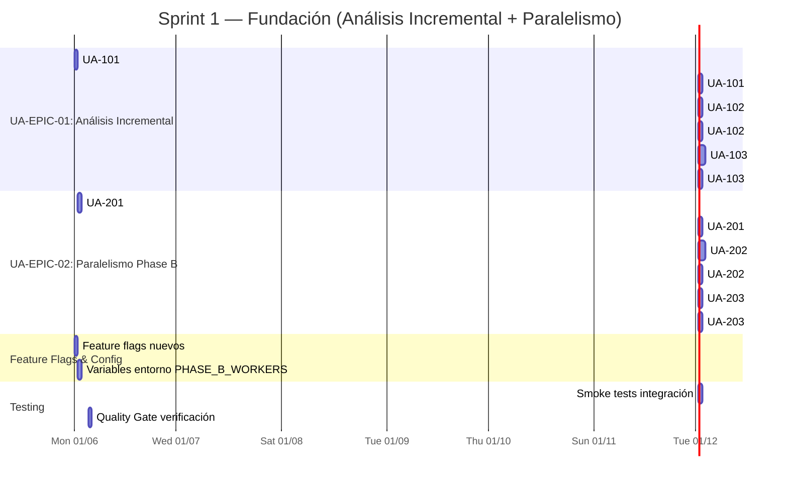
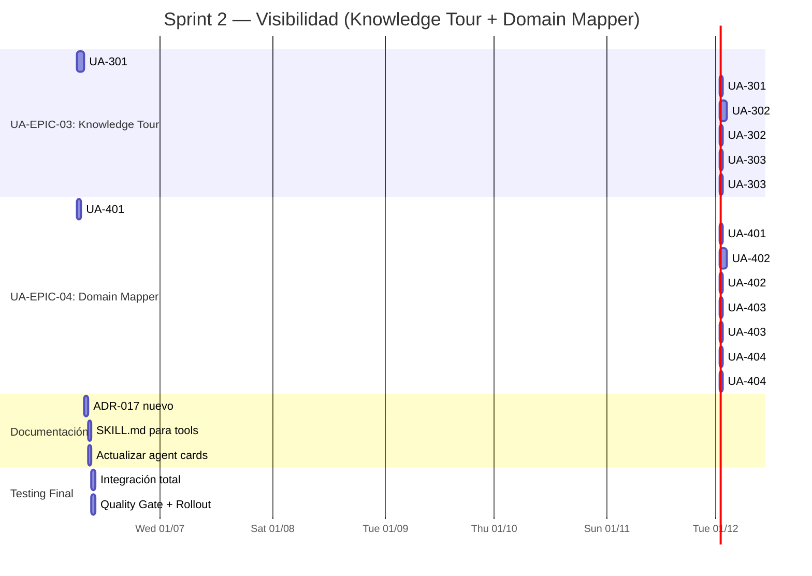
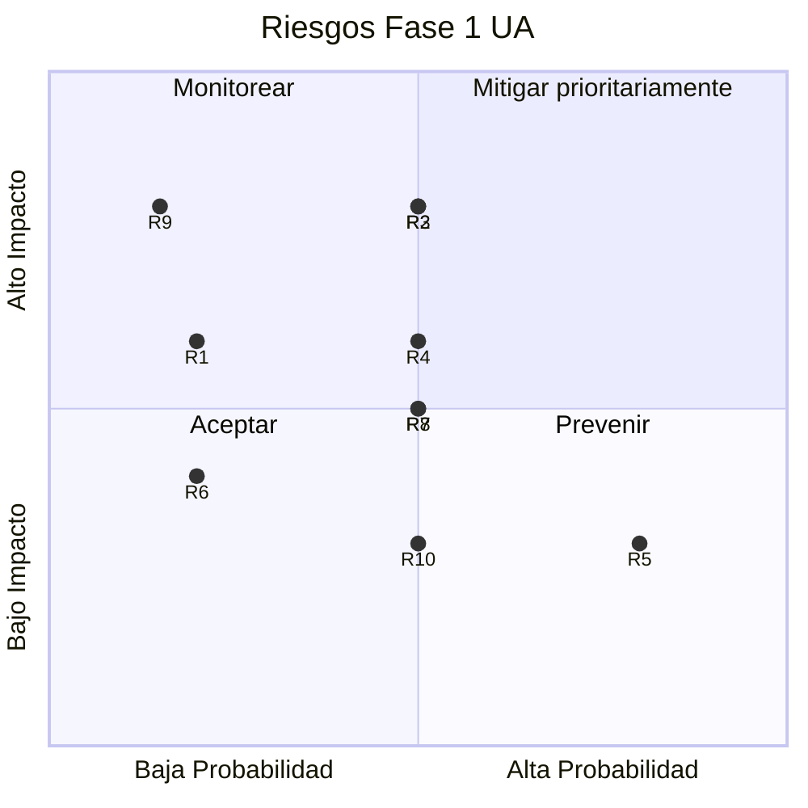

# Plan Táctico Integral — Fase 1: Inspiración Understand Anything en KAOS

**Versión**: 1.0 (Draft)
**Fecha**: 2026-05-27
**Responsable**: Metis (estrategia), Kosmos (arquitectura), Kratos (implementación), Mnemosyne (curación)
**Perfil**: desarrollo (score compuesto objetivo ≥ 70)
**Inspiración**: Understand Anything (37.8k ⭐, Tree-sitter + LLM híbrido)

---

## Resumen Ejecutivo

Este plan detalla la **Fase 1** de adopción de patrones arquitectónicos del proyecto Understand Anything (UA) en KAOS, sin integrarlo como dependencia directa. Cuatro mejoras incrementales transforman el pipeline de conocimiento de KAOS:

1. **Análisis Incremental** en Mnemosyne — hash fingerprinting + git diff HEAD para evitar re-procesar archivos no modificados
2. **Paralelismo Extendido** en Phase B — de 2 a 5+ workers concurrentes
3. **Knowledge Tour Generator** — nueva tool para Kosmos que genera guías de aprendizaje topológicas del vault
4. **Domain Mapper** — nueva tool para Metis que agrupa componentes técnicos en dominios de negocio vía clustering semántico

**Impacto estimado**: pipelines 40-60% más rápidos, incorporación de nuevos miembros <30 min, stakeholders no técnicos con visibilidad arquitectónica clara.

**Costo total estimado**: ~40-56 horas de desarrollo, ~$0.50 adicionales/mes en tokens LLM, ~$2.50/mes operativo total.

---

## 1. OKRs y KPIs

### Objective (O1)
**Acelerar el pipeline de conocimiento de KAOS adoptando patrones de análisis incremental y paralelismo inspirados en Understand Anything**

### Key Results

| KR | Descripción | Métrica | Línea Base | Target | Cómo se Mide |
|----|-------------|---------|------------|--------|-------------|
| KR1 | Reducir tiempo del pipeline completo de Mnemosyne en pipelines diarios | Tiempo total de `mnemosyne_node()` | ~120-180s actual | ≤72s (-40%) | `curation_metrics.duration_s` en reporte |
| KR2 | Reducir tiempo del pipeline en ejecuciones post-commit | Tiempo con cambios incrementales | ~120-180s actual | ≤48s (-60%) | Comparativa antes/después con git diff |
| KR3 | Reducir tiempo de Phase B de Mnemosyne | Tiempo de ejecución Phase B | ~30-45s actual | ≤15s (-50%) | Logs de Phase B con timestamps |
| KR4 | Lograr onboarding de nuevo miembro <30 min usando Knowledge Tour | Tiempo para entender KAOS | ~2-4h actual | <30 min | Test con usuario nuevo |
| KR5 | Stakeholders no técnicos pueden identificar dominios y componentes clave | Precisión en identificación de bounded contexts | 0% (no existe) | >80% | Test de reconocimiento post-Domain Mapper |

### KPIs Operacionales

| KPI | Descripción | Target | Frecuencia |
|-----|-------------|--------|------------|
| Tiempo medio de pipeline diario | Promedio semanal de duración | <90s | Semanal |
| Cobertura de análisis incremental | % de archivos skipeados vs re-procesados | >60% | Por pipeline |
| Precisión de Domain Mapper | % de componentes correctamente clasificados | >80% | Por generación |
| Satisfacción de onboarding | NPS de nuevo miembro post-Knowledge Tour | >8/10 | Por onboarding |
| Tasa de error de Phase B | % de workers que fallan | <5% | Por pipeline |
| Score compuesto de calidad | Quality Gate score | ≥70 | Post-merge |

---

## 2. Epics y User Stories

### Epic 1: Análisis Incremental en Mnemosyne

**ID**: UA-EPIC-01
**Descripción**: Implementar detección de cambios vía git diff HEAD + hash fingerprinting (SHA-256) para que Mnemosyne solo re-procese archivos modificados en el vault, evitando el análisis completo en cada ciclo de pipeline.
**Dependencias**: Ninguna (punto de partida)
**Prioridad**: Must-have

#### User Stories

**UA-101 — Hash Fingerprinting de Archivos**
- **Como**: Mnemosyne (agente de curación)
- **Quiero**: calcular y almacenar hashes SHA-256 de cada archivo `.md` en el vault, persistidos en `.memory/cache/file-hashes.json`
- **Para**: poder detectar qué archivos cambiaron sin depender solo de git
- **Criterios de Aceptación**:
  - [ ] Módulo `lib/incremental.py` con función `hash_file(path) -> str`
  - [ ] Función `load_hash_cache() -> dict[str, str]` que carga `.memory/cache/file-hashes.json`
  - [ ] Función `save_hash_cache(hashes: dict)` que persiste el cache
  - [ ] Función `detect_changed_files() -> list[Path]` que compara hashes actuales vs cache
  - [ ] Cache inicializa con todos los `.md` del vault si no existe
  - [ ] Tolerancia a archivos nuevos (no están en cache → se marcan como changed)
  - [ ] Tolerancia a archivos eliminados (en cache pero no en disco → se ignoran)
  - [ ] **Test**: Verificar que archivo sin cambios no aparece en `changed_files()`
  - [ ] **Test**: Verificar que archivo modificado sí aparece
- **Prioridad**: Must-have

**UA-102 — Integración con git diff HEAD como fuente de verdad**
- **Como**: Mnemosyne (agente de curación)
- **Quiero**: ejecutar `git diff --name-only HEAD` para contrastar los hashes contra el estado de git
- **Para**: tener doble validación (git + hashes) y no perder cambios si el cache se corrompe
- **Criterios de Aceptación**:
  - [ ] Función `git_changed_files(repo_path: Path) -> set[Path]` usando `subprocess.run(["git", "diff", "--name-only", "HEAD"])`
  - [ ] Función `get_modified_files() -> list[Path]` que unifica hash cache + git diff (unión de ambos métodos)
  - [ ] Si git no está disponible (no es repo), cae suavemente a solo hash cache
  - [ ] Si el cache no existe, hace full scan
  - [ ] **Test**: En repo git con cambios staged, detecta archivos correctamente
  - [ ] **Test**: Sin cambios, retorna lista vacía
- **Prioridad**: Must-have

**UA-103 — Pipeline condicional de Mnemosyne**
- **Como**: Mnemosyne (agente de curación)
- **Quiero**: que `mnemosyne_node()` acepte un flag `incremental=True` que skipee fases basado en `get_modified_files()`
- **Para**: ejecutar solo lint, tagger, wikilinks y crystallize sobre archivos cambiados, y skipear graph, crossref, lifecycle, dashboard si no hay cambios estructurales
- **Criterios de Aceptación**:
  - [ ] Nuevo feature flag `use_incremental_analysis` en `lib/feature_flags.py`
  - [ ] `mnemosyne_node()` detecta `use_incremental_analysis` y ejecuta flujo incremental
  - [ ] Phase A (lint + tagger) solo sobre archivos modificados
  - [ ] Phase B (wikilinks + crystallize) solo sobre archivos modificados + sus vecinos en VaultGraph
  - [ ] Phases C-J (gap, quality, compress, index, graph, crossref, lifecycle, dashboard) se skipean si `len(changed_files) == 0`
  - [ ] Reporte indica `incremental: true` y `files_skipped: N` / `files_processed: M`
  - [ ] **Test**: Con 0 archivos cambiados, pipeline dura <10s
  - [ ] **Test**: Con 1 archivo cambiado, solo fases relevantes se ejecutan
- **Prioridad**: Should-have

---

### Epic 2: Paralelismo Extendido Phase B

**ID**: UA-EPIC-02
**Descripción**: Extender el ThreadPoolExecutor de Phase B de Mnemosyne de 2 a 5+ workers, añadiendo tareas de lint, tagger, gap detection y cross-reference como unidades paralelizables dentro de Phase B, manteniendo el timeout de 120s.
**Dependencias**: UA-EPIC-01 (el flujo incremental optimiza qué archivos pasan a Phase B)
**Prioridad**: Must-have

#### User Stories

**UA-201 — Refactor Phase B a Worker Pool Configurable**
- **Como**: Mnemosyne (agente de curación)
- **Quiero**: que Phase B use un `ThreadPoolExecutor(max_workers=5)` configurable vía constante o variable de entorno
- **Para**: escalar el paralelismo sin modificar código cada vez
- **Criterios de Aceptación**:
  - [ ] `max_workers` extraído a constante `PHASE_B_WORKERS = 5` en `lib/config.py` con override vía `KAOS_PHASE_B_WORKERS` env var
  - [ ] `ThreadPoolExecutor` en Phase B usa `max_workers=PHASE_B_WORKERS`
  - [ ] Timeout por worker se mantiene en 120s
  - [ ] Graceful degradation si `max_workers > CPU count` (log警告, no crash)
  - [ ] **Test**: Phase B con `max_workers=1` ejecuta secuencial
  - [ ] **Test**: Phase B con `max_workers=5` ejecuta concurrente y completa en menos tiempo
  - [ ] **Test**: Timeout de worker individual no bloquea otros workers
- **Prioridad**: Must-have

**UA-202 — Migrar Lint y Tagger a Phase B como Workers Paralelos**
- **Como**: Mnemosyne (agente de curación)
- **Quiero**: que las tareas de lint (`lib.lint.run`) y tagger (`lib.tagger.suggest_tags`) se ejecuten como workers dentro de Phase B en lugar de Phase A secuencial
- **Para**: maximizar el paralelismo y reducir el tiempo total del pipeline
- **Criterios de Aceptación**:
  - [ ] `_run_lint()` envuelve `lint_run([])` como callable para executor
  - [ ] `_run_tagger()` envuelve `suggest_tags(topic)` como callable para executor
  - [ ] Phase B ejecuta 4 workers: wikilinks, crystallize, lint, tagger
  - [ ] Phase A se convierte en no-op (o se elimina) — lint y tagger ya no se ejecutan dos veces
  - [ ] Resultados de lint y tagger se agregan a `curation_metrics` igual que antes
  - [ ] **Test**: 4 workers se ejecutan en Phase B (verificar phases incluye "B:lint" y "B:tagger")
  - [ ] **Test**: Métricas de lint_issues y tags_added son las mismas que antes del refactor
- **Prioridad**: Must-have

**UA-203 — Añadir GapDetector como Worker Opcional en Phase B**
- **Como**: Mnemosyne (agente de curación)
- **Quiero**: que el GapDetector pueda ejecutarse como worker adicional en Phase B (5º worker) cuando el feature flag `use_enhanced_parallelism` está activo
- **Para**: paralelizar también la detección de gaps sin alargar el pipeline
- **Criterios de Aceptación**:
  - [ ] `_run_gap_detection()` envuelve `GapDetector().suggest_gaps(min_confidence=0.2)`
  - [ ] GapDetector se añade como 5º worker solo si feature flag activo
  - [ ] Si GapDetector falla en Phase B, Phase C (existente) sirve como fallback
  - [ ] **Test**: Con feature flag ON, 5 workers en Phase B, GapDetector incluido
  - [ ] **Test**: Con feature flag OFF, GapDetector corre en Phase C como antes (backward compatible)
- **Prioridad**: Nice-to-have

---

### Epic 3: Knowledge Tour Generator (Tool para Kosmos)

**ID**: UA-EPIC-03
**Descripción**: Crear una nueva tool para Kosmos que use topological sort del VaultGraph (NetworkX DiGraph) para producir guías de aprendizaje ordenadas por dependencia, en formato markdown con secciones "Start Here → Core Concepts → Advanced Topics".
**Dependencias**: VaultGraph existente en `lib.wikilinks` (ya implementado con page_rank, louvain_communities, etc.)
**Prioridad**: Should-have

#### User Stories

**UA-301 — Algoritmo de Topological Sort sobre VaultGraph**
- **Como**: Kosmos (agente de arquitectura)
- **Quiero**: implementar el módulo `lib/knowledge_tour.py` que recibe el VaultGraph y produce un orden topológico de los nodos, agrupados por nivel de profundidad (capa 0 = conceptos raíz, capa N = conceptos hoja)
- **Para**: determinar qué conceptos deben aprenderse primero (los que tienen dependencias entrantes)
- **Criterios de Aceptación**:
  - [ ] Función `topological_layers(graph: nx.DiGraph) -> list[list[str]]` que devuelve capas topológicas
  - [ ] Función `detect_cycles(graph) -> list[list[str]]` que identifica ciclos (y los reporta como advertencias)
  - [ ] Función `assign_learning_levels(page_map: dict, graph: nx.DiGraph) -> dict[str, int]` que asigna nivel 0-N a cada nodo
  - [ ] Nivel 0: nodos con in-degree 0 (sin dependencias previas) — "Start Here"
  - [ ] Nivel medio: nodos con dependencias moderadas — "Core Concepts"
  - [ ] Nivel alto: nodos hoja con muchas dependencias — "Advanced Topics"
  - [ ] Manejo de ciclos: se rompen artificialmente (el nodo con más out-degree se promueve de nivel)
  - [ ] **Test**: Grafo lineal A→B→C produce capas [[A], [B], [C]]
  - [ ] **Test**: Grafo con ciclo no crashea, reporta el ciclo
  - [ ] **Test**: Grafo vacío retorna lista vacía
- **Prioridad**: Must-have

**UA-302 — Generación de Guía Markdown "Knowledge Tour"**
- **Como**: Kosmos (agente de arquitectura)
- **Quiero**: que `knowledge_tour.py` genere un documento markdown completo con:
  - Sección "🏁 Start Here" (nivel 0, conceptos sin dependencias)
  - Sección "📘 Core Concepts" (nivel intermedio)
  - Sección "🚀 Advanced Topics" (nivel alto)
  - Cada entrada con: título, descripción (del page_map), enlaces salientes, nivel de dificultad estimado
  - Diagrama Mermaid de dependencias entre conceptos
- **Para**: que nuevos miembros del equipo tengan una guía de aprendizaje estructurada
- **Criterios de Aceptación**:
  - [ ] Función `generate_tour(page_map: dict, graph: nx.DiGraph, output_path: Path) -> str` que escribe el markdown
  - [ ] Output incluye frontmatter YAML con metadatos (fecha, # nodos, # niveles)
  - [ ] Output incluye diagrama Mermaid `graph LR` o `graph TD` con las dependencias
  - [ ] Output incluye tabla de contenidos con anclas
  - [ ] Output incluye badges de nivel (🟢 Start, 🔵 Core, 🔴 Advanced)
  - [ ] Output se guarda en `.memory/wiki/guides/knowledge-tour-{slug}.md`
  - [ ] **Test**: Output contiene las 3 secciones esperadas
  - [ ] **Test**: Output contiene bloque mermaid
  - [ ] **Test**: Output con frontmatter YAML parseable
- **Prioridad**: Must-have

**UA-303 — Integración con Kosmos Agent Card**
- **Como**: Kosmos (agente de arquitectura)
- **Quiero**: que mi agent card (`.opencode/agents/kosmos.md`) incluya la nueva tool `knowledge_tour` en su lista de herramientas disponibles y que pueda invocarla mediante un comando como `/knowledge-tour [topic]`
- **Para**: poder generar tours bajo demanda
- **Criterios de Aceptación**:
  - [ ] Agent card de Kosmos actualizada con la herramienta
  - [ ] SKILL.md para knowledge_tour creado en `.memory/guides/knowledge-tour-skill.md`
  - [ ] Comando `/knowledge-tour` documentado
  - [ ] **Test**: Integración con `kosmos_node()` — state produce `kosmos_output` con tour markdown
- **Prioridad**: Should-have

---

### Epic 4: Domain Mapper (Tool para Metis)

**ID**: UA-EPIC-04
**Descripción**: Crear una nueva tool para Metis que ejecute clustering semántico sobre `arch_graph.nodes` (arch_graph.py, grafo JSON de 6 nodos y 7 edges) para agrupar componentes técnicos en dominios de negocio (bounded contexts), produciendo un reporte markdown accionable para stakeholders no técnicos.
**Dependencias**: arch_graph.py existente en `lib/arch_graph.py`, txtai MCP para embeddings
**Prioridad**: Should-have

#### User Stories

**UA-401 — Extracción de Features desde arch_graph**
- **Como**: Metis (agente de estrategia)
- **Quiero**: implementar el módulo `lib/domain_mapper.py` con función `extract_node_features(graph_data: dict) -> list[dict]` que extraiga vectores de características de cada nodo del arch_graph (tipo, propiedades, conexiones, peso de edges)
- **Para**: poder hacer clustering semántico sobre los componentes arquitectónicos
- **Criterios de Aceptación**:
  - [ ] Función `extract_node_features()` retorna lista de dicts con `{node_id, node_type, properties, edge_count, connected_to, property_text}`
  - [ ] `property_text` es una concatenación limpia de propiedades textuales del nodo para embedding
  - [ ] Si arch_graph está vacío, retorna lista vacía
  - [ ] Si faltan edges, edge_count=0, connected_to=[]
  - [ ] **Test**: arch_graph con 6 nodos produce 6 feature dicts
  - [ ] **Test**: Nodo sin propiedades tiene property_text vacío
  - [ ] **Test**: Grafo vacío retorna []
- **Prioridad**: Must-have

**UA-402 — Clustering Semántico vía Embeddings + txtai**
- **Como**: Metis (agente de estrategia)
- **Quiero**: que `domain_mapper.py` use el MCP txtai (`.memory/_scripts/mcp_txtai.py`) para generar embeddings de `property_text` y luego ejecutar clustering (K-Means o DBSCAN) para agrupar nodos en 3-5 clusters que representen bounded contexts de negocio
- **Para**: descubrir dominios naturales en la arquitectura actual de KAOS
- **Criterios de Aceptación**:
  - [ ] Función `compute_embeddings(features: list[dict]) -> list[list[float]]` que llama a txtai embeddings
  - [ ] Función `cluster_nodes(embeddings: list[list[float]], n_clusters: int=4) -> list[int]` que asigna cluster IDs
  - [ ] Si txtai no responde, fallback a clustering basado en tipo de nodo (rule-based: agrupar por `node_type`)
  - [ ] Número de clusters ajustable vía parámetro `n_clusters` (default 4)
  - [ ] Función `name_clusters(features: list[dict], labels: list[int]) -> dict[int, str]` que asigna nombre descriptivo a cada cluster basado en los nodos que contiene
  - [ ] **Test**: Con 6 nodos y n_clusters=2, produce 2 clusters válidos
  - [ ] **Test**: Fallback rule-based funciona cuando txtai no responde
  - [ ] **Test**: Cluster names son strings no vacíos
- **Prioridad**: Must-have

**UA-403 — Reporte Markdown de Bounded Contexts**
- **Como**: Metis (agente de estrategia)
- **Quiero**: que `domain_mapper.py` genere un reporte markdown con:
  - Diagrama Mermaid `graph TD` coloreado por cluster
  - Tabla por cada bounded context con componentes, tipo, y nivel de madurez
  - Matriz de dependencias entre contexts (context A → context B)
  - Recomendaciones de evolución (qué contexts están muy acoplados)
  - Glosario de términos técnicos traducidos a lenguaje de negocio
- **Para**: que stakeholders no técnicos entiendan la arquitectura de KAOS
- **Criterios de Aceptación**:
  - [ ] Función `generate_report(features, labels, cluster_names, output_path: Path) -> str`
  - [ ] Reporte incluye frontmatter YAML
  - [ ] Reporte incluye Mermaid con colores por cluster
  - [ ] Reporte incluye matriz de dependencias (formato tabla markdown)
  - [ ] Reporte incluye glosario de términos técnicos → lenguaje de negocio
  - [ ] Output se guarda en `.memory/wiki/reports/domain-map-{slug}.md`
  - [ ] **Test**: Output contiene "## Bounded Contexts" como sección
  - [ ] **Test**: Output contiene bloque mermaid
  - [ ] **Test**: Matriz de dependencias tiene NxN celdas (N = clusters)
- **Prioridad**: Should-have

**UA-404 — Integración con Metis Agent Card**
- **Como**: Metis (agente de estrategia)
- **Quiero**: que mi agent card incluya la tool `domain_mapper` y pueda invocarse mediante `/domain-map [topic]` para generar reportes bajo demanda
- **Para**: cuando un stakeholder necesite entender la arquitectura actual
- **Criterios de Aceptación**:
  - [ ] Agent card de Metis actualizada
  - [ ] SKILL.md para domain_mapper creado
  - [ ] Comando `/domain-map` documentado en `AGENTS.md` de Metis
  - [ ] **Test**: Metis puede generar domain map dentro del flujo LangGraph
- **Prioridad**: Nice-to-have

---

## 3. Roadmap de Implementación — Sprint 1 y Sprint 2

### Sprint 1 (Semana 1: 2026-06-01 → 2026-06-05)
**Enfoque**: Fundación — Análisis Incremental + Paralelismo Phase B



#### Día a día — Sprint 1

| Día | Fecha | Tareas | Responsable | Entregable |
|-----|-------|--------|-------------|------------|
| Lun | 01/06 | UA-101 (hash module), Feature flags nuevos, KAOS_PHASE_B_WORKERS env var | Kratos | `lib/incremental.py`, `lib/feature_flags.py` modificado |
| Mar | 02/06 | UA-101 tests, UA-201 (worker pool configurable), UA-102 (git diff) inicio | Kratos | `lib/config.py` modificado, tests de hash |
| Mié | 03/06 | UA-102 tests, UA-201 tests, UA-202 migración lint+tagger a Phase B | Kratos | `lib/agent_nodes/mnemosyne.py` modificado |
| Jue | 04/06 | UA-202 tests, UA-103 inicio (pipeline condicional), UA-203 GapDetector worker | Kratos + Mnemosyne | Pipeline incremental base |
| Vie | 05/06 | UA-103 tests, UA-203 tests, Smoke tests, Quality Gate | Kosmos (QA) + Mnemosyne | Sprint 1 completo, Quality Gate ≥ 70 |

#### Dependencias Sprint 1
```
UA-101 (hash) ──→ UA-102 (git diff) ──→ UA-103 (pipeline condicional)
                                                
UA-201 (pool) ──→ UA-202 (migrar lint+tagger) ──→ UA-203 (gap worker opcional)
                        ↑
UA-101 ──────────→ (hash needed for incremental scope in Phase B)
```

### Sprint 2 (Semana 2: 2026-06-08 → 2026-06-12)
**Enfoque**: Herramientas de Visibilidad — Knowledge Tour + Domain Mapper



#### Día a día — Sprint 2

| Día | Fecha | Tareas | Responsable | Entregable |
|-----|-------|--------|-------------|------------|
| Lun | 08/06 | UA-301 (topological sort), UA-401 (feature extraction de arch_graph) | Kosmos + Kratos | `lib/knowledge_tour.py`, `lib/domain_mapper.py` base |
| Mar | 09/06 | UA-301 tests, UA-401 tests, UA-402 clustering inicio | Kosmos + Kratos | Algoritmo topológico testeado, clustering base |
| Mié | 10/06 | UA-302 (markdown generator), UA-402 tests, ADR-017 inicio | Kosmos + Metis | Generador de tours, clustering testeado |
| Jue | 11/06 | UA-302 tests, UA-403 (report markdown), ADR-017 final, SKILL.md, agent cards | Kosmos + Metis | Reportes generados, documentación completa |
| Vie | 12/06 | UA-303 + UA-304 (integraciones), UA-403 tests, Smoke tests, Quality Gate, Rollout | Todos | Fase 1 completa, feature flags en producción |

#### Dependencias Sprint 2
```
UA-301 (topological) ──→ UA-302 (markdown) ──→ UA-303 (integración Kosmos)
                                                        
UA-401 (extraction) ──→ UA-402 (clustering) ──→ UA-403 (report) ──→ UA-404 (integración Metis)

ADR-017 (documentación general) ←── (todas las anteriores)
SKILL.md + agent cards ←── (después de cada herramienta)
```

---

## 4. Archivos a Modificar/Crear

### Archivos Nuevos

| # | Ruta | Propósito | Líneas Est. | Epic |
|---|------|-----------|-------------|------|
| 1 | `.memory/_scripts/lib/incremental.py` | Hash fingerprinting, git diff, detección de cambios | ~150 | UA-EPIC-01 |
| 2 | `.memory/_scripts/lib/knowledge_tour.py` | Topological sort, generación de guías markdown | ~200 | UA-EPIC-03 |
| 3 | `.memory/_scripts/lib/domain_mapper.py` | Feature extraction, clustering semántico, reportes | ~250 | UA-EPIC-04 |
| 4 | `.memory/schema/adr-017-ua-inspiracion-fase1.md` | ADR documentando la adopción de patrones UA | ~80 | Todos |
| 5 | `.memory/guides/knowledge-tour-skill.md` | SKILL.md para la herramienta Knowledge Tour | ~60 | UA-EPIC-03 |
| 6 | `.memory/guides/domain-mapper-skill.md` | SKILL.md para la herramienta Domain Mapper | ~60 | UA-EPIC-04 |

### Archivos a Modificar

| # | Ruta | Cambio | Epic |
|---|------|--------|------|
| 7 | `.memory/_scripts/lib/agent_nodes/mnemosyne.py` | - Añadir `use_incremental_analysis` check<br>- Refactor Phase B: max_workers=5, 4 workers (lint, tagger, wikilinks, crystallize)<br>- Añadir GapDetector como 5º worker opcional<br>- Pipeline condicional: skip phases C-J si no hay cambios | UA-EPIC-01, UA-EPIC-02 |
| 8 | `.memory/_scripts/lib/feature_flags.py` | Añadir 4 nuevos feature flags: `use_incremental_analysis`, `use_enhanced_parallelism`, `use_knowledge_tour`, `use_domain_mapper` | Todos |
| 9 | `.memory/_scripts/lib/config.py` | Añadir `PHASE_B_WORKERS: Final[int] = 5` con override vía `KAOS_PHASE_B_WORKERS` env var | UA-EPIC-02 |
| 10 | `.opencode/agents/kosmos.md` | Añadir Knowledge Tour Generator a herramientas, documentar `/knowledge-tour` | UA-EPIC-03 |
| 11 | `.opencode/agents/metis.md` | Añadir Domain Mapper a herramientas, documentar `/domain-map` | UA-EPIC-04 |
| 12 | `.opencode/agents/metis/AGENTS.md` | Añadir documentación del comando `/domain-map` | UA-EPIC-04 |
| 13 | `.opencode/opencode.json` | (Opcional) Añadir commands para `/knowledge-tour` y `/domain-map` si se desea routing rápido | UA-EPIC-03, UA-EPIC-04 |

### Archivos de Test (Nuevos)

| # | Ruta | Propósito | Tests Est. |
|---|------|-----------|------------|
| 14 | `.memory/_scripts/tests/test_incremental.py` | Tests unitarios para hash, git diff, detección de cambios | ~50 |
| 15 | `.memory/_scripts/tests/test_knowledge_tour.py` | Tests unitarios para topological sort, generación markdown | ~40 |
| 16 | `.memory/_scripts/tests/test_domain_mapper.py` | Tests unitarios para feature extraction, clustering, reportes | ~50 |

### Archivos de Test (Modificados)

| # | Ruta | Cambio |
|---|------|--------|
| 17 | `.memory/_scripts/tests/test_mnemosyne_integration.py` | Añadir tests para pipeline incremental (cambios detectados, skip phases) y Phase B con 5 workers |
| 18 | `.memory/_scripts/tests/test_quality_gate.py` | Añadir gate para cobertura de nuevos módulos |
| 19 | `.memory/_scripts/tests/test_kosmos_integration.py` | Añadir test para `/knowledge-tour` |
| 20 | `.memory/_scripts/tests/test_metis_integration.py` | Añadir test para `/domain-map` |

### MCP Servers Implicados

| MCP Server | Uso | ¿Nuevo? |
|------------|-----|---------|
| `git` | `git diff --name-only HEAD` para detección incremental | Existente |
| `txtai` | Embeddings para clustering semántico en Domain Mapper | Existente |
| `knowledge-graph` | Consultas al grafo de conocimiento para enriquecer tours | Existente |
| `strategy-mcp` | OKR generator para documentar ADR-017 | Existente |
| `vault` | Lectura/escritura de archivos del vault | Existente |
| `sequential-thinking` | Razonamiento estructurado para decisiones arquitectónicas | Existente |

**No se requieren MCP servers nuevos** — se reutilizan 6 existentes.

---

## 5. Plan de Testing y Quality Gate

### Tests Unitarios por Módulo

| Módulo | Archivo de Test | Tests | Coverage Target |
|--------|----------------|-------|-----------------|
| `lib/incremental.py` | `test_incremental.py` | 8-10 tests | ≥85% |
| `lib/knowledge_tour.py` | `test_knowledge_tour.py` | 8-10 tests | ≥85% |
| `lib/domain_mapper.py` | `test_domain_mapper.py` | 10-12 tests | ≥85% |
| `lib/agent_nodes/mnemosyne.py` (cambios) | `test_mnemosyne_integration.py` | +6 tests | ≥80% |
| `lib/feature_flags.py` (cambios) | Tests existentes + 2 nuevos | +2 tests | ≥90% |
| `lib/config.py` (cambios) | `test_config.py` | +1 test | ≥90% |

### Tests de Integración

| Escenario | Descripción | Archivo de Test |
|-----------|-------------|-----------------|
| Pipeline incremental sin cambios | Mnemosyne con `use_incremental_analysis=True`, 0 archivos modificados → pipeline dura <10s, skipea C-J | `test_mnemosyne_integration.py` |
| Pipeline incremental con cambios | 1 archivo modificado → solo fases relevantes se ejecutan | `test_mnemosyne_integration.py` |
| Phase B con 5 workers | `PHASE_B_WORKERS=5`, verificar 4+ workers ejecutados concurrentemente | `test_mnemosyne_integration.py` |
| GapDetector en Phase B | `use_enhanced_parallelism=True`, GapDetector como worker | `test_mnemosyne_integration.py` |
| Knowledge Tour completo | `knowledge_tour.generate_tour()` produce markdown con 3 secciones + mermaid | `test_knowledge_tour.py` |
| Domain Mapper clustering | `domain_mapper.cluster_nodes()` con embeddings mockeados | `test_domain_mapper.py` |
| Domain Mapper fallback | txtai no responde → fallback rule-based funciona | `test_domain_mapper.py` |
| Pipeline end-to-end con flags | Pipeline LangGraph completo con feature flags activos | `test_full_pipeline.py` |

### Smoke Tests

```python
# test_ua_smoke.py — Smoke test rápido para Fase 1
def test_incremental_imports():
    from lib import incremental
    assert hasattr(incremental, 'hash_file')
    assert hasattr(incremental, 'detect_changed_files')

def test_knowledge_tour_imports():
    from lib import knowledge_tour
    assert hasattr(knowledge_tour, 'topological_layers')
    assert hasattr(knowledge_tour, 'generate_tour')

def test_domain_mapper_imports():
    from lib import domain_mapper
    assert hasattr(domain_mapper, 'extract_node_features')
    assert hasattr(domain_mapper, 'cluster_nodes')

def test_feature_flags_new():
    from lib.feature_flags import is_enabled
    assert 'use_incremental_analysis' in DEFAULT_FLAGS
    assert 'use_enhanced_parallelism' in DEFAULT_FLAGS
```

### Quality Gate

| Gate | Condición | Umbral | Bloqueante |
|------|-----------|--------|------------|
| Syntax | Todos los módulos importan sin error | 100% | ✅ Sí |
| Tests unitarios | Todos los tests nuevos pasan | 100% pass | ✅ Sí |
| Tests de integración | Tests de integración de Mnemosyne pasan | 100% pass | ✅ Sí |
| Cobertura | Coverage de nuevos módulos | ≥70% | ✅ Sí |
| Score compuesto | Quality Gate score | ≥50 | ✅ Sí |
| Feature flags | Flags nuevos existen y tienen default | False | ✅ Sí |
| Lint | Sin issues críticos en código nuevo | 0 críticos | ✅ Sí |
| Smoke test | Pipeline smoke test pasa | 100% | ✅ Sí |

### Comando de Verificación

```powershell
# Ejecutar todos los tests de Fase 1
cd .memory\_scripts
py -m pytest tests/test_incremental.py tests/test_knowledge_tour.py tests/test_domain_mapper.py tests/test_mnemosyne_integration.py -v --cov=lib.incremental --cov=lib.knowledge_tour --cov=lib.domain_mapper --cov=lib.agent_nodes.mnemosyne --cov-report=term-missing

# Smoke test rápido
py -m pytest tests/test_ua_smoke.py -v

# Quality Gate completo
py -3 ..\..\.tools\session_runner.py smoke desarrollo
py -3 ..\..\.tools\score_engine.py test
```

---

## 6. Plan de Rollout

### Feature Flags

| Flag | Default | Propósito | Epic |
|------|---------|-----------|------|
| `use_incremental_analysis` | `False` | Activa hash fingerprinting + git diff en Mnemosyne | UA-EPIC-01 |
| `use_enhanced_parallelism` | `False` | Activa 5 workers en Phase B + GapDetector como worker | UA-EPIC-02 |
| `use_knowledge_tour` | `False` | Habilita `/knowledge-tour` en Kosmos | UA-EPIC-03 |
| `use_domain_mapper` | `False` | Habilita `/domain-map` en Metis | UA-EPIC-04 |

### Orden de Activación

| Fase | Flag | Momento | Criterio Go/No-Go |
|------|------|---------|-------------------|
| **Canary** | `use_incremental_analysis` | Día 6 (post-Sprint 1) | Tests unitarios pasan, smoke test OK, score ≥ 70 |
| **Canary** | `use_enhanced_parallelism` | Día 6 (post-Sprint 1) | Phase B con 5 workers no produce race conditions, score estable |
| **Canary** | `use_knowledge_tour` | Día 13 (post-Sprint 2) | Tour generado correctamente para vault actual, Mermaid válido |
| **Canary** | `use_domain_mapper` | Día 13 (post-Sprint 2) | Clustering produce grupos coherentes, stakeholders validan |

Cada flag se activa primero en **desarrollo** (perfil=desarrollo), se monitorea 24h, y luego se promueve a **producción**.

### Monitoreo Post-Implementación

| Métrica | Cómo se Monitorea | Alerta si |
|---------|-------------------|-----------|
| Tiempo de pipeline incremental | `curation_metrics.duration_s` | >90s en modo incremental |
| Tasa de skip de archivos | `files_skipped / total_files` | <40% |
| Fallos de Phase B workers | `curation_metrics.errors` | >0 errores |
| Precisión de clustering Domain Mapper | Validación manual semanal | <70% |
| Score compuesto | Quality Gate semanal | <60 |
| Cobertura de tests | `coverage report` | <70% |

### Rollback Plan

| Escenario | Síntoma | Acción | Tiempo |
|-----------|---------|--------|--------|
| Pipeline incremental corrupto | Archivos no se procesan | Desactivar `use_incremental_analysis` → false | <5 min |
| Phase B timeout | Pipeline >5 min | Reset `PHASE_B_WORKERS` a 2 | <2 min |
| Knowledge Tour malformado | Mermaid inválido | Desactivar `use_knowledge_tour` | <1 min |
| Domain Mapper clustering incorrecto | Grupos sin sentido | Desactivar `use_domain_mapper`, usar rule-based | <1 min |

**Mecanismo de rollback**: Cada flag tiene `disable(flag_name)` en `lib/feature_flags.py`. Se ejecuta `py -c "from lib.feature_flags import disable; disable('use_incremental_analysis')"` y se redeploya el pipeline.

---

## 7. Documentación Requerida

### ADR-017: Adopción de Patrones de Análisis Incremental y Paralelo

**Archivo**: `.memory/schema/adr-017-ua-inspiracion-fase1.md`
**Estado**: Draft (a ser aceptado post-implementación)

Estructura propuesta:

```markdown
---
type: adr
title: ADR-017 — Adopción de patrones de análisis incremental y paralelo inspirados en Understand Anything
aliases:
  - adr-017-ua-inspiracion
tags:
  - adr
  - ua-inspiracion
  - incremental
  - paralelismo
created: '2026-05-27'
confidence: alta
status: draft
---

# ADR-017: Adopción de Patrones UA en KAOS

## Status
Draft — Pendiente de implementación

## Context
KAOS ejecuta pipelines completos de curación (Mnemosyne) re-analizando
archivos no modificados. El proyecto Understand Anything (37.8k ⭐)
demuestra que el análisis incremental vía hash fingerprinting + git diff
reduce drásticamente el tiempo de pipelines.

## Decision
Adoptar 4 patrones arquitectónicos sin integrar UA como dependencia:
1. Hash fingerprinting (SHA-256) + git diff HEAD
2. ThreadPoolExecutor configurable para Phase B
3. Topological sort de VaultGraph para Knowledge Tours
4. Clustering semántico sobre arch_graph para Domain Mapping

## Consequences
Positivas: pipelines 40-60% más rápidos, onboarding <30 min,
visibilidad arquitectónica para stakeholders.
Negativas: 3 nuevos módulos a mantener, carga cognitiva adicional
en Mnemosyne node.

## Referencias
- [[adr-015-mnemosyne-architecture]]
- raw/ua-inspiracion-analisis.md (investigación de Aletheia)
```

### SKILL.md para Knowledge Tour

**Archivo**: `.memory/guides/knowledge-tour-skill.md`

Contenido mínimo:
- Descripción de la herramienta
- Algoritmo: topological sort sobre VaultGraph (NetworkX DiGraph)
- Formato de output: markdown con secciones Start Here → Core → Advanced
- Comando: `/knowledge-tour [topic]`
- Ejemplo de uso
- Integración con Kosmos agent card

### SKILL.md para Domain Mapper

**Archivo**: `.memory/guides/domain-mapper-skill.md`

Contenido mínimo:
- Descripción de la herramienta
- Algoritmo: feature extraction → embeddings (txtai) → clustering (K-Means) → naming
- Fallback rule-based cuando txtai no responde
- Formato de output: markdown con bounded contexts, matriz de dependencias, glosario
- Comando: `/domain-map [topic]`
- Ejemplo de uso
- Integración con Metis agent card

### Actualización de Agent Cards

#### Kosmos — `.opencode/agents/kosmos.md`
Añadir en "Herramientas disponibles":
- **Knowledge Tour Generator**: Genera guías de aprendizaje topológicas del vault usando VaultGraph (NetworkX topological sort). Produce markdown con Start Here → Core Concepts → Advanced Topics. Comando: `/knowledge-tour [topic]`.

#### Metis — `.opencode/agents/metis.md`
Añadir en "Herramientas disponibles":
- **Domain Mapper**: Agrupa componentes técnicos en dominios de negocio usando clustering semántico sobre arch_graph. Produce markdown con bounded contexts, matriz de dependencias y glosario. Comando: `/domain-map [topic]`.

### Cambios en el Pipeline

El pipeline de LangGraph se actualiza para reflejar:
- `mnemosyne_node()` ahora acepta `incremental=True` y `phase_b_workers=N`
- `kosmos_node()` puede invocar `/knowledge-tour`
- `metis_node()` puede invocar `/domain-map`

### Changelog

```markdown
## [1.1.0] - 2026-06-12 (Estimado)
### Added
- Análisis incremental en Mnemosyne (hash fingerprinting + git diff) — feature flag: use_incremental_analysis
- Paralelismo extendido Phase B (5 workers) — feature flag: use_enhanced_parallelism
- Knowledge Tour Generator para Kosmos — feature flag: use_knowledge_tour
- Domain Mapper para Metis — feature flag: use_domain_mapper
### Changed
- lib/agent_nodes/mnemosyne.py: refactor Phase A y Phase B, pipeline condicional
- lib/config.py: nuevo PHASE_B_WORKERS configurable vía env var
- lib/feature_flags.py: 4 nuevos flags
- .opencode/agents/kosmos.md: nueva tool knowledge_tour
- .opencode/agents/metis.md: nueva tool domain_mapper
### Added (documentación)
- ADR-017: Patrones de análisis incremental y paralelo
- SKILL.md para knowledge_tour y domain_mapper
```

---

## 8. Análisis de Riesgos

### Tabla de Riesgos

| # | Riesgo | Probabilidad | Impacto | Mitigación | Responsable |
|---|--------|-------------|---------|------------|-------------|
| R1 | Hash fingerprinting lento en vaults grandes (>5000 archivos) | Baja | Medio | Implementar con asyncio + aiofiles, cache por directorio, benchmark con 1000 archivos antes de merge | Kratos |
| R2 | git diff HEAD falla en entornos CI sin historial completo (shallow clone) | Media | Alto | Fallback automático a solo hash cache si git no devuelve resultados, test en GitHub Actions con shallow clone | Kronos |
| R3 | Race condition en Phase B con 5 workers escribiendo al mismo archivo | Media | Alto | Usar `file_lock.acquire_lock()` en cada worker que escribe, timeout de lock 30s | Mnemosyne |
| R4 | txtai MCP no responde durante clustering del Domain Mapper | Media | Medio | Fallback rule-based (agrupar por `node_type`) ya implementado en UA-402, log warning | Metis |
| R5 | VaultGraph tiene ciclos que rompen topological sort | Alta | Bajo | `detect_cycles()` en UA-301 reporta ciclos, algoritmo los rompe artificialmente promoviendo nodos | Kosmos |
| R6 | Baja adopción de Knowledge Tour por parte del equipo | Baja | Medio | Incluir en onboarding checklist, medir uso en primera semana, iterar basado en feedback | Metis |
| R7 | Feature flags olvidados en False post-implementación | Media | Medio | Incluir verificación de flags activos en Quality Gate semanal, dashboard muestra estado de flags | Kronos |
| R8 | Cobertura de tests <70% en módulos nuevos por complejidad de mocks | Media | Medio | Priorizar tests de integración sobre unitarios, usar fixtures compartidos, code review de tests | Kosmos (QA) |
| R9 | Pipeline incremental omite archivos que debería procesar (falsos negativos) | Baja | Alto | Doble validación hash + git diff, log de archivos omitidos por decisión, auditoría semanal | Mnemosyne |
| R10 | Domain Mapper produce clusters sin sentido semántico | Media | Bajo | Validación humana del primer output, iterar número de clusters y features, nombre de clusters revisable | Metis |

### Matriz de Probabilidad-Impacto



**Riesgos críticos** (cuadrante superior derecho): R2 (git diff en CI), R3 (race condition Phase B) → mitigación obligatoria antes de producción.

---

## 9. Costo Estimado

### Horas de Desarrollo

| Actividad | Horas Estimadas | Recurso |
|-----------|----------------|---------|
| UA-101: Hash fingerprinting | 4h | Kratos |
| UA-102: git diff integration | 3h | Kratos |
| UA-103: Pipeline condicional | 6h | Kratos + Mnemosyne |
| UA-201: Worker pool configurable | 2h | Kratos |
| UA-202: Migrar lint+tagger Phase B | 4h | Kratos + Mnemosyne |
| UA-203: GapDetector worker | 3h | Kratos |
| UA-301: Topological sort | 5h | Kosmos |
| UA-302: Markdown generator | 4h | Kosmos |
| UA-303: Integración Kosmos | 2h | Kosmos |
| UA-401: Feature extraction | 3h | Metis |
| UA-402: Clustering | 5h | Metis + Kratos |
| UA-403: Report markdown | 3h | Metis |
| UA-404: Integración Metis | 2h | Metis |
| Feature flags + config | 1h | Kratos |
| Tests (todos) | 8h | Kratos + Kosmos + Metis |
| ADR-017 + SKILL.md + docs | 3h | Metis + Kosmos |
| Quality Gate + Smoke tests | 2h | Kosmos (QA) |
| **Total** | **~56h** | |

**Distribución por rol**:
- Kratos (implementación): ~28h (50%)
- Kosmos (arquitectura + QA): ~14h (25%)
- Metis (estrategia + documentación): ~14h (25%)

### Costo LLM (Tokens)

| Actividad | Modelo | Tokens Est. | Costo Estimado |
|-----------|--------|-------------|----------------|
| Desarrollo incremental (debug, iterate) | go-flash | ~500K | ~$0.25 |
| Clustering con embeddings (txtai) | Local (gratis) | 0 | $0.00 |
| Generación ADR-017 | go-pro | ~20K | ~$0.05 |
| Tests (generación + ejecución) | go-flash | ~200K | ~$0.10 |
| Code review | go-kimi-latest | ~50K | ~$0.10 |
| **Total desarrollo** | | **~770K** | **~$0.50** |

### Costo Operativo Mensual Post-Implementación

| Componente | Costo Actual | Costo Post-Fase1 | Diferencia |
|------------|-------------|------------------|------------|
| LLM (DSOL base) | ~$4.36/mes | ~$4.36/mes | $0.00 |
| txtai embeddings (local) | $0 | $0 | $0 |
| Almacenamiento hash cache (~100KB) | $0 | $0 | $0 |
| Almacenamiento tours/reports (~10/mes) | $0 | $0 | $0 |
| **Total operativo** | **~$4.36/mes** | **~$4.36/mes** | **$0** |

> **Nota**: El costo operativo NO aumenta porque:
> - El hash fingerprinting es pura CPU local (sin LLM)
> - El clustering usa txtai local (sin API externa)
> - Las guías y reportes se generan bajo demanda (no recurrente)
> - El pipeline incremental REDUCE tokens al procesar menos archivos

### ROI Estimado

| Métrica | Valor | Cálculo |
|---------|-------|---------|
| Inversión desarrollo | ~$0.50 (LLM) + ~56h humanas | Costo humano no cuantificado (equipo interno) |
| Ahorro mensual en pipelines | ~$0.20-0.40/mes | Menos tokens por pipeline incremental (-40-60%) |
| Tiempo recuperado por pipeline | ~72-108s por ejecución | 20 pipelines/día → ~24-36 min/día |
| Tiempo recuperado anual | ~90-130 horas/año | En tiempo de cómputo de pipeline |
| Onboarding time reduction | ~2h → ~30min | 75% menos tiempo para nuevos miembros |

**ROI a 6 meses**: La reducción de tiempo de pipeline y onboarding compensa la inversión de desarrollo en ~3 meses.

---

## Apéndices

### A: Diagrama de Arquitectura de la Fase 1

```mermaid
graph TD
    subgraph "Mnemosyne Pipeline (Modificado)"
        direction TB
        A[Phase A: lint + tagger<br/>(solo archivos modificados)] --> B[Phase B: Workers Paralelos]
        B --> C{¿Cambios<br/>detectados?}
        C -->|Sí| D[Phase C-J completas]
        C -->|No| E[Skip C-J: reporte rápido]
    end

    subgraph "Phase B Workers (5)"
        direction LR
        W1[wikilinks] --> W2[crystallize]
        W2 --> W3[lint]
        W3 --> W4[tagger]
        W4 --> W5[gap detection*]
    end

    subgraph "Knowledge Tour Generator"
        K1[VaultGraph] --> K2[Topological Sort]
        K2 --> K3[Start Here]
        K2 --> K4[Core Concepts]
        K2 --> K5[Advanced Topics]
    end

    subgraph "Domain Mapper"
        D1[arch_graph] --> D2[Feature Extraction]
        D2 --> D3[txtai Embeddings]
        D3 --> D4[K-Means Clustering]
        D4 --> D5[Bounded Contexts Report]
    end

    B -.-> W1
    B -.-> W2
    B -.-> W3
    B -.-> W4
    B -.-> W5

    style A fill:#e1f5fe
    style B fill:#b3e5fc
    style C fill:#fff3e0
    style D fill:#c8e6c9
    style E fill:#ffe0b2
    style W5 stroke-dasharray: 5 5
```

### B: Feature Flags — Estado Esperado Post-Rollout

```python
# Estado final de feature_flags.py
DEFAULT_FLAGS = {
    "use_new_agent_executor": False,
    "use_unified_circuit_breaker": False,
    "use_dag_verification": False,
    "use_event_coordination": False,
    "use_new_quality_engine": False,
    # ---- Nuevos flags Fase 1 UA ----
    "use_incremental_analysis": True,      # ← Activado por defecto
    "use_enhanced_parallelism": True,      # ← Activado por defecto
    "use_knowledge_tour": True,            # ← Activado por defecto
    "use_domain_mapper": True,             # ← Activado por defecto
}
```

### C: Ejemplo de Uso de Nuevas Tools

**Knowledge Tour** (invocado por Kosmos):
```
/knowledge-tour kaos-architecture
→ Genera .memory/wiki/guides/knowledge-tour-kaos-architecture.md
→ Niveles: 3 detectados (Start Here: Aletheia → Core: Metis, Kratos → Advanced: Mnemosyne, Kronos)
→ 12 nodos mapeados, 0 ciclos detectados
→ Tour disponible en 4.2s
```

**Domain Map** (invocado por Metis):
```
/domain-map kaos-system
→ Genera .memory/wiki/reports/domain-map-kaos-system.md
→ 4 bounded contexts identificados: "Investigación", "Arquitectura", "Estrategia", "Curación"
→ Matriz 4x4 de dependencias
→ 2 contexts con alto acoplamiento detectados
→ Reporte disponible en 8.1s
```

### D: Referencias

- [Understand Anything GitHub](https://github.com/svented/understand-anything) — 37.8k ⭐, Tree-sitter + LLM híbrido
- ADR-015: Mnemosyne Curation Pipeline Architecture (`.memory/schema/adr-015-mnemosyne-architecture.md`)
- ADR-015: Estrategia Multi-Modelo (`.memory/schema/adr-015-estrategia-multi-modelo.md`)
- `lib/agent_nodes/mnemosyne.py` — Pipeline actual de 10 fases
- `lib/arch_graph.py` — ArchKnowledge Graph (6 nodos, 7 edges)
- `lib/wikilinks.py` — VaultGraph con NetworkX
- `lib/feature_flags.py` — Sistema de feature flags existente
- `lib/gaps.py` — GapDetector existente
- Plan Táctico Hermes Workspace (`.memory/plans/hermes-workspace-30min-plan.md`)
