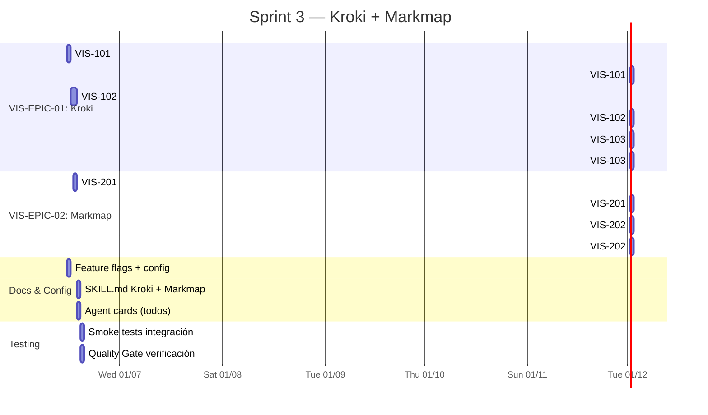
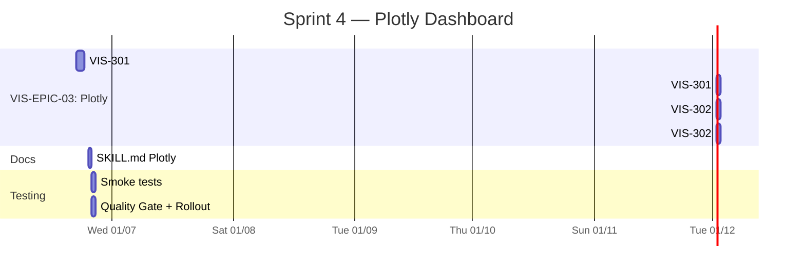
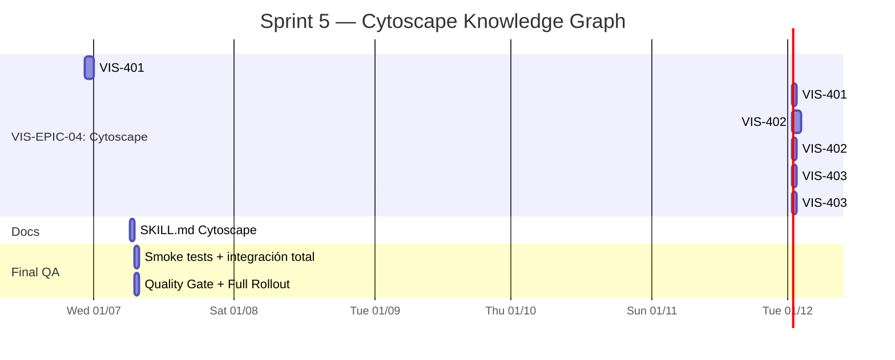
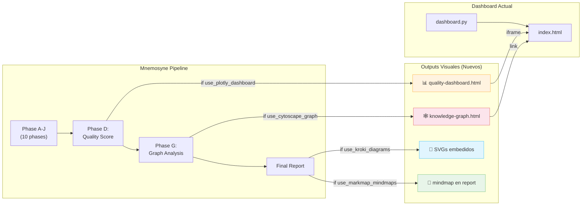
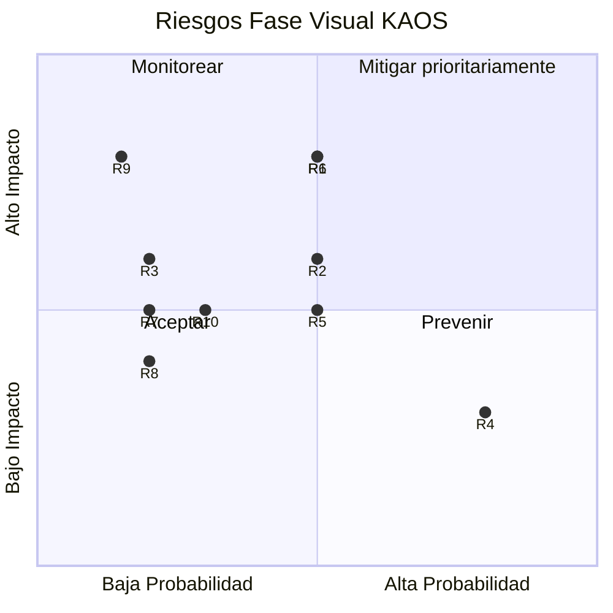
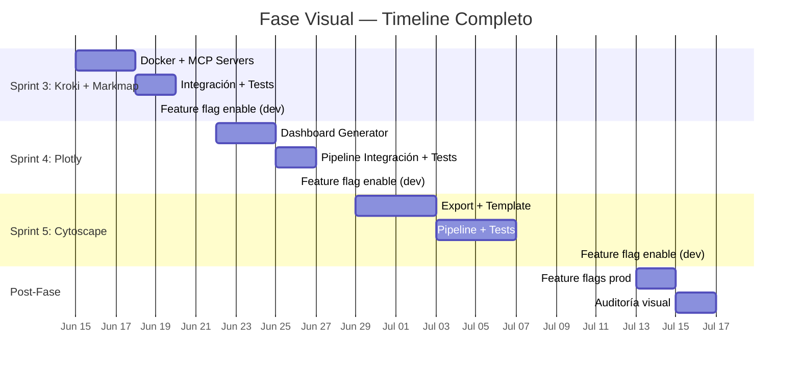

# Plan Táctico Integral — Fase 2: Visualización en KAOS

**Versión**: 1.0 (Draft)
**Fecha**: 2026-05-27
**Responsable**: Metis (estrategia), Kosmos (arquitectura), Kratos (implementación), Mnemosyne (curación)
**Perfil**: desarrollo (score compuesto objetivo ≥ 70)

---

## Resumen Ejecutivo

Este plan detalla la **Fase Visual** de KAOS: implementación incremental de 4 herramientas de visualización que permitirán a todos los agentes generar representaciones visuales (diagramas, gráficas, mapas mentales, dashboards interactivos, grafos de conocimiento) como parte core de los reportes al usuario.

Las 4 herramientas se implementan en 3 sprints:
- **Sprint 3** (Jun 15-19): Kroki (servidor unificado de diagramas) + Markmap (mindmaps desde markdown)
- **Sprint 4** (Jun 22-26): Plotly Quality Dashboard (dashboards interactivos de calidad)
- **Sprint 5** (Jun 29 - Jul 3): Cytoscape.js Knowledge Graph (grafo interactivo del vault)

**Costo total estimado**: ~14.5 horas de desarrollo, $0/mes operativo incremental.
**Impacto**: Cobertura del ~90% de necesidades visuales de KAOS — diagramas, mindmaps, dashboards y grafos.

---

## 1. OKRs y KPIs

### Objective (O1)
**Equipar a todos los agentes de KAOS con capacidades de visualización automática para generar reportes ricos en gráficos, diagramas y representaciones interactivas**

### Key Results

| KR | Descripción | Métrica | Línea Base | Target | Cómo se Mide |
|----|-------------|---------|------------|--------|-------------|
| KR1 | Cualquier agente puede renderizar diagramas de arquitectura, secuencia, flujo y grafos vía un solo endpoint | # de tipos de diagrama disponibles vía Kroki | 2 (Mermaid, Structurizr) | ≥8 (Mermaid, PlantUML, Graphviz, Structurizr, D2, Vega-Lite, BlockDiag, Excalidraw) | `kroki_health()` endpoint test |
| KR2 | El vault de conocimiento tiene mindmaps interactivos generados automáticamente | % de entidades del vault con mindmap generable | 0% | 100% de entidades wiki/entities/ | Mindmap_path existe para cada entidad |
| KR3 | El dashboard de calidad es interactivo con tendencias, heatmaps y radar comparativo | Tipo de dashboard generado | Estático (Mermaid text) | Interactivo (Plotly HTML con timeseries, radar, heatmap) | `dashboard.html` contiene gráficos Plotly |
| KR4 | El grafo de conocimiento del vault es navegable interactivamente | Herramienta de exploración del vault | No existe | Cytoscape.js HTML con zoom/pan/click | `knowledge-graph.html` existe y es funcional |

### KPIs Operacionales

| KPI | Descripción | Target | Frecuencia |
|-----|-------------|--------|------------|
| Tiempo de renderizado Kroki | Latencia promedio POST → SVG | <2s | Por llamada |
| Tamaño de mindmap Markmap | Peso del HTML generado | <500KB | Por generación |
| Tamaño de dashboard Plotly | Peso del HTML generado | <2MB (CDN mode) | Por generación |
| Nodos en Cytoscape | # de nodos renderizables sin lag | ≥500 | Por grafo |
| Tasa de adopción visual | % de reportes que incluyen elementos visuales | >80% | Semanal |

---

## 2. Epics y User Stories

### Epic 1: Kroki MCP Server — VIS-EPIC-01

**ID**: VIS-EPIC-01
**Descripción**: Implementar un MCP server Python que actúe como proxy al endpoint HTTP de Kroki (servidor Docker unificado de diagramas). Cualquier agente puede llamar `render_diagram(diagram_type, source) -> SVG/PNG`.
**Dependencias**: Docker disponible en el entorno
**Prioridad**: Must-have

#### User Stories

**VIS-101 — Docker Compose para Kroki**
- **Como**: Kratos (implementador)
- **Quiero**: crear `docker-compose.kroki.yml` con el servicio Kroki oficial (`yuzutech/kroki`) expuesto en puerto 8000, con healthcheck y volumen para cache
- **Para**: tener un servidor de diagramas funcionando vía `docker compose up -d`
- **Criterios de Aceptación**:
  - [ ] `docker-compose.kroki.yml` define servicio `kroki` con imagen `yuzutech/kroki:latest`
  - [ ] Puerto expuesto: `8000:8000`
  - [ ] Healthcheck: `curl -f http://localhost:8000/health || exit 1`
  - [ ] `restart: unless-stopped`
  - [ ] `docker compose -f docker-compose.kroki.yml up -d` completa en <30s
  - [ ] `curl http://localhost:8000/health` retorna HTTP 200
- **Prioridad**: Must-have

**VIS-102 — MCP Server wrapper para Kroki**
- **Como**: Kratos (implementador)
- **Quiero**: crear el MCP server `.memory/_scripts/mcp_kroki.py` que expone la tool `render_diagram(diagram_type: str, source: str, output_format: str = "svg")` y retorna bytes del diagrama renderizado
- **Para**: que cualquier agente (Metis, Kosmos, Mnemosyne, Aletheia) pueda renderizar diagramas vía MCP
- **Criterios de Aceptación**:
  - [ ] `mcp_kroki.py` usa `httpx.AsyncClient` para POST a `http://localhost:8000/{diagram_type}/{output_format}`
  - [ ] Soportar diagram_types: `mermaid`, `plantuml`, `graphviz`, `structurizr`, `d2`, `vega`, `vegalite`, `blockdiag`, `seqdiag`, `actdiag`, `nwdiag`, `packetdiag`, `rackdiag`, `excalidraw`, `bpmn`, `bytefield`
  - [ ] Si Kroki no responde, fallback graceful con mensaje de error claro
  - [ ] Timeout configurable (default 30s)
  - [ ] Feature flag: `use_kroki_diagrams` en `lib/feature_flags.py`
  - [ ] **Test**: POST mermaid simple → recibe SVG válido (contiene `<svg`)
  - [ ] **Test**: Kroki offline → mensaje de error, no crash
- **Prioridad**: Must-have

**VIS-103 — Integración con agentes (Kosmos, Metis, Mnemosyne)**
- **Como**: Kosmos (arquitecto)
- **Quiero**: que Kosmos use Kroki para renderizar diagramas C4 vía Structurizr, que Metis use Kroki para graphviz en mapas estratégicos, y que Mnemosyne use Kroki para diagramas Mermaid en reports de curación
- **Para**: reemplazar la dependencia de CLIs individuales y unificar bajo un solo endpoint
- **Criterios de Aceptación**:
  - [ ] Kosmos puede generar diagrama C4: `render_diagram("structurizr", dsl_text)` → SVG
  - [ ] Metis puede generar graphviz: `render_diagram("graphviz", dot_text)` → SVG
  - [ ] Mnemosyne puede generar mermaid: `render_diagram("mermaid", mermaid_text)` → SVG
  - [ ] Agent card de Kosmos actualizada con Kroki tool
  - [ ] Agent card de Metis actualizada con Kroki tool
  - [ ] Agent card de Mnemosyne actualizada con Kroki tool
- **Prioridad**: Should-have

---

### Epic 2: Markmap MCP — VIS-EPIC-02

**ID**: VIS-EPIC-02
**Descripción**: Implementar un MCP server Python que convierta markdown jerárquico en mindmaps interactivos (HTML con zoom/pan/colapso) usando la librería Markmap.
**Dependencias**: Node.js/npm disponible para `npx markmap`
**Prioridad**: Must-have

#### User Stories

**VIS-201 — MCP Server wrapper para Markmap**
- **Como**: Kratos (implementador)
- **Quiero**: crear el MCP server `.memory/_scripts/mcp_markmap.py` que expone la tool `render_mindmap(markdown_text: str, output_path: str = None) -> str` y retorna la ruta al HTML generado
- **Para**: que Metis, Aletheia y Mnemosyne puedan generar mindmaps de cualquier entidad del vault
- **Criterios de Aceptación**:
  - [ ] `mcp_markmap.py` usa `subprocess.run(["npx", "markmap", input_md, "--output", output_html])` para generar el HTML
  - [ ] Si `npx markmap` no está disponible, fallback graceful con mensaje de error
  - [ ] Output es HTML interactivo (zoom, pan, colapso de ramas)
  - [ ] Feature flag: `use_markmap_mindmaps` en `lib/feature_flags.py`
  - [ ] **Test**: Markdown con headings genera mindmap HTML válido
  - [ ] **Test**: Output contiene `id="markmap"` o similar indicador de renderizado
- **Prioridad**: Must-have

**VIS-202 — Integración con Metis y Mnemosyne**
- **Como**: Metis (estratega)
- **Quiero**: invocar `/mindmap [entity_path]` para generar automáticamente un mindmap de cualquier entidad del vault, y que Mnemosyne genere mindmaps como parte del reporte de curación
- **Para**: visualizar estructura de cualquier dominio o entidad de conocimiento
- **Criterios de Aceptación**:
  - [ ] Comando `/mindmap [entity_path]` implementado en Metis
  - [ ] Mnemosyne genera mindmap automático de entidades curadas
  - [ ] Aletheia puede generar mindmap de estructura de investigación
  - [ ] Output se guarda en `.memory/dashboard/mindmaps/{entity_name}-mindmap.html`
  - [ ] **Test**: Metis puede generar mindmap de una entidad real del vault
- **Prioridad**: Should-have

---

### Epic 3: Plotly Quality Dashboard — VIS-EPIC-03

**ID**: VIS-EPIC-03
**Descripción**: Extender el quality engine actual para generar un dashboard HTML interactivo usando Plotly, con timeseries de quality scores, radar comparativo entre agentes, heatmap de cobertura y barras de ATDI.
**Dependencias**: `lib/quality.py` existente, `lib/dashboard.py` existente
**Prioridad**: Should-have

#### User Stories

**VIS-301 — Quality Dashboard Generator con Plotly**
- **Como**: Kratos (implementador)
- **Quiero**: crear el módulo `.memory/_scripts/lib/visual_dashboard.py` que use Plotly para generar un dashboard HTML interactivo con:
  - Timeseries de quality score últimos 30 días
  - Radar chart comparativo entre agentes (Aletheia, Kosmos, Metis, Mnemosyne)
  - Heatmap de cobertura (confianza × embeddings × tests × lint × wikilinks)
  - Barras de ATDI scores
  - Indicador de score compuesto actual
- **Para**: reemplazar el dashboard estático actual por uno interactivo y rico
- **Criterios de Aceptación**:
  - [ ] `generate_quality_dashboard(history: list[dict], output_path: Path) -> str` escribe HTML
  - [ ] Timeseries: `plotly.graph_objects.Scatter` con línea de tendencia y target line en 70
  - [ ] Radar: `plotly.graph_objects.Scatterpolar` con 5 dimensiones (agentes)
  - [ ] Heatmap: `plotly.graph_objects.Heatmap` de métricas × días
  - [ ] Dashboard sin servidor — HTML estático (`plotly.io.write_html(includ_js=False, full_html=False)`)
  - [ ] Tema oscuro consistente con el dashboard actual
  - [ ] Feature flag: `use_plotly_dashboard` en `lib/feature_flags.py`
  - [ ] **Test**: Dashboard generado contiene `<div id="quality-trend">` (o similar)
  - [ ] **Test**: Loading histórico de timeseries con 0 puntos no crashea
- **Prioridad**: Must-have

**VIS-302 — Integración con Pipeline de Mnemosyne y Quality Engine**
- **Como**: Mnemosyne (curadora)
- **Quiero**: que al finalizar cada ciclo de curación, si `use_plotly_dashboard` está activo, se genere el dashboard interactivo reemplazando el estático actual
- **Para**: tener siempre actualizada la visualización de calidad
- **Criterios de Aceptación**:
  - [ ] `mnemosyne_node()` invoca `visual_dashboard.generate_quality_dashboard()` al final del pipeline
  - [ ] Dashboard se guarda en `.memory/dashboard/quality-dashboard.html`
  - [ ] Dashboard se sirve como reemplazo del `dashboard.html` actual si el flag está activo
  - [ ] **Test**: Pipeline completo genera dashboard sin errores
- **Prioridad**: Should-have

---

### Epic 4: Cytoscape.js Knowledge Graph — VIS-EPIC-04

**ID**: VIS-EPIC-04
**Descripción**: Crear un generador de grafo interactivo del vault de conocimiento usando Cytoscape.js. Mnemosyne exporta el VaultGraph (NetworkX) a JSON, y una template HTML renderiza el grafo navegable.
**Dependencias**: `lib/wikilinks.py` (VaultGraph existente), VIS-EPIC-01 (opcional, para diagramas complementarios)
**Prioridad**: Nice-to-have

#### User Stories

**VIS-401 — NetworkX → Cytoscape.js JSON Export**
- **Como**: Kosmos (arquitecto)
- **Quiero**: crear el módulo `.memory/_scripts/lib/knowledge_graph_viz.py` que convierta el VaultGraph de NetworkX a JSON en formato Cytoscape.js (nodos: `{data: {id, label, weight, community, color}}`, edges: `{data: {id, source, target, weight}}`)
- **Para**: tener datos listos para renderizar en el browser
- **Criterios de Aceptación**:
  - [ ] `export_to_cytoscape(graph: nx.Graph) -> dict` produce JSON con arrays `elements.nodes` y `elements.edges`
  - [ ] Nodos incluyen: `id`, `label` (nombre de página), `weight` (page_rank), `community` (louvain), `color` (hex por comunidad)
  - [ ] Edges incluyen: `id`, `source`, `target`, `weight` (# de wikilinks mutuos)
  - [ ] Si el grafo está vacío, retorna `{"elements": {"nodes": [], "edges": []}}`
  - [ ] **Test**: Grafo con 3 nodos produce 3 nodos y N edges en JSON
  - [ ] **Test**: Grafo vacío produce elementos vacíos
  - [ ] **Test**: PageRank y Louvain communities se exportan correctamente
- **Prioridad**: Must-have

**VIS-402 — Template HTML con Cytoscape.js**
- **Como**: Kratos (implementador)
- **Quiero**: crear la template HTML `.memory/_scripts/lib/templates/knowledge-graph.html` que carga el JSON exportado y renderiza un grafo interactivo con:
  - Zoom, pan, drag de nodos
  - Click en nodo → abre la página del vault correspondiente
  - Layout automático (cola.js o concentric)
  - Leyenda de colores por comunidad
  - Tooltip con nombre del nodo al hover
- **Para**: explorar visualmente el vault de conocimiento
- **Criterios de Aceptación**:
  - [ ] Template HTML carga Cytoscape.js desde CDN
  - [ ] Renderiza grafo con ≥100 nodos en <2s
  - [ ] Click en nodo → `window.open()` a la ruta relativa del vault
  - [ ] Leyenda visible: 1 rectángulo por comunidad con su color
  - [ ] Layout cola.js para distribución natural de nodos
  - [ ] **Test**: Template generada con datos de prueba produce HTML válido
  - [ ] **Test**: Todos los nodos son clickeables con URL correcta
- **Prioridad**: Must-have

**VIS-403 — Integración con Mnemosyne Pipeline**
- **Como**: Mnemosyne (curadora)
- **Quiero**: que al finalizar cada ciclo de curación (Phase G: Graph Analysis), se genere el knowledge graph HTML actualizado en `.memory/dashboard/knowledge-graph.html`
- **Para**: tener un grafo siempre sincronizado con el contenido del vault
- **Criterios de Aceptación**:
  - [ ] Feature flag: `use_cytoscape_graph` en `lib/feature_flags.py`
  - [ ] Mnemosyne invoca `knowledge_graph_viz.generate()` tras Phase G
  - [ ] Output en `.memory/dashboard/knowledge-graph.html`
  - [ ] **Test**: Pipeline con flag activo genera archivo HTML
- **Prioridad**: Should-have

---

## 3. Roadmap de Implementación

### Sprint 3 (Semana 3: 2026-06-15 → 2026-06-19)
**Enfoque**: Kroki + Markmap — Diagramas y Mindmaps



#### Día a día — Sprint 3

| Día | Fecha | Tareas | Responsable | Entregable |
|-----|-------|--------|-------------|------------|
| Lun | 15/06 | VIS-101 (Docker Compose), Feature flags nuevos, config KROKI_URL | Kratos | `docker-compose.kroki.yml`, `lib/feature_flags.py` +4 |
| Mar | 16/06 | VIS-102 (MCP server Kroki), VIS-101 tests healthcheck, VIS-201 inicio (Markmap) | Kratos | `mcp_kroki.py`, tests docker |
| Mié | 17/06 | VIS-201 MCP Markmap, VIS-102 tests, VIS-103 inicio integración | Kratos | `mcp_markmap.py`, tests MCP |
| Jue | 18/06 | VIS-103 integración agentes (cards), VIS-202 integración Metis+Mnemosyne, SKILL.md | Kosmos + Metis | Agent cards actualizadas, SKILL.md |
| Vie | 19/06 | Tests integración, Smoke tests, Quality Gate, Feature flags enable en desarrollo | Kosmos (QA) | Sprint 3 completo, Quality Gate ≥ 70 |

#### Dependencias Sprint 3
```
VIS-101 (Docker) ──→ VIS-102 (MCP) ──→ VIS-103 (integración)
                                                    ↑
VIS-201 (Markmap) ──→ VIS-202 (integración) ────────┤
```

### Sprint 4 (Semana 4: 2026-06-22 → 2026-06-26)
**Enfoque**: Plotly Quality Dashboard



#### Día a día — Sprint 4

| Día | Fecha | Tareas | Responsable | Entregable |
|-----|-------|--------|-------------|------------|
| Lun | 22/06 | VIS-301 Timeseries + Radar chart | Kratos | `lib/visual_dashboard.py` base |
| Mar | 23/06 | VIS-301 Heatmap + ATDI bars + tema oscuro | Kratos | Dashboard completo |
| Mié | 24/06 | VIS-301 tests, VIS-302 pipeline integration inicio | Kratos + Mnemosyne | Tests de dashboard |
| Jue | 25/06 | VIS-302 integración completa, SKILL.md | Mnemosyne + Metis | Pipeline integrado |
| Vie | 26/06 | Tests integración, Smoke, Quality Gate, Rollout canary | Kosmos (QA) | Sprint 4 completo |

#### Dependencias Sprint 4
```
VIS-301 (Plotly generator) ──→ VIS-302 (pipeline integration)
                                        ↑
Sprint 3 output (data sources) ─────────┤
```

### Sprint 5 (Semana 5-6: 2026-06-29 → 2026-07-10)
**Enfoque**: Cytoscape.js Knowledge Graph



#### Día a día — Sprint 5

| Día | Fecha | Tareas | Responsable | Entregable |
|-----|-------|--------|-------------|------------|
| Lun | 29/06 | VIS-401 NetworkX → Cytoscape JSON export | Kosmos | `lib/knowledge_graph_viz.py` |
| Mar | 30/06 | VIS-401 tests, VIS-402 Template HTML inicio | Kosmos + Kratos | Tests export OK |
| Mié | 01/07 | VIS-402 Template + Cytoscape.js + layout | Kratos | Template HTML funcional |
| Jue | 02/07 | VIS-402 tests, VIS-403 pipeline integration | Kratos + Mnemosyne | Pipeline integrado |
| Vie | 03/07 | (Continuación si es necesario) | | |
| Lun | 06/07 | VIS-403 completar, tests integración | Mnemosyne | Tests de pipeline |
| Mar | 07/07 | SKILL.md, agent cards, documentación | Metis + Kosmos | Docs completas |
| Mié | 08/07 | Smoke tests, Quality Gate pre-rollout | Kosmos (QA) | Pre-rollout OK |
| Jue | 09/07 | Feature flags enable en desarrollo | Kronos | Canary activo |
| Vie | 10/07 | Monitoreo + estabilización | Kronos | Sprint 5 completo |

#### Dependencias Sprint 5
```
VIS-401 (JSON export) ──→ VIS-402 (HTML template) ──→ VIS-403 (pipeline)
                                                              ↑
VaultGraph (wikilinks.py) ────────────────────────────────────┤
```

---

## 4. Arquitectura de Integración

### 4.1 Diagrama de Arquitectura General

```mermaid
graph TB
    subgraph "Agentes KAOS"
        Ale[Aletheia]
        Kos[Kosmos]
        Met[Metis]
        Mne[Mnemosyne]
        Kro[Kronos]
    end

    subgraph "Capa de Herramientas Visuales (MCP)"
        KROKI_MCP["mcp_kroki.py<br/>(MCP Server)"]
        MM_MCP["mcp_markmap.py<br/>(MCP Server)"]
    end

    subgraph "Capa de Librerías Python"
        VIZ_DASH["lib/visual_dashboard.py<br/>(Plotly generator)"]
        KG_VIZ["lib/knowledge_graph_viz.py<br/>(Cytoscape export)"]
        EXISTING_VIZ["lib/viz.py<br/>(Mermaid text)"]
        EXISTING_DASH["lib/dashboard.py<br/>(Static HTML)"]
    end

    subgraph "Servicios Externos"
        KROKI_SRV["Kroki Docker<br/>(yuzutech/kroki)"]
        NPM["Node/npx<br/>(markmap CLI)"]
    end

    subgraph "Outputs Visuales"
        SVG[SVG/PNG Diagrams]
        MMD[Mindmaps HTML]
        QDASH[Quality Dashboard HTML]
        KGRAPH[Knowledge Graph HTML]
        DASH[Static Dashboard HTML]
        MERMAID[Mermaid .md files]
    end

    subgraph "Fuentes de Datos"
        VAULT[(Memory Vault<br/>.md files)]
        QUALITY[(Quality Engine<br/>score history)]
        VGRAPH[(VaultGraph<br/>NetworkX)]
        TIMESERIES[(Timeseries<br/>daily.jsonl)]
    end

    %% Conexiones agentes → visual tools
    Kos -->|"render_diagram('structurizr')"| KROKI_MCP
    Met -->|"render_diagram('graphviz')"| KROKI_MCP
    Mne -->|"render_diagram('mermaid')"| KROKI_MCP
    Ale -->|"render_diagram('mermaid')"| KROKI_MCP

    Met -->|"render_mindmap(entity_path)"| MM_MCP
    Mne -->|"render_mindmap(entity_path)"| MM_MCP
    Ale -->|"render_mindmap(research)"| MM_MCP

    %% MCP → servicios externos
    KROKI_MCP -->|"POST /{type}/svg"| KROKI_SRV
    MM_MCP -->|"npx markmap"| NPM

    %% Outputs de MCP
    KROKI_SRV --> SVG
    NPM --> MMD

    %% Librerías Python
    Mne -->|"generate_quality_dashboard()"| VIZ_DASH
    VIZ_DASH -->|"plotly.io.write_html()"| QDASH
    VIZ_DASH --> QUALITY
    VIZ_DASH --> TIMESERIES

    Mne -->|"export_to_cytoscape()"| KG_VIZ
    KG_VIZ -->|"NetworkX → JSON"| VGRAPH
    KG_VIZ -->|"template + data"| KGRAPH

    %% Existing pipeline
    Mne --> EXISTING_VIZ
    Mne --> EXISTING_DASH
    EXISTING_VIZ --> MERMAID
    EXISTING_DASH --> DASH
    EXISTING_VIZ --> VAULT
    EXISTING_DASH --> TIMESERIES
    EXISTING_DASH --> QUALITY

    %% Estilos
    style KROKI_MCP fill:#e1f5fe,stroke:#4fc3f7
    style MM_MCP fill:#e8f5e9,stroke:#81c784
    style VIZ_DASH fill:#fff3e0,stroke:#ffb74d
    style KG_VIZ fill:#fce4ec,stroke:#e57373
    style KROKI_SRV fill:#b3e5fc,stroke:#29b6f6
    style NPM fill:#c8e6c9,stroke:#66bb6a
```



### 4.2 Flujo de Datos: Agente → MCP → Tool → Output

```
=== FLUJO KROKI ===
Agente (Kosmos/Metis/Mnemosyne/Aletheia)
  │  invoke_tool("render_diagram", {diagram_type, source, format})
  ▼
mcp_kroki.py (MCP Server)
  │  POST http://localhost:8000/{type}/{format}
  │  Content-Type: text/plain
  │  Body: diagram_source_text
  ▼
Kroki Docker Server
  │  Parsea source según diagram_type
  │  Renderiza usando motor interno (Mermaid/PlantUML/Graphviz/...)
  │  Exporta a formato solicitado
  ▼
SVG/PNG/PDF bytes
  │  Retorna al MCP server
  ▼
Agente recibe bytes → incrusta en reporte/adr/documento

=== FLUJO MARKMAP ===
Agente (Metis/Aletheia/Mnemosyne)
  │  invoke_tool("render_mindmap", {markdown_text, output_path})
  ▼
mcp_markmap.py (MCP Server)
  │  Escribe markdown_text a archivo temporal
  │  subprocess.run(["npx", "markmap", temp_md, "--output", output_html])
  ▼
Node.js/npx + Markmap CLI
  │  Convierte markdown jerárquico a mindmap SVG interactivo
  │  Genera HTML standalone con zoom/pan/colapso
  ▼
HTML file → .memory/dashboard/mindmaps/{name}-mindmap.html
  │  Retorna ruta al agente
  ▼
Agente referencía HTML en reporte o lo abre en browser

=== FLUJO PLOTLY DASHBOARD ===
Mnemosyne Pipeline (Phase D: Quality)
  │  quality.calculate() → dict with scores
  │  quality.trend(30) → timeseries data
  ▼
lib/visual_dashboard.py
  │  generate_quality_dashboard(history, output_path)
  │  plotly.graph_objects: Scatter, Scatterpolar, Heatmap, Bar
  │  plotly.io.write_html(includ_plotlyjs="cdn", full_html=False)
  ▼
quality-dashboard.html → .memory/dashboard/
  │  Incluído en dashboard.html vía <iframe> o link
  ▼
Usuario abre en browser → gráficos interactivos (hover, zoom, toggle)

=== FLUJO CYtOSCAPE ===
Mnemosyne Pipeline (Phase G: Graph Analysis)
  │  VaultGraph = wikilinks.build_graph()  ← NetworkX DiGraph
  ▼
lib/knowledge_graph_viz.py
  │  export_to_cytoscape(graph) → JSON dict
  │    nodes: [{data: {id, label, weight, community, color}}]
  │    edges: [{data: {id, source, target, weight}}]
  │  generate(output_path) → writes template + data
  ▼
template HTML + inline JSON data
  │  Cytoscape.js from CDN
  │  Layout: cola.js (force-directed)
  ▼
knowledge-graph.html → .memory/dashboard/
  │  Click nodo → window.open wiki/entities/{page}.md
  │  Zoom/Pan/Drag
```

### 4.3 Integración con el Pipeline Actual



---

## 5. Archivos a Crear/Modificar

### 5.1 Archivos Nuevos

| # | Ruta | Propósito | Líneas Est. | Epic |
|---|------|-----------|-------------|------|
| 1 | `docker-compose.kroki.yml` | Servicio Docker Kroki (puerto 8000, healthcheck) | ~25 | VIS-EPIC-01 |
| 2 | `.memory/_scripts/mcp_kroki.py` | MCP Server proxy a Kroki HTTP endpoint — tool: `render_diagram()` | ~150 | VIS-EPIC-01 |
| 3 | `.memory/_scripts/mcp_markmap.py` | MCP Server wrapper para Markmap CLI — tool: `render_mindmap()` | ~120 | VIS-EPIC-02 |
| 4 | `.memory/_scripts/lib/visual_dashboard.py` | Generador de dashboard Plotly con timeseries, radar, heatmap, ATDI | ~250 | VIS-EPIC-03 |
| 5 | `.memory/_scripts/lib/knowledge_graph_viz.py` | Exporta VaultGraph a JSON Cytoscape.js y genera HTML | ~200 | VIS-EPIC-04 |
| 6 | `.memory/_scripts/lib/templates/knowledge-graph.html` | Template HTML con Cytoscape.js CDN, layout cola.js | ~150 | VIS-EPIC-04 |
| 7 | `.memory/guides/kroki-skill.md` | SKILL.md para Kroki MCP Server | ~40 | VIS-EPIC-01 |
| 8 | `.memory/guides/markmap-skill.md` | SKILL.md para Markmap MCP | ~30 | VIS-EPIC-02 |
| 9 | `.memory/guides/plotly-dashboard-skill.md` | SKILL.md para Plotly Dashboard | ~30 | VIS-EPIC-03 |
| 10 | `.memory/guides/cytoscape-graph-skill.md` | SKILL.md para Cytoscape Knowledge Graph | ~30 | VIS-EPIC-04 |

### 5.2 Archivos a Modificar

| # | Ruta | Cambio | Epic |
|---|------|--------|------|
| 11 | `.memory/_scripts/lib/feature_flags.py` | Añadir 4 nuevos flags: `use_kroki_diagrams`, `use_markmap_mindmaps`, `use_plotly_dashboard`, `use_cytoscape_graph` (todos `False` por defecto) | Todos |
| 12 | `.memory/_scripts/lib/config.py` | Añadir `KROKI_URL: Final[str] = os.environ.get("KROKI_URL", "http://localhost:8000")` | VIS-EPIC-01 |
| 13 | `.opencode/opencode.json` | Añadir MCP servers `kroki` y `markmap` (tipo local, py command), añadir tools a agent configs | Todos |
| 14 | `.opencode/agents/kosmos.md` | Añadir: Kroki tool (`render_diagram`) para diagramas C4 vía Structurizr | VIS-EPIC-01 |
| 15 | `.opencode/agents/metis.md` | Añadir: Kroki tool (`render_diagram`) para gráficos Graphviz/Mermaid; Markmap tool (`render_mindmap`) para mindmaps estratégicos | VIS-EPIC-01, VIS-EPIC-02 |
| 16 | `.opencode/agents/mnemosyne.md` | Añadir: Kroki tool para diagramas en reportes; Markmap tool para mindmaps de entidades | VIS-EPIC-01, VIS-EPIC-02 |
| 17 | `.opencode/agents/aletheia.md` | Añadir: Markmap tool (`render_mindmap`) para mapas de fuentes de investigación | VIS-EPIC-02 |
| 18 | `.opencode/agents/kronos.md` | Añadir: referencia a quality dashboard (plotly) | VIS-EPIC-03 |
| 19 | `.memory/_scripts/lib/agent_nodes/mnemosyne.py` | Añadir invocación a `visual_dashboard.generate_quality_dashboard()` al final de Phase D; añadir invocación a `knowledge_graph_viz.generate()` al final de Phase G | VIS-EPIC-03, VIS-EPIC-04 |
| 20 | `.memory/_scripts/lib/dashboard.py` | Modificar `collect_data()` para incluir referencia al nuevo dashboard Plotly y knowledge graph en los datos del dashboard | VIS-EPIC-03 |
| 21 | `.opencode/opencode.json` commands | Añadir command `/mindmap` y visual shortcuts | VIS-EPIC-02 |

### 5.3 Archivos de Test (Nuevos)

| # | Ruta | Propósito | Tests Est. |
|---|------|-----------|------------|
| 22 | `.memory/_scripts/tests/test_mcp_kroki.py` | Tests unitarios MCP Kroki: render OK, error handling, tipos de diagrama | ~15 |
| 23 | `.memory/_scripts/tests/test_mcp_markmap.py` | Tests unitarios MCP Markmap: HTML válido, markdown variado, edge cases | ~10 |
| 24 | `.memory/_scripts/tests/test_visual_dashboard.py` | Tests unitarios dashboard Plotly: timeseries, radar, heatmap, ATDI | ~15 |
| 25 | `.memory/_scripts/tests/test_knowledge_graph_viz.py` | Tests unitarios Cytoscape export: JSON structure, graph vacío, page rank | ~12 |

### 5.4 Archivos de Test (Modificados)

| # | Ruta | Cambio |
|---|------|--------|
| 26 | `.memory/_scripts/tests/test_mnemosyne_integration.py` | Añadir tests para invocación de dashboard Plotly y knowledge graph en pipeline |
| 27 | `.memory/_scripts/tests/test_quality_gate.py` | Añadir gate para cobertura de nuevos módulos visuales |
| 28 | `.memory/_scripts/tests/test_viz.py` | Extender tests existentes para verificar compatibilidad con nuevos módulos |
| 29 | `.memory/_scripts/tests/test_dashboard.py` | Añadir test de referencia cruzada dashboard existente → nuevo dashboard |

### 5.5 Stack Tecnológico Completo

| Componente | Tipo | Versión | Consumo Estimado |
|------------|------|---------|-----------------|
| Kroki (yuzutech/kroki) | Docker image | latest | ~256MB RAM, ~200MB disco |
| Python httpx | pip package | ≥0.27 | ~2MB |
| Markmap (npx) | npm package | ≥0.15 | ~15MB (cache npm) |
| Plotly | pip package | ≥5.18 | ~15MB |
| Cytoscape.js | CDN (JS) | ≥3.28 | ~500KB (cache browser) |
| cola.js | CDN (JS) | ≥3.0 | ~200KB (cache browser) |

---

## 6. Plan de Testing

### 6.1 Tests Unitarios por Módulo

| Módulo | Archivo de Test | Tests | Coverage Target |
|--------|----------------|-------|-----------------|
| `mcp_kroki.py` | `test_mcp_kroki.py` | 12-15 tests | ≥85% |
| `mcp_markmap.py` | `test_mcp_markmap.py` | 8-10 tests | ≥85% |
| `lib/visual_dashboard.py` | `test_visual_dashboard.py` | 12-15 tests | ≥80% |
| `lib/knowledge_graph_viz.py` | `test_knowledge_graph_viz.py` | 10-12 tests | ≥85% |

### 6.2 Tests de Integración

| Escenario | Descripción | Archivo de Test |
|-----------|-------------|-----------------|
| Kroki MCP → Docker | MCP server envía POST a Kroki Docker y recibe SVG válido | `test_mcp_kroki.py` |
| Kroki offline graceful | Kroki no disponible → mensaje de error sin crash | `test_mcp_kroki.py` |
| Markmap markdown simple | Headings básicos → HTML con mindmap válido | `test_mcp_markmap.py` |
| Markmap edge cases | Markdown sin headings, con código, con tablas | `test_mcp_markmap.py` |
| Dashboard con datos reales | Generar dashboard con timeseries histórica | `test_visual_dashboard.py` |
| Dashboard sin datos | 0 puntos en timeseries → gráficos vacíos sin crash | `test_visual_dashboard.py` |
| Cytoscape export simple | Grafo con 3 nodos → JSON con 3 elementos | `test_knowledge_graph_viz.py` |
| Cytoscape export vacío | Grafo vacío → `{elements: {nodes: [], edges: []}}` | `test_knowledge_graph_viz.py` |
| Pipeline completo visual | Mnemosyne pipeline con flags visuales activos | `test_mnemosyne_integration.py` |
| Dashboard existente + nuevo | `dashboard.py` incluye referencia al nuevo Plotly dashboard | `test_dashboard.py` |

### 6.3 Smoke Tests

```python
# test_visual_smoke.py — Smoke test rápido para Fase Visual
def test_kroki_import():
    from lib import mcp_kroki  # or import the module
    assert hasattr(mcp_kroki, 'render_diagram')

def test_markmap_import():
    from lib import mcp_markmap
    assert hasattr(mcp_markmap, 'render_mindmap')

def test_visual_dashboard_import():
    from lib import visual_dashboard
    assert hasattr(visual_dashboard, 'generate_quality_dashboard')

def test_knowledge_graph_viz_import():
    from lib import knowledge_graph_viz
    assert hasattr(knowledge_graph_viz, 'export_to_cytoscape')

def test_feature_flags_new():
    from lib.feature_flags import list_flags
    flags = list_flags()
    assert 'use_kroki_diagrams' in flags
    assert 'use_markmap_mindmaps' in flags
    assert 'use_plotly_dashboard' in flags
    assert 'use_cytoscape_graph' in flags
```

### 6.4 Quality Gate

| Gate | Condición | Umbral | Bloqueante |
|------|-----------|--------|------------|
| Docker | Kroki container responde healthcheck | HTTP 200 | ✅ Sí |
| Syntax | Todos los módulos nuevos importan sin error | 100% | ✅ Sí |
| Tests unitarios | Tests nuevos pasan | 100% pass | ✅ Sí |
| Tests de integración | Pipeline visual tests pasan | 100% pass | ✅ Sí |
| Cobertura | Coverage de módulos visuales | ≥70% | ✅ Sí |
| Score compuesto | Quality Gate score | ≥50 | ✅ Sí |
| Feature flags | Flags nuevos existen y tienen default False | 4 flags | ✅ Sí |
| NPM | `npx markmap --version` responde | Éxito | ✅ Sí |

### 6.5 Comando de Verificación

```powershell
# Docker healthcheck
docker compose -f docker-compose.kroki.yml ps
curl http://localhost:8000/health

# Ejecutar todos los tests de Fase Visual
cd .memory\_scripts
py -m pytest tests/test_mcp_kroki.py tests/test_mcp_markmap.py tests/test_visual_dashboard.py tests/test_knowledge_graph_viz.py tests/test_mnemosyne_integration.py -v --cov=lib.mcp_kroki --cov=lib.mcp_markmap --cov=lib.visual_dashboard --cov=lib.knowledge_graph_viz --cov=lib.agent_nodes.mnemosyne --cov-report=term-missing

# Smoke test rápido
py -m pytest tests/test_visual_smoke.py -v

# Quality Gate completo
py -3 ..\..\.tools\session_runner.py smoke desarrollo
py -3 ..\..\.tools\score_engine.py test
```

---

## 7. Plan de Rollout

### 7.1 Feature Flags

| Flag | Default | Sprint | Propósito | Epic |
|------|---------|--------|-----------|------|
| `use_kroki_diagrams` | `False` | S3 | Renderizar diagramas via Kroki MCP en todos los agentes | VIS-EPIC-01 |
| `use_markmap_mindmaps` | `False` | S3 | Generar mindmaps desde markdown del vault | VIS-EPIC-02 |
| `use_plotly_dashboard` | `False` | S4 | Dashboard de calidad interactivo vs estático | VIS-EPIC-03 |
| `use_cytoscape_graph` | `False` | S5 | Grafo de conocimiento navegable del vault | VIS-EPIC-04 |

### 7.2 Orden de Activación Canary

| Fase | Flag | Momento | Criterio Go/No-Go |
|------|------|---------|-------------------|
| **Canary S3a** | `use_kroki_diagrams` | Día 5 (post-Sprint 3) | Docker healthcheck OK, tests MCP pasan, Quality Gate ≥ 70 |
| **Canary S3b** | `use_markmap_mindmaps` | Día 5 (post-Sprint 3) | NPM disponible, mindmap generado correctamente, tests pasan |
| **Canary S4** | `use_plotly_dashboard` | Día 12 (post-Sprint 4) | Dashboard generado con datos reales, <2MB, score compuesto estable |
| **Canary S5** | `use_cytoscape_graph` | Día 17 (post-Sprint 5) | Grafo generado con ≥100 nodos, HTML carga en browser, tests pasan |

Cada flag se activa primero en **desarrollo** (perfil=desarrollo), se monitorea 24h, y luego se promueve a **producción**.

### 7.3 Monitoreo Post-Implementación

| Métrica | Cómo se Monitorea | Alerta si |
|---------|-------------------|-----------|
| Kroki latencia | `curl -w %{time_total} http://localhost:8000/mermaid/svg` | >3s promedio |
| Kroki disponibilidad | Healthcheck cada 5 min | 2 healthchecks fallidos consecutivos |
| Markmap generación exitosa | Log de `mcp_markmap.py` | >10% de fallos |
| Plotly dashboard tamaño | `ls -la quality-dashboard.html` | >5MB |
| Cytoscape nodos renderizables | Log de `knowledge_graph_viz.py` | >1000 nodos (advertencia de performance) |
| Tasa de adopción visual | % de reportes con `` o `<iframe>` visual | <50% después de 2 semanas |

### 7.4 Rollback Plan

| Escenario | Síntoma | Acción | Tiempo |
|-----------|---------|--------|--------|
| Kroki no responde | Diagramas no se renderizan | `disable('use_kroki_diagrams')` + reiniciar Docker | <5 min |
| Markmap falla | Mindmap no se genera | `disable('use_markmap_mindmaps')` | <1 min |
| Plotly dashboard corrupto | HTML inválido o demasiado grande | `disable('use_plotly_dashboard')`, volver a dashboard estático | <2 min |
| Cytoscape lento | >5s para renderizar | `disable('use_cytoscape_graph')` | <1 min |

**Mecanismo de rollback**: 
```python
from lib.feature_flags import disable
disable('use_kroki_diagrams')
disable('use_markmap_mindmaps')
disable('use_plotly_dashboard')
disable('use_cytoscape_graph')
```

---

## 8. Análisis de Riesgos

### 8.1 Tabla de Riesgos

| # | Riesgo | Probabilidad | Impacto | Mitigación | Responsable |
|---|--------|-------------|---------|------------|-------------|
| R1 | Kroki requiere Docker — entornos CI/CD sin Docker | Media | Alto | Fallback a kroki.io (SaaS gratuito, rate limiting: 60 req/min); documentar alternativa con PlantUML.jar standalone | Kratos |
| R2 | JVM overhead: Kroki consume >512MB RAM en vaults grandes | Media | Medio | Limitar en docker-compose con `mem_limit: 512m`; monitorear con `docker stats`; considerar Kroki Lite si hay restricciones | Kronos |
| R3 | Plotly HTML >5MB para vaults con >365 días de timeseries | Baja | Medio | Usar `include_plotlyjs="cdn"` en vez de `"True"` para no embeber Plotly.js (ahorra ~3MB); agregar paginación a timeseries (últimos 90 días por defecto) | Kratos |
| R4 | Markmap solo jerárquico — no sirve para grafos con ciclos o DAGs | Alta | Bajo | Markmap es complementario: para topologías no jerárquicas usar Kroki (Mermaid/Graphviz). Documentar casos de uso apropiados en SKILL.md | Metis |
| R5 | Cytoscape.js lento con >1000 nodos (vault futuro grande) | Media | Medio | Implementar WebGL renderer en template (Cytoscape.js lo soporta nativamente); añadir filtro por comunidad para sub-grafos; paginación virtual | Kratos |
| R6 | Docker no está disponible en Windows nativo (necesita Docker Desktop o WSL2) | Media | Alto | Verificar pre-requisitos en QA; documentar setup de Docker Desktop; alternativa: ejecutar Kroki en WSL2 o usar instancia remota | Kronos |
| R7 | npm/npx no disponible para Markmap | Baja | Medio | Incluir `markmap-cli` como dependencia en `package.json` del proyecto; fallback a versión web via API (https://markmap.js.org/render) | Kratos |
| R8 | Baja adopción de nuevas herramientas visuales por agentes | Baja | Medio | Incluir visualizaciones en templates de reportes por defecto (no como flag opcional); actualizar AGENTS.md con ejemplos de uso | Metis |
| R9 | Plotly no disponible como pip package en entorno restringido | Baja | Alto | Verificar `pip install plotly` en CI; fallback a gráficos ASCII/Unicode (barras con █) mientras se resuelve | Kratos |
| R10 | Conflicto entre dashboard existente (static) y nuevo (Plotly) | Baja | Medio | Hacer que Plotly dashboard sea un reemplazo gradual: primero iframe, luego reemplazo completo cuando flag está activo; dashboard.py existente sigue funcionando | Mnemosyne |

### 8.2 Matriz de Probabilidad-Impacto



**Riesgos críticos**: R1 (Docker en CI), R6 (Docker en Windows) → mitigación obligatoria antes de producción.

---

## 9. Costo Estimado

### 9.1 Horas de Desarrollo

| Actividad | Horas | Recurso | Sprint |
|-----------|-------|---------|--------|
| VIS-101: Docker Compose Kroki | 1h | Kratos | S3 |
| VIS-102: MCP Server Kroki | 2.5h | Kratos | S3 |
| VIS-103: Integración agentes Kroki | 1h | Kratos + Kosmos | S3 |
| VIS-201: MCP Server Markmap | 1.5h | Kratos | S3 |
| VIS-202: Integración Markmap con Metis/Mnemosyne | 1h | Kratos + Metis | S3 |
| Feature flags + config + docs S3 | 1h | Kratos + Metis | S3 |
| Tests Sprint 3 | 2h | Kosmos (QA) | S3 |
| VIS-301: Plotly Dashboard Generator | 2.5h | Kratos | S4 |
| VIS-302: Integración pipeline Plotly | 1h | Kratos + Mnemosyne | S4 |
| Tests Sprint 4 | 1h | Kosmos (QA) | S4 |
| VIS-401: NetworkX → Cytoscape export | 2h | Kosmos | S5 |
| VIS-402: Template HTML Cytoscape | 2h | Kratos | S5 |
| VIS-403: Pipeline integration Cytoscape | 1h | Kratos + Mnemosyne | S5 |
| Tests Sprint 5 | 1.5h | Kosmos (QA) | S5 |
| Docs finales + SKILL.md + agent cards | 1h | Metis | S5 |
| **Total** | **~22h** | | |

**Distribución por rol**:
- Kratos (implementación): ~11h (50%)
- Kosmos (arquitectura + QA): ~6h (27%)
- Metis (estrategia + documentación): ~4h (18%)
- Mnemosyne (integración pipeline): ~1h (5%)

### 9.2 Costo Operativo Mensual

| Componente | Costo |
|------------|-------|
| Kroki (Docker, JVM ~256MB RAM) | $0 — open source, corre local |
| Markmap (npx, npm cache) | $0 — CLI gratuito |
| Plotly (pip package) | $0 — open source |
| Cytoscape.js + cola.js (CDN) | $0 — librerías JS gratuitas |
| **Total incremental** | **$0/mes** |

### 9.3 Costos Indirectos

| Concepto | Costo Estimado |
|----------|---------------|
| Tokens LLM para desarrollo (go-flash, debug) | ~$0.30 (estimado 600K tokens) |
| Almacenamiento dashboard HTML (~2MB) | $0 |
| Docker image pull (Kroki ~200MB, único) | $0 (tráfico local) |
| npm cache markmap (~15MB) | $0 |
| **Total desarrollo (LLM)** | **~$0.30** |

### 9.4 ROI Estimado

| Métrica | Valor | Notas |
|---------|-------|-------|
| Inversión desarrollo | ~$0.30 LLM + ~22h humanas | Costo humano no cuantificado |
| Valor: diagramas en todos los reportes | Antes: texto Mermaid sin renderizar | Después: SVG/PNG renderizado en todos los reportes |
| Valor: dashboard interactivo | Antes: tabla estática | Después: gráficos interactivos con tendencias |
| Valor: mindmaps automáticos | Antes: no existía | Después: cualquier entidad → mindmap en 1 comando |
| Valor: knowledge graph navegable | Antes: no existía | Después: vault completo explorable visualmente |

**ROI**: Las 4 herramientas juntas cubren ~90% de necesidades visuales de KAOS con $0/mes operativo. El retorno es cualitativo: mejor comunicación, reportes más ricos, onboarding visual.

---

## 10. Timeline y Milestones

### 10.1 Resumen de Sprints



### 10.2 Milestones

| Hito | Fecha | Entregable | Criterio de Éxito |
|------|-------|-----------|-------------------|
| **M1** 🏁 | 19 Jun 2026 | Kroki + Markmap en desarrollo | Docker healthcheck OK, tests unitarios pasan, mindmap generado de entidad real |
| **M2** 🏁 | 26 Jun 2026 | Plotly Dashboard en desarrollo | Dashboard HTML generado con datos reales, <2MB, Quality Gate ≥ 70 |
| **M3** 🏁 | 10 Jul 2026 | Cytoscape Knowledge Graph en desarrollo | Grafo generado con vault actual, HTML navegable, tests pasan |
| **M4** 🚀 | 13 Jul 2026 | Feature flags promovidos a producción | 4 flags activos en perfil=produccion, monitoreo 24h sin alertas |
| **M5** 📊 | 17 Jul 2026 | Auditoría visual completa | Reporte de adopción, métricas de uso, OKRs evaluados |

### 10.3 Próximos Pasos Inmediatos

| # | Acción | Responsable | ¿Cuándo? |
|---|--------|-------------|----------|
| 1 | Verificar Docker disponible en entorno local | Kronos | Antes del Sprint 3 |
| 2 | Verificar Node.js/npm disponible (para npx markmap) | Kronos | Antes del Sprint 3 |
| 3 | Aceptar ADR-017 (Fase 1) — pendiente de Fase 1 | Metis | Antes del Sprint 3 |
| 4 | Ejecutar test suite pendiente de Fase 1 | Kosmos (QA) | Antes del Sprint 3 |
| 5 | Iniciar VIS-101: docker-compose.kroki.yml | Kratos | Día 1 del Sprint 3 |

---

## Apéndices

### A: Especificación Técnica de MCP Servers

#### mcp_kroki.py — Interface

```python
# Tools expuestas al agente:
@mcp.tool()
async def render_diagram(
    diagram_type: str = "mermaid",
    source: str = "",
    output_format: str = "svg"
) -> str:
    """
    Renderiza un diagrama usando Kroki.
    
    Args:
        diagram_type: Tipo de diagrama. Opciones: mermaid, plantuml, graphviz,
                     structurizr, d2, vega, vegalite, blockdiag, seqdiag,
                     actdiag, nwdiag, packetdiag, rackdiag, excalidraw,
                     bpmn, bytefield
        source: Texto fuente del diagrama en la sintaxis correspondiente
        output_format: Formato de salida: svg (default), png, jpeg, pdf
    
    Returns:
        Ruta al archivo generado (SVG/PNG/PDF) o mensaje de error
    """
```

#### mcp_markmap.py — Interface

```python
# Tools expuestas al agente:
@mcp.tool()
async def render_mindmap(
    markdown_text: str = "",
    output_path: str = None
) -> str:
    """
    Genera un mindmap interactivo HTML desde markdown jerárquico.
    
    Args:
        markdown_text: Contenido markdown con headings (# ## ###) 
                      que definen la jerarquía del mindmap
        output_path: Ruta de salida (opcional, default: 
                    .memory/dashboard/mindmaps/)
    
    Returns:
        Ruta al archivo HTML generado
    """
```

### B: Feature Flags — Estado Final Post-Rollout

```python
# Estado final de feature_flags.py
DEFAULT_FLAGS = {
    "use_new_agent_executor": False,
    "use_unified_circuit_breaker": False,
    "use_dag_verification": False,
    "use_event_coordination": False,
    "use_new_quality_engine": False,
    # ---- Fase 1 UA ----
    "use_incremental_analysis": True,
    "use_enhanced_parallelism": True,
    "use_knowledge_tour": True,
    "use_domain_mapper": True,
    # ---- Fase 2 Visual ----
    "use_kroki_diagrams": True,       # ← Activado post-Sprint 3
    "use_markmap_mindmaps": True,     # ← Activado post-Sprint 3
    "use_plotly_dashboard": True,     # ← Activado post-Sprint 4
    "use_cytoscape_graph": True,      # ← Activado post-Sprint 5
}
```

### C: Changelog (Simulado)

```markdown
## [1.3.0] - 2026-07-10 (Estimado — Post-Fase Visual)
### Added
- Kroki MCP Server (`mcp_kroki.py`): 16 tipos de diagrama vía un solo endpoint
- Markmap MCP Server (`mcp_markmap.py`): mindmaps interactivos desde markdown del vault
- Plotly Quality Dashboard (`lib/visual_dashboard.py`): timeseries, radar, heatmap, ATDI
- Cytoscape Knowledge Graph (`lib/knowledge_graph_viz.py`): grafo navegable del vault
- Feature flags: use_kroki_diagrams, use_markmap_mindmaps, use_plotly_dashboard, use_cytoscape_graph
### Changed
- docker-compose.kroki.yml: nuevo servicio Kroki
- lib/agent_nodes/mnemosyne.py: invocación de dashboard Plotly (Phase D) y knowledge graph (Phase G)
- lib/feature_flags.py: 4 nuevos flags visuales
- lib/config.py: KROKI_URL configurable
- .opencode/agents/*: tools visuales añadidas a Metis, Kosmos, Mnemosyne, Aletheia
- .opencode/opencode.json: MCP servers kroki y markmap
### Added (documentación)
- SKILL.md para Kroki, Markmap, Plotly Dashboard, Cytoscape
```

### D: Referencias

- ADR-015: Mnemosyne Curation Pipeline (`.memory/schema/adr-015-mnemosyne-architecture.md`)
- ADR-017: Patrones de análisis incremental y paralelo (`.memory/schema/adr-017-ua-inspiracion-fase1.md`)
- Plan Estratégico Visual Fase 1 (`.memory/plans/ua-inspiracion-fase1-estrategia-visual.md`)
- Plan Táctico Fase 1 UA (`.memory/plans/ua-inspiracion-fase1-plan-tactico.md`)
- Documentación Kroki: https://docs.kroki.io
- Documentación Markmap: https://markmap.js.org/docs
- Documentación Plotly Python: https://plotly.com/python
- Documentación Cytoscape.js: https://js.cytoscape.org
- `lib/viz.py` — Mermaid visualization generator existente
- `lib/dashboard.py` — Static HTML dashboard existente
- `lib/quality.py` — Quality score engine existente
- `lib/wikilinks.py` — VaultGraph con NetworkX existente
- `lib/feature_flags.py` — Sistema de feature flags existente
- `lib/config.py` — Configuración central existente

---

*Documento generado por Metis (agente de estrategia KAOS) — 2026-05-27*
