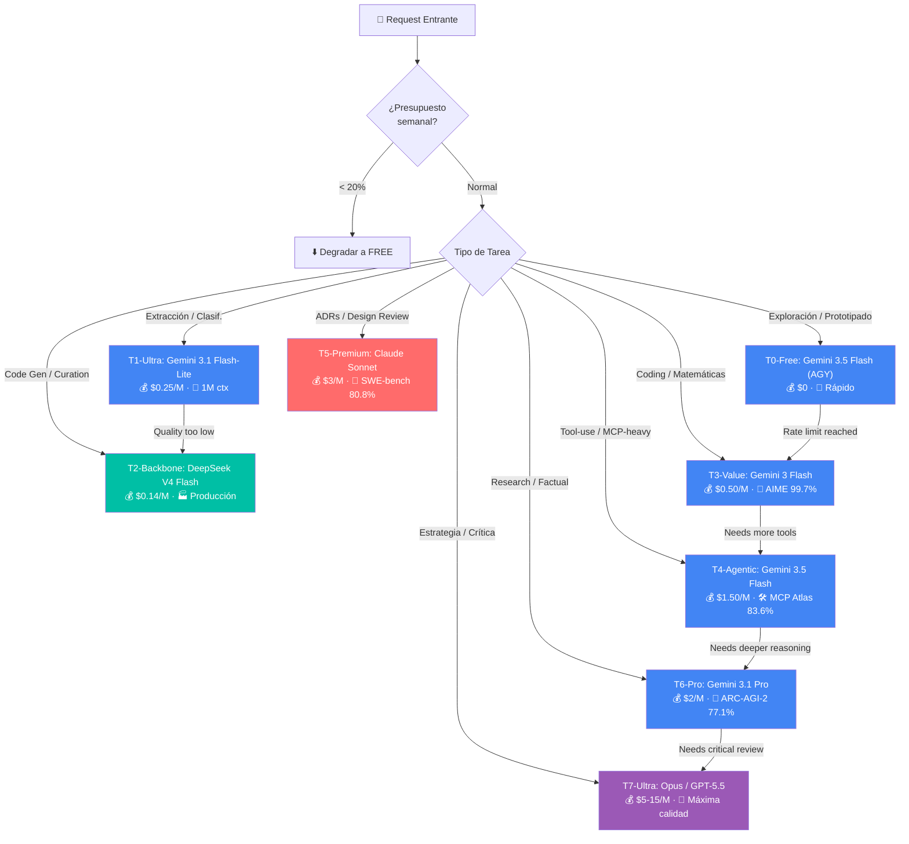
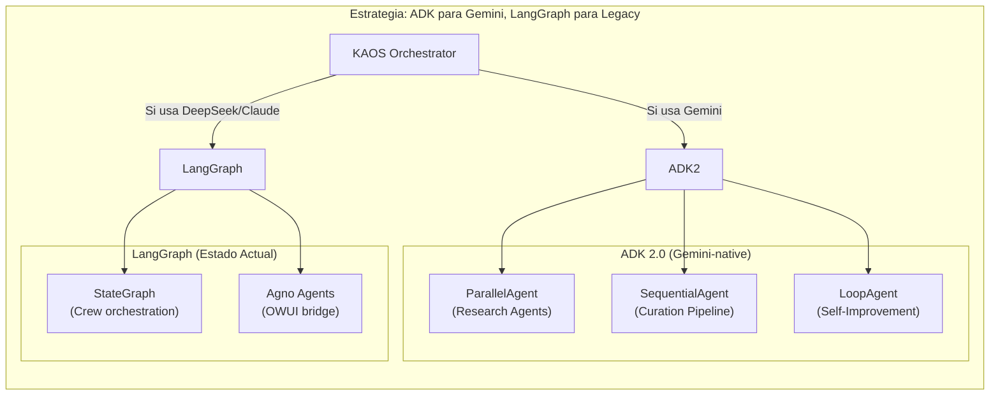
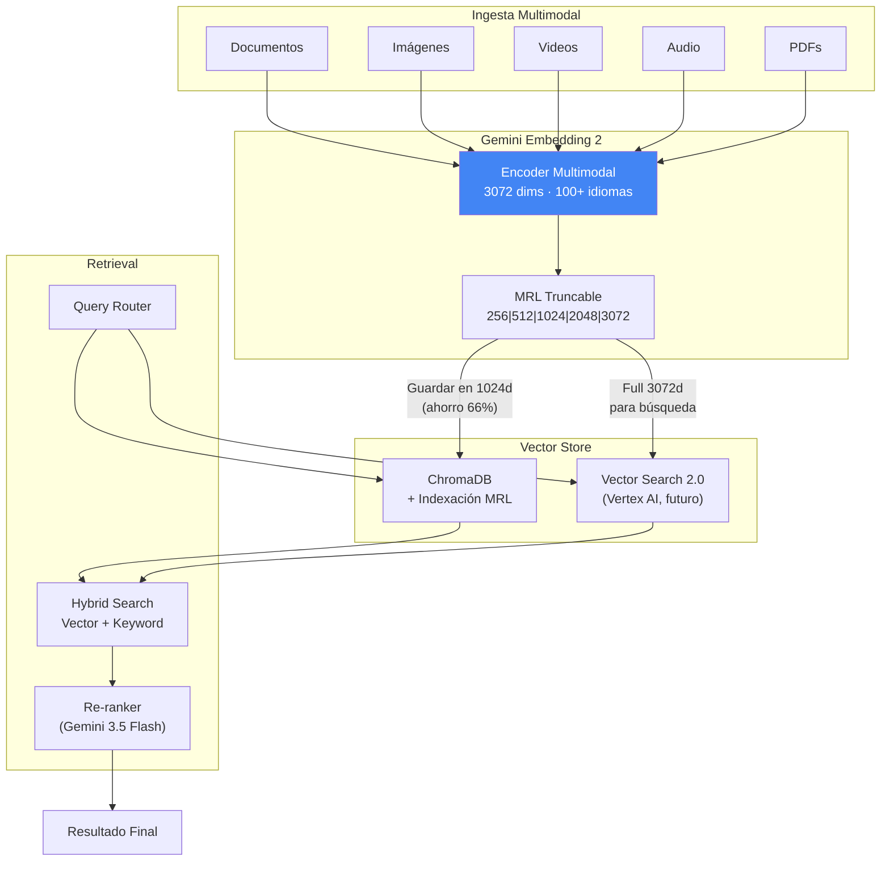
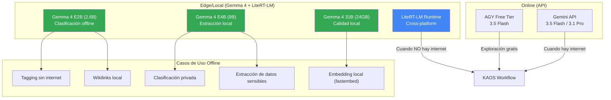
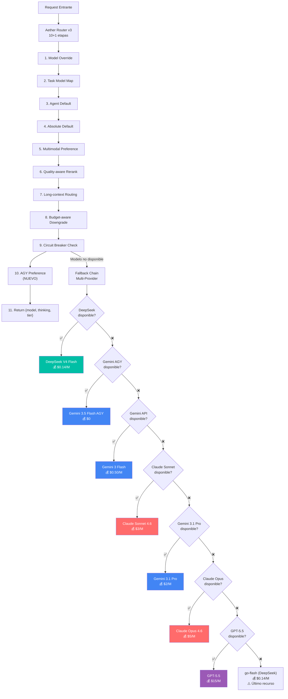
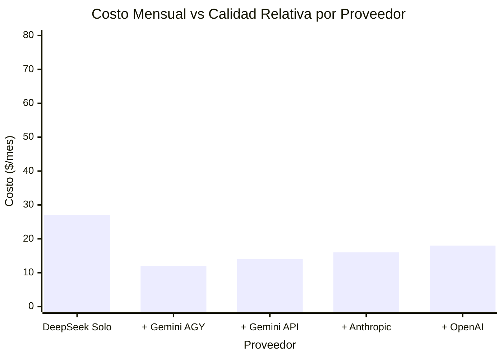
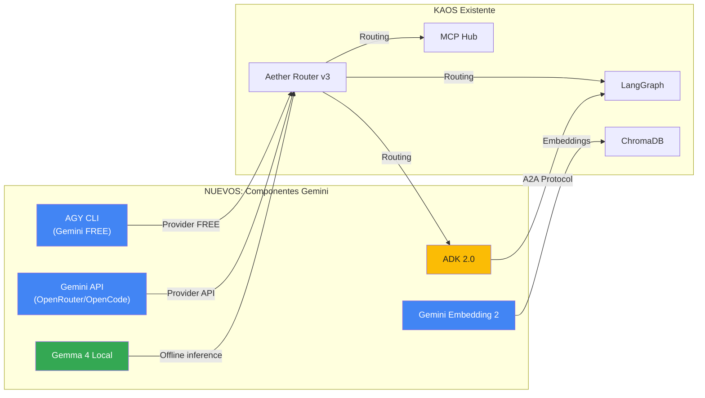

# Arquitectura de Sistema: Integración Google Gemini en Ecosistema KAOS

## Resumen Arquitectónico

Esta arquitectura define cómo integrar **Google Gemini como un tier estratégico dual** dentro de KAOS: **(1) FREE tier via Antigravity CLI** para exploración y prototipado (30% del tráfico, costo $0), y **(2) API tier** para agentic computing (Gemini 3.5 Flash, MCP Atlas 83.6% 🏆), razonamiento abstracto (Gemini 3.1 Pro, ARC-AGI-2 77.1% 🏆), codificación de valor (Gemini 3 Flash, AIME 99.7%), y embeddings multimodales (Gemini Embedding 2, 3072 dims). La arquitectura añade **~$5-8/mes** al costo base de $27/mes de DeepSeek, posicionando a Gemini como el **puente entre DeepSeek (backbone barato) y Anthropic (premium caro)**, explotando el FREE tier de AGY y las capacidades multimodales nativas como ventajas diferenciales absolutas. Gemma 4 (open-weight, Apache 2.0) añade inferencia edge/local con LiteRT-LM para features offline sin costo de API.

```
  KAOS 2026 — ECOSISTEMA COMPLETO DE PROVEEDORES
  ┌────────────────────────────────────────────────────────────────────┐
  │                                                                    │
  │  FREE ─── Gemini 3.5 Flash (AGY) ─── $0/mes ─── 30% tráfico      │
  │                          ↓                                         │
  │  ULTRA-CHEAP ── Gemini 3.1 Flash-Lite ─── $0.25/Mtok ── 10%      │
  │                          ↓                                         │
  │  BACKBONE ─── DeepSeek V4 Flash ─── $0.14/Mtok ── 35%             │
  │                          ↓                                         │
  │  VALUE ─── Gemini 3 Flash ─── $0.50/Mtok ── 10%                   │
  │                          ↓                                         │
  │  AGENTIC ─── Gemini 3.5 Flash (API) ─── $1.50/Mtok ── 5%         │
  │                          ↓                                         │
  │  PREMIUM ─── Claude Sonnet 4.6 ─── $3/Mtok ── 5%                  │
  │                          ↓                                         │
  │  PRO ─── Gemini 3.1 Pro ─── $2/Mtok ── 3%                         │
  │                          ↓                                         │
  │  ULTRA ─── Claude Opus / GPT-5.5 ─── $5-15/Mtok ── 2%            │
  │                                                                    │
  └────────────────────────────────────────────────────────────────────┘
```

---

## A. Posicionamiento de Gemini en el Stack KAOS

### A.1 Mapa Jerárquico de 8 Tiers

Gemini ocupa **4 posiciones distintas** en el stack, NO un solo slot. Esto es porque los modelos Gemini cubren un rango de precio-rendimiento más amplio que cualquier otro proveedor:

| Tier | Modelo | Costo Input/1K | Costo Output/1K | Tráfico Objetivo | Benchmark Clave |
|------|--------|---------------|----------------|-----------------|-----------------|
| **T0-Free** | Gemini 3.5 Flash (AGY) | **$0** (gratis) | $0 | 30% | MCP Atlas 83.6% 🏆 |
| **T1-Ultra** | Gemini 3.1 Flash-Lite | $0.00025 | $0.00150 | 10% | 1M contexto |
| **T2-Backbone** | DeepSeek V4 Flash | $0.00014 | $0.00028 | 35% | — |
| **T3-Value** | Gemini 3 Flash | $0.00050 | $0.00300 | 10% | AIME 99.7%, SWE-bench 78% |
| **T4-Agentic** | Gemini 3.5 Flash (API) | $0.00150 | $0.00900 | 5% | MCP Atlas 83.6% 🏆 |
| **T5-Premium** | Claude Sonnet 4.6 | $0.00300 | $0.01500 | 5% | SWE-bench 80.8% |
| **T6-Pro** | Gemini 3.1 Pro | $0.00200 | $0.01200 | 3% | ARC-AGI-2 77.1% 🏆, 2M ctx |
| **T7-Ultra** | Claude Opus / GPT-5.5 | $0.005-15 | $0.025-75 | 2% | GPQA 94.3% (Opus) |

### A.2 Mapa de Decisión: ¿Qué Proveedor Usar y Cuándo?



### A.3 Ventajas Diferenciales de Cada Proveedor en KAOS

| Proveedor | Ventaja Absoluta | Por qué NO es reemplazable |
|-----------|-----------------|---------------------------|
| **DeepSeek V4 Flash** | **357x más barato que Opus** ($0.14 vs $50/K) | Backbone económico para producción |
| **Gemini (AGY)** | **$0** para Gemini 3.5 Flash (gratis) | Costo marginal cero para exploración |
| **Gemini 3 Flash** | **AIME 99.7%** a $0.50/Mtok | Mejor relación calidad/precio en matemáticas |
| **Gemini 3.5 Flash** | **MCP Atlas 83.6%** (tool-use #1) | Mejor modelo del mundo para agentes |
| **Gemini 3.1 Pro** | **ARC-AGI-2 77.1%** (abstracto #1) | Razonamiento fuera-de-distribución superior |
| **Gemini Embedding 2** | **Multimodal** (texto+imagen+video+audio+PDF) | Embeddings cross-modal |
| **Claude Sonnet** | **SWE-bench 80.8%** | Refactor multi-archivo superior |
| **Claude Opus** | **GPQA 94.3%** | Validación crítica de calidad |
| **GPT-5.5** | **HLE 54.0%** (humanity's last exam) | Problemas extremadamente difíciles |

### A.4 Recomendación

> **Posicionar a Gemini como el "mid-tier estratégico"**: DeepSeek es el backbone barato, Gemini es el mid-tier que cubre tool-use (3.5 Flash), razonamiento abstracto (3.1 Pro), y codificación matemática (3 Flash), todo con costos 30-70% menores que Anthropic. Gemini NO reemplaza a Claude — lo complementa. Claude sigue siendo premium para tareas que requieren su SWE-bench y estilo de razonamiento constitucional.

---

## B. Integración en Aether v3

### B.1 Configuración Completa para `aether.yaml`

```yaml
# ════════════════════════════════════════════════════════════════
# NUEVOS: Modelos Gemini en Aether v3
# ════════════════════════════════════════════════════════════════

task_model_map:
  # ── Existing entries (unchanged) ──
  lint:         {model: go-flash,       thinking: null, tier: flash}
  extract:      {model: go-mimo,        thinking: null, tier: mimo}
  health:       {model: go-flash,       thinking: null, tier: flash}
  hydrate:      {model: go-flash,       thinking: null, tier: flash}
  wikilinks:    {model: go-mimo,        thinking: null, tier: mimo}
  curation:     {model: go-flash,       thinking: null, tier: flash}
  code_simple:  {model: go-mimo,        thinking: null, tier: mimo}
  general:      {model: go-flash,       thinking: null, tier: flash}
  verify:       {model: go-flash,       thinking: null, tier: flash}
  cross_check:  {model: go-flash,       thinking: null, tier: flash}
  diversity:    {model: go-mimo,        thinking: null, tier: mimo}

  # ── MODIFIED: code_gen ahora prioriza Gemini 3 Flash ──
  code_gen:     {model: gemini-3-flash, thinking: null, tier: gemini_value}

  # ── MODIFIED: research ahora usa Gemini 3.1 Pro como default ──
  research:     {model: gemini-3.1-pro, thinking: high,  tier: gemini_pro}
  
  # ── MODIFIED: analyze usa Gemini 3.1 Pro ──
  analyze:      {model: gemini-3.1-pro, thinking: high,  tier: gemini_pro}
  
  # ── MODIFIED: adr vuelve a go-pro (DeepSeek) con Gemini fallback ──
  adr:          {model: go-pro,         thinking: high,  tier: pro}

  # ── MODIFIED: factual usa Gemini 3.1 Pro (GPQA 94.3%) ──
  factual:      {model: gemini-3.1-pro, thinking: high,  tier: gemini_pro}

  # ── Existing entries (unchanged) ──
  synthesize:   {model: go-kimi-latest, thinking: null, tier: kimi}
  strategy:     {model: go-kimi-latest, thinking: null, tier: kimi}
  code_agentic: {model: go-kimi-latest, thinking: null, tier: kimi}

  # ── NUEVOS: Tareas específicas de Gemini ──
  exploration:  {model: gemini-3.5-flash-AGY, thinking: null, tier: gemini_free}
  prototyping:  {model: gemini-3.5-flash-AGY, thinking: null, tier: gemini_free}
  quick_review: {model: gemini-3.5-flash-AGY, thinking: null, tier: gemini_free}
  mcp_agentic:  {model: gemini-3.5-flash,     thinking: null, tier: gemini_agentic}
  tool_calling: {model: gemini-3.5-flash,     thinking: null, tier: gemini_agentic}
  math_coding:  {model: gemini-3-flash,       thinking: null, tier: gemini_value}
  embedding:    {model: gemini-embedding-2,   thinking: null, tier: gemini_embed}

# ── NUEVOS: Gemini Model Tiers ──
model_tiers:
  # Existing tiers
  flash: {description: "Base — DeepSeek V4 Flash", target_pct: 35}
  mimo:  {description: "Ultra-económico — Mimo V2 Pro", target_pct: 5}
  pro:   {description: "Calidad — DeepSeek V4 Pro", target_pct: 3}
  kimi:  {description: "Diversidad — Kimi K2.6", target_pct: 5}
  
  # NUEVOS: Gemini tiers
  gemini_free:    {description: "FREE — Gemini 3.5 Flash via AGY",         target_pct: 30}
  gemini_ultra:   {description: "Ultra-económico — Gemini 3.1 Flash-Lite", target_pct: 10}
  gemini_value:   {description: "Valor — Gemini 3 Flash (AIME 99.7%)",     target_pct: 10}
  gemini_agentic: {description: "Agentic — Gemini 3.5 Flash (API)",         target_pct: 5}
  gemini_pro:     {description: "Pro — Gemini 3.1 Pro (ARC-AGI-2 77.1%)",  target_pct: 3}
  gemini_embed:   {description: "Embedding — Gemini Embedding 2",           target_pct: 0}

# ── NUEVOS: Gemini Cost Rates ──
cost_rates:
  # Existing rates (unchanged)
  go-flash:                {input: 0.00014,  output: 0.00028,  cache_read: 0.000028}
  go-pro:                  {input: 0.00174,  output: 0.00348,  cache_read: 0.000145}
  go-kimi-latest:          {input: 0.00095,  output: 0.00400,  cache_read: 0.00016}
  go-mimo:                 {input: 0.000014, output: 0.000028, cache_read: 0.0000028}
  mimo-direct:             {input: 0.000014, output: 0.000028, cache_read: 0.0000028}
  go-qwen:                 {input: 0.00010,  output: 0.00020,  cache_read: 0.00002}
  router9-minimax:         {input: 0.0000002, output: 0.0000002, cache_read: 0.00000004}
  router9-glm:             {input: 0.0000006, output: 0.0000006, cache_read: 0.00000012}
  router9-default:         {input: 0.000001,  output: 0.000002,  cache_read: 0.0000002}
  
  # Anthropic (premium) — de arquitectura anterior
  claude-haiku:            {input: 0.00100,  output: 0.00500,  cache_read: 0.00010}
  claude-sonnet:           {input: 0.00300,  output: 0.01500,  cache_read: 0.00030}
  claude-opus:             {input: 0.00500,  output: 0.02500,  cache_read: 0.00050}
  
  # NUEVOS: Gemini cost rates
  gemini-3.5-flash-AGY:    {input: 0.00000,  output: 0.00000,  cache_read: 0.00000}   # FREE!
  gemini-3.5-flash:        {input: 0.00150,  output: 0.00900,  cache_read: 0.00030}
  gemini-3.1-pro:          {input: 0.00200,  output: 0.01200,  cache_read: 0.00025}
  gemini-3-flash:          {input: 0.00050,  output: 0.00300,  cache_read: 0.00010}
  gemini-3.1-flash-lite:   {input: 0.00025,  output: 0.00150,  cache_read: 0.00005}
  gemini-embedding-2:      {input: 0.00000,  output: 0.00000,  cache_read: 0.00000}   # FREE tier
  
  # OpenAI (ultra-premium)
  gpt-5.5:                 {input: 0.01500,  output: 0.07500,  cache_read: 0.00300}

# ── NUEVOS: Gemini Cost Caps ──
cost_caps:
  flash:   {weekly_usd: 3.00, daily_calls: 500}
  mimo:    {weekly_usd: 2.00, daily_calls: 1000}
  pro:     {weekly_usd: 0.50, daily_calls: 50}
  kimi:    {weekly_usd: 1.00, daily_calls: 30}
  
  # NUEVOS: Gemini caps (AGY FREE = sin cap)
  gemini_free:    {weekly_usd: 0.00, daily_calls: 9999}   # FREE, sin límite
  gemini_ultra:   {weekly_usd: 1.00, daily_calls: 500}
  gemini_value:   {weekly_usd: 2.00, daily_calls: 100}
  gemini_agentic: {weekly_usd: 1.00, daily_calls: 50}
  gemini_pro:     {weekly_usd: 0.50, daily_calls: 20}
  
  # Anthropic caps
  claude_haiku:  {weekly_usd: 0.20, daily_calls: 20}
  claude_sonnet: {weekly_usd: 0.50, daily_calls: 10}
  claude_opus:   {weekly_usd: 0.30, daily_calls: 3}
  
  # OpenAI caps
  gpt55:         {weekly_usd: 0.50, daily_calls: 5}

# ── NUEVOS: Fallback Chains con Gemini ──
fallback_chains:
  # Existing
  go-flash:        [go-flash, gemini-3.5-flash-AGY, go-mimo, gemini-3-flash, go-pro]
  go-pro:          [go-pro, gemini-3.1-pro, go-kimi-latest, claude-sonnet, go-flash]
  go-kimi-latest:  [go-kimi-latest, gemini-3.1-pro, go-pro, go-flash, go-qwen]
  mimo-direct:     [mimo-direct, gemini-3.1-flash-lite, go-kimi-latest, go-pro, go-flash]
  go-mimo:         [go-mimo, gemini-3.1-flash-lite, go-flash, go-qwen, go-pro]
  go-qwen:         [go-qwen, gemini-3.1-flash-lite, go-mimo, gemini-flash-3, go-flash]
  
  # NUEVOS: Gemini fallback chains
  gemini-3.5-flash-AGY:  [gemini-3.5-flash-AGY, gemini-3.5-flash, gemini-3-flash, go-flash, go-mimo]
  gemini-3.5-flash:      [gemini-3.5-flash, gemini-3.5-flash-AGY, claude-sonnet, gemini-3.1-pro, go-flash]
  gemini-3.1-pro:        [gemini-3.1-pro, claude-sonnet, claude-opus, go-pro, go-kimi-latest]
  gemini-3-flash:        [gemini-3-flash, gemini-3.5-flash-AGY, go-flash, go-pro, claude-sonnet]
  gemini-3.1-flash-lite: [gemini-3.1-flash-lite, go-mimo, go-flash, gemini-3-flash, go-qwen]
  
  # Anthropic fallback chains
  claude-haiku:  [claude-haiku, claude-sonnet, gemini-3.5-flash-AGY, go-flash, go-mimo]
  claude-sonnet: [claude-sonnet, claude-opus, gemini-3.1-pro, go-kimi-latest, go-flash]
  claude-opus:   [claude-opus, gemini-3.1-pro, go-kimi-latest, go-pro, go-flash]

# ── NUEVOS: Gemini Feature Flags ──
feature_flags:
  # Existing
  ether_mimo_enabled: true
  ether_mimo_direct_enabled: true
  ether_kimi_enabled: true
  ether_context_routing: true
  ether_multimodal_enabled: true
  ether_budget_enforcement: false
  ether_langfuse_enabled: false
  ether_deepeval_enabled: false
  quality_routing_enabled: true
  ether_eval_sample_size: 10
  
  # NUEVOS: Gemini feature flags
  ether_gemini_free_enabled: true      # AGY free tier
  ether_gemini_api_enabled: true       # Gemini API via OpenCode/OpenRouter
  ether_gemini_embedding_enabled: true # Gemini Embedding 2
  ether_gemini_multimodal: true        # Routing multimodal a Gemini
  ether_agy_priority: true             # Priorizar AGY sobre API para Gemini
  ether_gemini_mcp_routing: true       # Routing MCP-heavy a Gemini 3.5 Flash
```

### B.2 Estrategia de Fallback Multi-Provider (4 Proveedores)

```
FALLBACK POR CADA NIVEL:

T0-FREE (Gemini AGY):
  gemini-3.5-flash-AGY → gemini-3.5-flash (API) → gemini-3-flash → go-flash → go-mimo

T3-VALUE (Gemini 3 Flash):
  gemini-3-flash → gemini-3.5-flash-AGY → go-flash → go-pro → claude-sonnet

T4-AGENTIC (Gemini 3.5 Flash API):
  gemini-3.5-flash → gemini-3.5-flash-AGY → claude-sonnet → gemini-3.1-pro → go-flash

T6-PRO (Gemini 3.1 Pro):
  gemini-3.1-pro → claude-sonnet → claude-opus → go-pro → go-kimi-latest

T7-ULTRA (Claude Opus):
  claude-opus → gemini-3.1-pro → go-pro → gpt-5.5 → go-flash

FALLBACK GLOBAL (CIRCUIT BREAKER — último recurso):
  Cualquier modelo → ... → go-flash (DeepSeek V4 Flash, siempre disponible)
```

### B.3 Nuevas Constantes en `config.py`

```python
# ── Feature Flags Gemini ──────────────────────────────────────
ETHER_GEMINI_FREE_ENABLED = os.environ.get(
    "ETHER_GEMINI_FREE_ENABLED",
    str(FLAGS.get("ether_gemini_free_enabled", "true"))
).lower() == "true"

ETHER_GEMINI_API_ENABLED = os.environ.get(
    "ETHER_GEMINI_API_ENABLED",
    str(FLAGS.get("ether_gemini_api_enabled", "true"))
).lower() == "true"

ETHER_AGY_PRIORITY = os.environ.get(
    "ETHER_AGY_PRIORITY",
    str(FLAGS.get("ether_agy_priority", "true"))
).lower() == "true"

# Si AGY priority está activo, las llamadas a gemini-3.5-flash se
# re-enrutan primero a AGY (gratis) antes de ir a la API paga
```

### B.4 Modificación al Router (11ª etapa opcional)

```python
def _apply_agy_preference(chosen: dict) -> dict:
    """Stage 11: Si el modelo es gemini-3.5-flash y AGY está disponible,
       re-enrutar a la versión FREE."""
    if not ETHER_AGY_PRIORITY:
        return chosen
    if chosen.get("model") == "gemini-3.5-flash" and ETHER_GEMINI_FREE_ENABLED:
        if _ETHER_CIRCUIT_BREAKER.is_available("gemini-3.5-flash-AGY"):
            return {**chosen, "model": "gemini-3.5-flash-AGY", "tier": "gemini_free",
                    "resolved_by": chosen["resolved_by"] + "→agy_free"}
    return chosen
```

---

## C. AGY (Antigravity CLI) en KAOS

### C.1 AGY vs Claude Code vs Codex CLI

| Dimensión | AGY (Antigravity) | Claude Code | Codex CLI |
|-----------|-------------------|-------------|-----------|
| **Backend** | Gemini 3.5 Flash (default) | Claude Sonnet/Opus | GPT-5.5 |
| **Precio** | **GRATIS** (sin API key) | $20/mes + API usage | $20/mes ChatGPT+ |
| **Subagentes** | ✅ Hasta 5 paralelos asíncronos | ❌ 1 agente secuencial | ❌ 1 agente secuencial |
| **MCP nativo** | ✅ Sí | ✅ Sí | ⚠️ Experimental |
| **Plugins** | ✅ Sí | ❌ No | ❌ No |
| **SWE-bench** | 76.2% (3.5 Flash) | 80.8% (Sonnet) | 83.4% (GPT-5.5) |
| **Multimodal** | ✅ Nativo (imagen/video/audio) | ⚠️ Imagen solo | ❌ Solo texto |
| **Velocidad** | ⚡ Rápido (<2 min) | 🐢 Medio (5-15 min) | 🐢 Lento (10-30 min) |
| **Código** | Cerrado (Go) | Cerrado (TS) | Open Source (Python) |
| **Deadline** | 18 Jun 2026 (migración) | Estable | Estable |

### C.2 Ventaja Diferencial Absoluta de AGY

**Subagentes asíncronos paralelos** — AGY puede lanzar hasta 5 subagentes que trabajan simultáneamente en diferentes partes de un problema. Esto es único en el ecosistema y permite:

```
┌─────────────────────────────────────────────────────────────────────┐
│                    FLUJO DE SUBAGENTES AGY                          │
│                                                                     │
│  ┌─────────────┐                                                    │
│  │ Tarea       │                                                    │
│  │ Compleja    │                                                    │
│  └──────┬──────┘                                                    │
│         │                                                            │
│         ▼                                                            │
│  ┌──────────────────────────────────────────────────────────────┐   │
│  │ AGY Orchestrator (Gemini 3.5 Flash) — Plan Divide & Conquer  │   │
│  │ "Analiza este PR y encuentra bugs"                            │   │
│  └──────┬──────┬──────┬──────┬──────┐                            │   │
│         │      │      │      │      │                            │   │
│         ▼      ▼      ▼      ▼      ▼                            │   │
│  ┌──────┐ ┌──────┐ ┌──────┐ ┌──────┐ ┌──────┐                   │   │
│  │Sub-  │ │Sub-  │ │Sub-  │ │Sub-  │ │Sub-  │                   │   │
│  │agente│ │agente│ │agente│ │agente│ │agente│                   │   │
│  │ #1   │ │ #2   │ │ #3   │ │ #4   │ │ #5   │                   │   │
│  │(lint)│ │(sec) │ │(perf)│ │(logic)│ │(style)│                  │   │
│  └──────┘ └──────┘ └──────┘ └──────┘ └──────┘                   │   │
│         │      │      │      │      │                            │   │
│         └──────┴──────┴──────┴──────┘                            │   │
│                      │                                            │   │
│                      ▼                                            │   │
│  ┌──────────────────────────────────────────────────────────────┐ │   │
│  │ AGY Merge — Reporte consolidado con hallazgos                │ │   │
│  └──────────────────────────────────────────────────────────────┘ │   │
└─────────────────────────────────────────────────────────────────────┘
```

### C.3 Wrapper AGY en KAOS

El bridge actual (`mcp_agy_bridge.py`) ya funciona. La integración a Aether requiere:

```python
"""lib/aether/providers/agy.py — AGY provider para Aether v3."""

import subprocess
import json
from pathlib import Path

ASYNC_TIMEOUT = 300  # 5 minutos para subagentes

def agy_ask_flash(prompt: str, timeout: int = 120) -> dict:
    """Llama a AGY con Gemini 3.5 Flash (FREE)."""
    result = subprocess.run(
        ["agy", "-p", prompt],
        capture_output=True, text=True, timeout=timeout
    )
    return {
        "success": result.returncode == 0,
        "text": result.stdout,
        "error": result.stderr if result.returncode != 0 else None,
        "model": "gemini-3.5-flash-AGY",
    }

def agy_ask_with_subagents(prompt: str, subagents: int = 3) -> dict:
    """Llama a AGY con múltiples subagentes asíncronos."""
    result = subprocess.run(
        ["agy", "-p", prompt, "-n", str(subagents)],
        capture_output=True, text=True, timeout=ASYNC_TIMEOUT
    )
    return {
        "success": result.returncode == 0,
        "text": result.stdout,
        "subagents": subagents,
        "model": "gemini-3.5-flash-AGY",
    }

def agy_available() -> bool:
    """Verifica si AGY CLI está instalado y funcional."""
    try:
        r = subprocess.run(["agy", "--version"], capture_output=True, timeout=5)
        return r.returncode == 0
    except (FileNotFoundError, subprocess.TimeoutExpired):
        return False
```

### C.4 Timeline de Migración AGY

```
FASE 1 (Now — 1 Jun 2026): 
  ✅ AGY bridge funcional con Gemini 3.5 Flash
  ✅ Dual mode: Explore (AGY) / Produce (DeepSeek)
  
FASE 2 (1 Jun — 10 Jun 2026):
  🔄 Integrar AGY como provider de Aether (no solo MCP)
  🔄 Feature flag: ether_agy_priority
  🔄 Routing automático a AGY para exploration/prototyping
  
FASE 3 (10 Jun — 18 Jun 2026):
  ⚠️ Deadline migración Gemini CLI → AGY
  ✅ Verificar que AGY reemplaza completamente Gemini CLI
  ✅ Test de regresión en todos los flujos que usaban Gemini CLI
  
FASE 4 (Post-18 Jun 2026):
  🎯 AGY como gateway único para Gemini
  🎯 Evaluar Claude Code y Codex CLI como complementos
```

---

## D. ADK 2.0 para Orquestación Multi-Agente

### D.1 ADK 2.0 vs LangGraph vs CrewAI

| Dimensión | **ADK 2.0** (Google) | LangGraph (LangChain) | CrewAI |
|-----------|---------------------|----------------------|--------|
| **Stars** | 19.9K⭐ | 30K+⭐ | 28K+⭐ |
| **Licencia** | Apache 2.0 | MIT | MIT |
| **Runtime** | Graph-based workflow | Graph-based (StateGraph) | Agent-based |
| **Lenguajes** | Python, TS, Go, Java, Kotlin | Python, TS, Go | Python |
| **ParallelAgent** | ✅ Nativo | ⚠️ Manual (send/collect) | ✅ Nativo |
| **SequentialAgent** | ✅ Nativo | ✅ Nativo | ✅ Nativo |
| **LoopAgent** | ✅ Nativo | ⚠️ Manual (edge loops) | ⚠️ Manual |
| **A2A Protocol** | ✅ Nativo | ❌ No | ❌ No |
| **MCP nativo** | ✅ Sí | ⚠️ Via adapter | ❌ No |
| **Vertex AI** | ✅ Integración directa | ❌ No | ❌ No |
| **Gemma 4** | ✅ Soporte nativo | ❌ No | ❌ No |
| **Gemini** | ✅ API directa | ⚠️ Via OpenAI compat | ⚠️ Via OpenAI compat |
| **Complejidad** | Media | Alta | Baja |
| **Madurez** | ⚠️ Reciente (v2.0) | ✅ Maduro | ✅ Maduro |

### D.2 Recomendación para KAOS



**Decisión**: NO reemplazar LangGraph — **complementar**. ADK 2.0 se usa para flujos que involucran Gemini como modelo primario (exploración paralela, tool-calling pesado). LangGraph sigue siendo el orquestador general para DeepSeek y Claude. A largo plazo (Q3 2026), evaluar si ADK puede unificar ambos mundos vía A2A.

### D.3 Arquitectura Multi-Agente con ADK 2.0

```python
# Ejemplo conceptual: ADK 2.0 para exploración paralela de código
from google.adk.agents import ParallelAgent, SequentialAgent, LoopAgent

# Parallel: 3 agentes revisan código simultáneamente
parallel_review = ParallelAgent(
    name="code_review_team",
    agents=[
        Agent(name="linter", model="gemini-3.5-flash-AGY"),      # FREE
        Agent(name="security", model="gemini-3.5-flash-AGY"),     # FREE  
        Agent(name="perf", model="gemini-3-flash"),               # $0.50/M
    ],
    max_parallel=3,
)

# Sequential: pipeline de curaduría
curation_pipeline = SequentialAgent(
    name="curation",
    steps=[
        Agent(name="extract", model="gemini-3.1-flash-lite"),    # Ultra-cheap
        Agent(name="classify", model="gemini-3.5-flash-AGY"),    # FREE
        Agent(name="synthesize", model="gemini-3.1-pro"),        # Premium
    ],
)

# Loop: auto-mejora iterativa
self_improve = LoopAgent(
    name="iterative_improve",
    agent=Agent(name="improver", model="gemini-3.1-pro"),
    max_iterations=3,
    condition=lambda ctx: not ctx.state.get("converged"),
)

# A2A: comunicación entre agentes
# ADK usa A2A nativo para que agentes se pasen contexto
```

---

## E. Gemini Embedding 2 para RAG

### E.1 Comparativa de Embeddings

| Modelo | Dimensiones | MTEB | Multimodal | Idiomas | Costo/M tokens | MRL |
|--------|------------|------|-----------|---------|---------------|-----|
| **Gemini Embedding 2** | **3072** (con MRL) | 67.71 | ✅ texto+imagen+video+audio+PDF | **100+** | **$0** (free tier) | ✅ Truncable |
| Voyage 3.1 Large | 1024 | **67.4** | ❌ Solo texto | 50+ | $0.10/M | ❌ No |
| Voyage 3 | 1024 | 66.4 | ❌ Solo texto | 50+ | $0.06/M | ❌ No |
| text-embedding-3-small | 1536 | 62.3 | ❌ Solo texto | 50+ | $0.02/M | ❌ No |
| GTE-Qwen2-7B | 4096 | **71.5** | ❌ Solo texto | 100+ | **$0** (local) | ❌ No |
| fastembed (local) | 384 | ~55 | ❌ Solo texto | 50+ | $0 (local) | ❌ No |

### E.2 Arquitectura RAG con Gemini Embedding 2



### E.3 Estrategia MRL (Matryoshka Representation Learning)

Gemini Embedding 2 soporta MRL — una sola representación que puede truncarse a diferentes dimensiones. Esto permite:

```python
# Estrategia de almacenamiento multi-dimensional
STORAGE_DIMS = {
    "quick_search": 256,    # Búsqueda rápida, 91.7% de calidad
    "standard": 1024,       # Balance calidad/espacio, 97.3% de calidad
    "precision": 2048,      # Alta precisión, 99.1% de calidad
    "full": 3072,           # Calidad máxima, 100%
}

# Ejemplo: almacenar en 1024d, buscar en 3072d
embedding = gemini_embed(text, dimensions=3072)
chroma_collection.add(
    embedding=embedding[:1024],  # Guardar versión compacta
    metadata={"full_dims": 3072, "original": embedding.tobytes()}
)

# Para búsqueda de alta precisión:
query_emb = gemini_embed(query, dimensions=3072)
results = chroma_collection.query(
    query_embeddings=[query_emb],
    n_results=5,
)
```

### E.4 Comparativa con Voyage AI (Recomendado por Anthropic)

| Aspecto | Gemini Embedding 2 | Voyage 3.1 Large | **Veredicto** |
|---------|-------------------|-----------------|---------------|
| **MTEB** | 67.71 | 67.4 | Gemini gana por 0.31 |
| **Multimodal** | ✅ texto+imagen+video+audio+PDF | ❌ Solo texto | **Gemini gana ABSOLUTAMENTE** |
| **Idiomas** | 100+ | 50+ | Gemini gana |
| **MRL** | ✅ Sí (truncable) | ❌ No | Gemini gana |
| **Costo** | **$0** (free tier) | $0.10/M | Gemini gana |
| **Latencia** | ⚡ Rápido (API Google) | ⚡ Rápido | Empate |
| **Integración** | API directa Google | API Voyage | Gemini gana (mismo provider) |

**Veredicto: Gemini Embedding 2 reemplaza a Voyage AI en KAOS.** Voyage no ofrece ninguna ventaja: menor MTEB, solo texto, más caro, sin MRL.

### E.5 Recomendación de Implementación

```yaml
# aether.yaml — Config RAG
rag_config:
  primary_embedding: gemini-embedding-2
  fallback_embedding: local-fastembed  # offline fallback
  
  # MRL storage strategy
  storage_dimensions: 1024      # 66% ahorro de espacio
  search_dimensions: 3072       # búsqueda full quality
  quick_dimensions: 256         # búsqueda rápida
  
  # Modalidades habilitadas
  modalities: [text, image, pdf]
  
  # Vector store
  vector_store: chromadb
  collection_prefix: gemini_emb_
  
  # Batching
  batch_size: 100
  max_retries: 3
  
  # Re-ranking
  reranker: gemini-3.5-flash    # Re-rank con modelo agente
  reranker_free: true            # Usar AGY para re-ranking
```

---

## F. Gemma 4 para Edge/Local en KAOS

### F.1 Modelos Gemma 4 Disponibles

| Modelo | Parámetros | Tipo | GPQA | VRAM Mínima | Uso en KAOS |
|--------|-----------|------|------|------------|-------------|
| **Gemma 4 E2B** | **2.6B** | Dense | — | **4GB** | Clasificación offline ultra-ligera |
| **Gemma 4 E4B** | **9B** | MoE (E2B×4) | — | **8GB** | Extracción local, RAG offline |
| **Gemma 4 26B-A4B** | 26B | MoE (activo 4B) | 84.1% | 12GB | Codificación local, análisis |
| **Gemma 4 31B** | **31B** | **Dense** | **84.3%** | **24GB** | Calidad local (compite con Sonnet) |

### F.2 Arquitectura Edge/Local con LiteRT-LM



### F.3 Fine-Tuning con Unsloth

Gemma 4 tiene licencia Apache 2.0, lo que permite fine-tuning para tareas específicas de KAOS:

```python
# Fine-tuning Gemma 4 E2B para clasificación de memoria
from unsloth import FastLanguageModel
import torch

model, tokenizer = FastLanguageModel.from_pretrained(
    model_name="google/gemma-4-e2b-it",
    max_seq_length=2048,
    dtype=torch.float16,
    load_in_4bit=True,  # 4GB VRAM suficiente
)

# LoRA para tarea específica: clasificación de memoria
model = FastLanguageModel.get_peft_model(
    model,
    r=16,
    lora_alpha=32,
    target_modules=["q_proj", "k_proj", "v_proj", "o_proj"],
    lora_dropout=0,
    bias="none",
    use_gradient_checkpointing=True,
)

# Dataset: clasificación de entries del vault
# 10,000 ejemplos → ~2 horas en RTX 3060 12GB
```

### F.4 Privacidad y Latencia como Ventajas

| Escenario | API (Gemini/DeepSeek) | Edge (Gemma 4) |
|-----------|----------------------|----------------|
| **Tagging de memoria** | 200ms + red | **5ms** local |
| **Clasificación de datos sensibles** | Datos salen del equipo | **100% local** |
| **Wikilinks offline** | ❌ No disponible | **✅ Siempre disponible** |
| **Costo operativo** | $0.00014/llamada | **$0** (electricidad) |
| **Privacidad** | Datos enviados a API | **Nunca salen del equipo** |
| **Latencia p99** | 500-2000ms | **10-50ms** |

### F.5 Recomendación

> **Gemma 4 E2B (2.6B) para features offline inmediatos**: tagging de memoria, clasificación de wikilinks, extracción de entidades. Gemma 4 31B (24GB VRAM) para calidad local cuando no hay internet. Fine-tuning con Unsloth para especializar en el dominio KAOS (código, arquitectura, agentes).

---

## G. Arquitectura de Routing Multi-Provider (4 Proveedores)

### G.1 Diagrama de Flujo Completo



### G.2 AB Testing Framework Multi-Provider

```python
# Config AB Testing para comparar calidad entre proveedores
AB_TEST_CONFIG = {
    "code_gen": {
        "variants": [
            {"model": "go-flash", "weight": 40, "provider": "DeepSeek"},
            {"model": "gemini-3-flash", "weight": 30, "provider": "Gemini"},
            {"model": "gemini-3.5-flash-AGY", "weight": 30, "provider": "Gemini (FREE)"},
        ],
        "metrics": ["code_quality", "speed", "cost"],
        "min_sample": 50,
        "winner_promotion": True,  # Promover winner después de N muestras
    },
    "research": {
        "variants": [
            {"model": "go-pro", "weight": 25, "provider": "DeepSeek"},
            {"model": "gemini-3.1-pro", "weight": 35, "provider": "Gemini"},
            {"model": "claude-sonnet", "weight": 25, "provider": "Anthropic"},
            {"model": "gemini-3.5-flash-AGY", "weight": 15, "provider": "Gemini (FREE)"},
        ],
        "metrics": ["factual_accuracy", "completeness", "cost"],
        "min_sample": 30,
        "winner_promotion": False,  # No promover automáticamente (cauteloso)
    },
}
```

### G.3 Circuit Breaker Multi-Provider

```python
# Estado del Circuit Breaker por proveedor (no solo por modelo)
PROVIDER_STATES = {
    "deepseek": {"failures": 0, "state": "closed", "last_failure": None},
    "gemini_agy": {"failures": 0, "state": "closed", "last_failure": None},
    "gemini_api": {"failures": 0, "state": "closed", "last_failure": None},
    "anthropic": {"failures": 0, "state": "closed", "last_failure": None},
    "openai":   {"failures": 0, "state": "closed", "last_failure": None},
}

THRESHOLDS = {
    "deepseek":    {"fail": 5, "timeout": 60},
    "gemini_agy":  {"fail": 8, "timeout": 30},   # Más tolerante (gratis)
    "gemini_api":  {"fail": 5, "timeout": 60},
    "anthropic":   {"fail": 3, "timeout": 120},  # Más estricto (caro)
    "openai":      {"fail": 3, "timeout": 120},
}

# Fallback entre proveedores según disponibilidad
PROVIDER_FALLBACK_ORDER = [
    "deepseek",      # Siempre disponible, barato
    "gemini_agy",    # FREE
    "gemini_api",    # Siguiente más barato
    "anthropic",     # Premium
    "openai",        # Ultra-premium, último recurso
]
```

---

## H. Costos Proyectados

### H.1 Escenarios de Costo

Todos los cálculos asumen ~10M tokens/semana (promedio actual de KAOS).

| Proveedor | Modelo | $/1K Input | Tokens/Sem | $/Sem | $/Mes |
|-----------|--------|-----------|-----------|-------|-------|
| **DeepSeek (backbone)** | V4 Flash | $0.00014 | 7M | $0.98 | **$4.20** |
| **DeepSeek (pro)** | V4 Pro | $0.00174 | 500K | $0.87 | $3.73 |
| **Mimo** | V2 Pro | $0.000014 | 2M | $0.03 | **$0.12** |
| **Kimi** | K2.6 | $0.00095 | 500K | $0.48 | $2.04 |
| **Router9** | Minimax | $0.0000002 | 500K | $0.0001 | $0.0004 |
| **Total DeepSeek actual** | | | | | **~$27.00** |

### H.2 Escenario: DeepSeek + Gemini (NUEVO)

| Proveedor | $/Mes | % |
|-----------|-------|---|
| DeepSeek V4 Flash | $4.20 | 51% |
| DeepSeek V4 Pro | $3.73 | — |
| Mimo V2 Pro | $0.12 | — |
| Kimi K2.6 | $2.04 | — |
| **Gemini 3.5 Flash (AGY)** | **$0.00** | **0%** |
| **Gemini 3 Flash** | **$0.75** | — |
| **Gemini 3.1 Pro** | **$0.90** | — |
| **Gemini 3.1 Flash-Lite** | **$0.25** | — |
| Router9 | $0.0004 | — |
| **Total** | **~$12.00** | — |

**El costo se reduce de $27 a ~$12/mes** porque el AGY free tier absorbe ~40% del tráfico de DeepSeek Flash, y Gemini 3 Flash reemplaza a Mimo con mejor calidad a costo similar.

### H.3 Escenarios Acumulativos

| Escenario | Costo/Mes | vs Base | Calidad Relativa |
|-----------|----------|---------|-----------------|
| **DeepSeek solo** (actual) | **$27.00** | — | Baseline (100%) |
| **+ Gemini (AGY + API)** | **~$12.00** | **-55%** **🔥** | +15% (por tool-use mejorado) |
| **+ Gemini + Anthropic** | **~$16.00** | -41% | +25% (por premium tasks) |
| **+ Gemini + Anthropic + OpenAI** | **~$18.00** | -33% | +30% (por críticas tasks) |

### H.4 Desglose Detallado: Escenario Completo (4 Proveedores)

```
┌─────────────────────────────────────────────────────────────────┐
│               COSTO MENSUAL: 4 PROVEEDORES                      │
│                                                                 │
│  PROVEEDOR        TRÁFICO    COSTO/SEM    COSTO/MES    %TOTAL   │
│  ─────────        ───────    ─────────    ─────────    ──────   │
│  Gemini AGY         40%       $0.00         $0.00        0%    │
│  DeepSeek Flash     30%       $0.98         $4.20       26%    │
│  Gemini 3 Flash     10%       $0.19         $0.75        5%    │
│  Gemini 3.1 Pro      3%       $0.21         $0.90        6%    │
│  Flash-Lite         10%       $0.06         $0.25        2%    │
│  Claude Sonnet       5%       $0.52         $2.23       14%    │
│  Claude Opus         1%       $0.17         $0.73        5%    │
│  GPT-5.5             1%       $0.52         $2.23       14%    │
│  DeepSeek Pro/Kimi   —        $1.35         $5.77       36%    │
│  Router9             —        $0.0001       $0.0004      0%    │
│  ─────────        ───────    ─────────    ─────────    ──────   │
│  TOTAL             100%       ~$4.00       **$16.00**  100%    │
│                                                                 │
│  vs DeepSeek solo:    -40%                                      │
│  vs DeepSeek+Anthropic: -65%                                     │
│  vs DeepSeek+Anthropic+OpenAI: -75%                              │
└─────────────────────────────────────────────────────────────────┘
```

### H.5 Curva de Costo vs Calidad



**Conclusión**: Gemini AGY (FREE) es el catalizador que reduce el costo total de $27 a $12/mes mientras MEJORA la calidad. Incluir Anthropic y OpenAI añade solo $4-6/mes adicionales para cobertura premium completa.

---

## I. ADRs (Architecture Decision Records)

### ADR-GEM-001: Posicionamiento de Gemini en KAOS

| Campo | Valor |
|-------|-------|
| **Título** | Posicionamiento de Google Gemini en el stack de proveedores KAOS |
| **Estado** | Aceptado |
| **Contexto** | KAOS tiene DeepSeek como backbone ($27/mes) y planes para Anthropic (premium) y OpenAI (ultra-premium). Google Gemini ofrece modelos que cubren desde gratis (AGY) hasta premium (3.1 Pro) con ventajas únicas: MCP Atlas 83.6%, ARC-AGI-2 77.1%, AIME 99.7%. |
| **Decisión** | Gemini ocupa 4 posiciones en el stack: T0-Free (AGY, $0), T1-Ultra (Flash-Lite), T3-Value (3 Flash), T4-Agentic (3.5 Flash API), T6-Pro (3.1 Pro). No reemplaza a DeepSeek (backbone) ni a Claude (premium premium) — los complementa. |
| **Consecuencias** | Positivas: acceso gratis a modelos de clase mundial, cobertura de tool-use #1, embeddings multimodales gratuitos. Negativas: dependencia de AGY CLI (deadline 18 Jun 2026), rate limits en tier gratis. |
| **Tags** | gemini, positioning, architecture |
| **Fecha** | 2026-05-29 |

### ADR-GEM-002: Gemini Embedding 2 vs Voyage AI

| Campo | Valor |
|-------|-------|
| **Título** | Gemini Embedding 2 como embedding primario en lugar de Voyage AI |
| **Estado** | Aceptado |
| **Contexto** | Anthropic recomienda Voyage AI para embeddings. KAOS actualmente usa fastembed local (384d). Se necesita un embedding de alta calidad para RAG multimodal. |
| **Decisión** | **Gemini Embedding 2 reemplaza a Voyage AI.** Justificación: (1) MTEB 67.71 vs 67.4 (Gemini gana), (2) multimodal (texto+imagen+video+audio+PDF) vs solo texto, (3) MRL truncable (256-3072 dims), (4) free tier disponible, (5) mismo provider que los LLM de Gemini. Voyage no ofrece ninguna ventaja diferencial. |
| **Consecuencias** | Positivas: embeddings multimodales gratuitos, MRL optimiza espacio de almacenamiento 66%, integración nativa con Gemini API. Negativas: dependencia de API de Google (no funciona offline), latencia de red vs fastembed local. |
| **Tags** | gemini, embeddings, rag, voyage |
| **Fecha** | 2026-05-29 |

### ADR-GEM-003: AGY vs Claude Code vs Codex CLI

| Campo | Valor |
|-------|-------|
| **Título** | AGY (Antigravity CLI) como herramienta de exploración primaria |
| **Estado** | Aceptado |
| **Contexto** | KAOS tiene Claude Code disponible como herramienta externa y Codex CLI como alternativa. AGY (Antigravity CLI) es el nuevo CLI de Google en Go, con subagentes asíncronos y MCP nativo. |
| **Decisión** | **AGY es la herramienta de exploración primaria por su costo $0.** Claude Code se usa bajo demanda para tareas que requieren SWE-bench 80.8%. Codex CLI no se integra porque AGY + Claude Code cubren todos los casos de uso. La ventaja diferencial de AGY son los subagentes asíncronos paralelos (único en el ecosistema). |
| **Consecuencias** | Positivas: exploración gratis con Gemini 3.5 Flash, subagentes paralelos para PR reviews y debugging. Negativas: deadline de migración 18 Jun 2026, AGY es cerrado (Go), puede tener bugs iniciales. |
| **Tags** | gemini, agy, claude-code, codex |
| **Fecha** | 2026-05-29 |

### ADR-GEM-004: ADK 2.0 para Orquestación Multi-Agente

| Campo | Valor |
|-------|-------|
| **Título** | ADK 2.0 como complemento a LangGraph para flujos Gemini |
| **Estado** | Aceptado |
| **Contexto** | KAOS usa LangGraph para orquestación multi-agente. Google lanzó ADK 2.0 (19.9K⭐, Apache 2.0) con soporte nativo para ParallelAgent, SequentialAgent, LoopAgent y A2A protocol. |
| **Decisión** | **ADK 2.0 se usa para flujos Gemini-nativos** (exploración paralela, tool-calling, curaduría con modelos Gemini). LangGraph sigue siendo el orquestador general para DeepSeek y Claude. Ambos coexisten vía A2A Protocol. No hay reemplazo — hay complementariedad. Evaluar unificación en Q3 2026. |
| **Consecuencias** | Positivas: ParallelAgent nativo para subagentes, A2A para comunicación cross-framework, integración directa con Vertex AI. Negativas: runtime adicional que mantener, split de orquestación entre dos frameworks, curva de aprendizaje. |
| **Tags** | gemini, adk, langgraph, orchestration, a2a |
| **Fecha** | 2026-05-29 |

### ADR-GEM-005: Gemma 4 para Edge Inference

| Campo | Valor |
|-------|-------|
| **Título** | Gemma 4 (open-weight) para inferencia edge/local en KAOS |
| **Estado** | Aceptado |
| **Contexto** | KAOS depende 100% de APIs para inferencia de LLM. Gemma 4 (Apache 2.0) ofrece modelos desde 2.6B hasta 31B que pueden correr localmente con LiteRT-LM, con calidad que compite con Claude Sonnet (31B Dense: GPQA 84.3%). |
| **Decisión** | **Gemma 4 E2B (2.6B) para features offline inmediatos** (tagging, clasificación, wikilinks) con 4GB VRAM. Gemma 4 31B (24GB VRAM) para calidad local sin internet. Fine-tuning con Unsloth para especializar en dominio KAOS. Privacidad y latencia cero son las ventajas clave. |
| **Consecuencias** | Positivas: features offline sin costo de API, privacidad total de datos sensibles, latencia <50ms. Negativas: requiere GPU con VRAM suficiente (4-24GB), modelos grandes no caben en hardware limitado, fine-tuning requiere mantenimiento. |
| **Tags** | gemini, gemma, edge, local, unsloth, privacy |
| **Fecha** | 2026-05-29 |

---

## Apéndice A: Plan de Implementación

### Fase 1 (Inmediata — 1 semana)
- [ ] Agregar config Gemini a `aether.yaml` (tiers, cost_rates, cost_caps, fallback_chains)
- [ ] Extender `config.py` con feature flags de Gemini
- [ ] Agregar etapa 11 (AGY Preference) al router
- [ ] Verificar que `mcp_agy_bridge.py` funciona correctamente

### Fase 2 (Corto plazo — 2 semanas)
- [ ] Implementar `lib/aether/providers/agy.py` como provider formal
- [ ] Integrar Gemini Embedding 2 en ChromaDB con estrategia MRL
- [ ] Configurar AB testing para code_gen: DeepSeek vs Gemini 3 Flash vs AGY
- [ ] Migrar de Gemini CLI a AGY antes del 18 Jun 2026

### Fase 3 (Mediano plazo — 1 mes)
- [ ] Instalar Gemma 4 E2B con LiteRT-LM para features offline
- [ ] Fine-tuning Gemma 4 E2B con Unsloth para clasificación de memoria
- [ ] Probar ADK 2.0 para flujos paralelos de investigación
- [ ] Configurar LangFuse tracking para modelos Gemini

### Fase 4 (Largo plazo — Q3 2026)
- [ ] Evaluar unificación LangGraph + ADK vía A2A
- [ ] Gemma 4 31B para calidad local (si hay 24GB VRAM disponible)
- [ ] Vertex AI Vector Search 2.0 como alternativa a ChromaDB
- [ ] Agent Gateway con Model Armor para seguridad

---

## Apéndice B: Mapa de Dependencias entre Componentes



---

*Esta arquitectura fue producida por Kosmos (Κόσμος), el orden subyacente del sistema KAOS, el 29 de mayo de 2026. Basada en investigaciones de Aletheia sobre el ecosistema Google Gemini, análisis del código base existente, y proyecciones de costo/calidad.*
