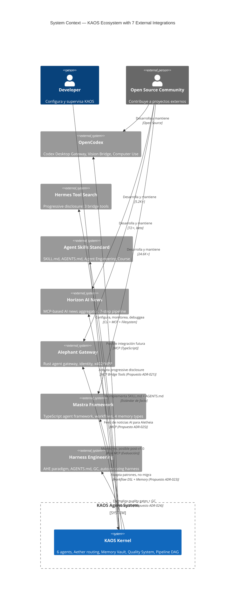
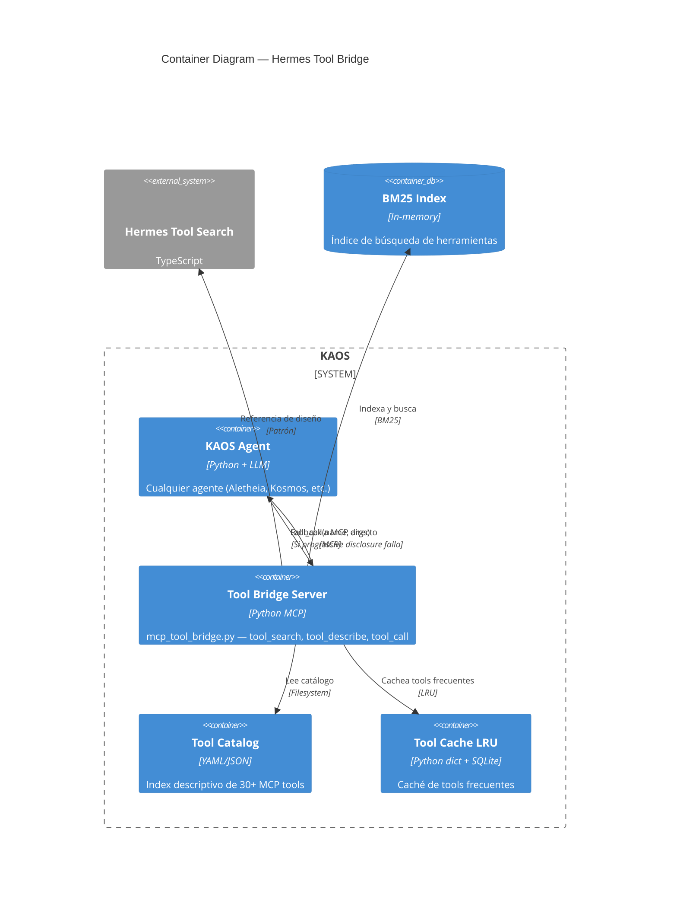
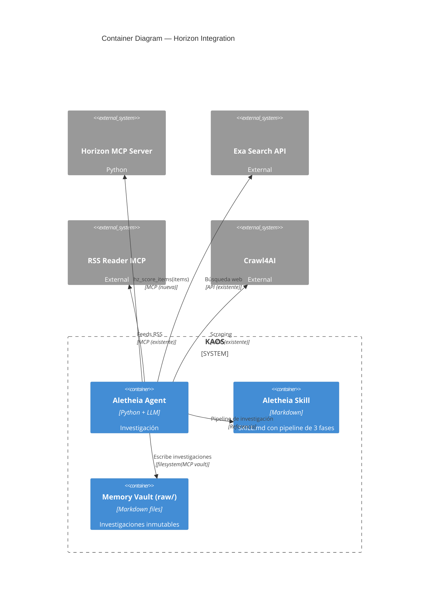
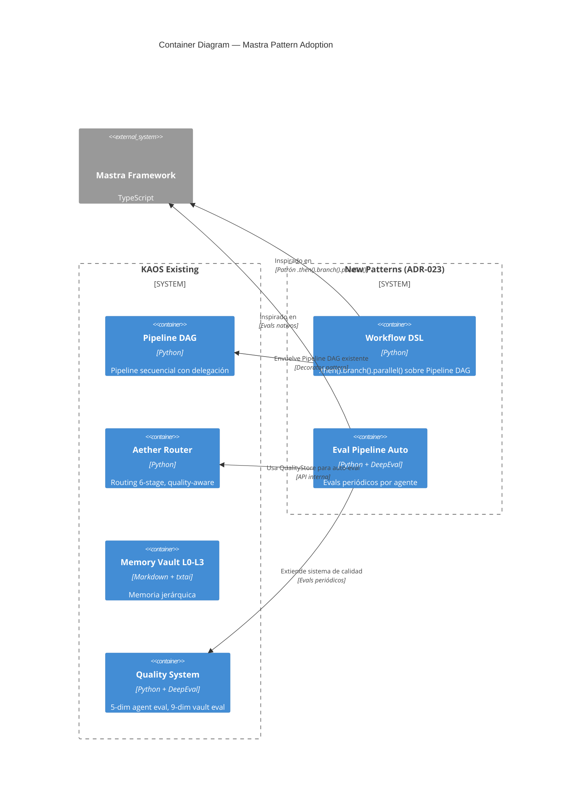
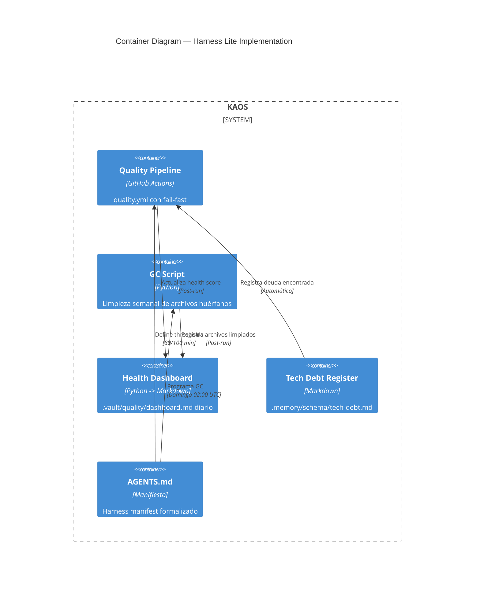
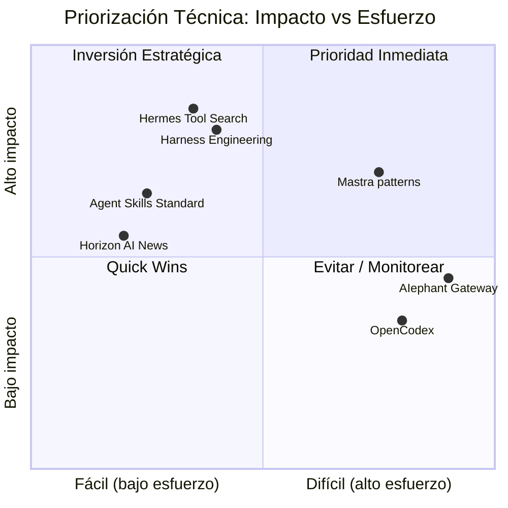

# Evaluación Arquitectónica de Integraciones — 7 Recursos Investigados por Aletheia

**Autor:** Kosmos (Agente de Arquitectura)  
**Fecha:** 2026-05-30  
**Estado:** Completo  
**ADRs generados:** ADR-021, ADR-022, ADR-023, ADR-024, ADR-025

---

## Resumen Arquitectónico

KAOS es un ecosistema de agentes con 6 agentes especializados, 30+ MCP servers, un sistema de routing de modelos (Aether) con 6 etapas de resolución, memoria jerárquica L0-L3, y sistema de calidad con 9 dimensiones de vault quality y 5 de agent output. La evaluación de 7 recursos externos — desde frameworks de agentes (Mastra) hasta gateways (AIephant) y pipelines de noticias (Horizon) — revela que **las mayores oportunidades de mejora no están en migrar a nuevas herramientas, sino en adoptar patrones específicos** que llenen gaps identificados: progressive disclosure para tool loading, formalización del harness engineering, y discovery estructurado de noticias AI.

---

## 1. Diagrama C4 — Nivel Contexto (System Context)

### Protocolos de Comunicación

| Integración | Protocolo | Dirección | Estado |
|-------------|-----------|-----------|--------|
| Hermes Tool Search | MCP (bridge tools) | Bidireccional (agente → bridge → MCP) | Propuesto |
| Horizon | MCP (tools) | KAOS → Horizon (fetch) | Propuesto |
| Mastra | Pattern adoption (no runtime) | N/A | Propuesto |
| Harness Engineering | Metodología + scripts | Interno | Propuesto |
| OpenCodex | MCP (potencial) | Bidireccional | Evaluación |
| AIephant | MCP (potencial post-v1.0) | Bidireccional | Monitoreo |
| Agent Skills Standard | Convención | Ya implementado | Adoptado |

---

## 2. Diagrama C4 — Nivel Contenedor (Container)

### 2.1 Hermes Tool Search — Progressive Disclosure

### 2.2 Horizon — AI News Discovery

### 2.3 Mastra — Patrones de Framework

### 2.4 Harness Engineering — Sistema de Calidad Vinculante

---

## 3. ADRs Generados (5)

| # | Título | Decisión | Archivo |
|---|--------|----------|---------|
| ADR-021 | MCP como Bus Universal con Progressive Disclosure | Bridge tools (tool_search/tool_describe/tool_call) + modo híbrido | `adr-021-mcp-progressive-disclosure.md` |
| ADR-022 | Estrategia de Gateway de Agentes | Extender Hermes (agent identity + telemetría). No integrar AIephant (inmaduro) | `adr-022-agente-gateway-strategy.md` |
| ADR-023 | Framework de Agentes — Patrones de Mastra | Adoptar 3 patrones (workflow DSL, 4 tipos memoria, evals periódicos). No migrar | `adr-023-framework-agentes-mastra-patterns.md` |
| ADR-024 | Harness Engineering en KAOS | Harness Lite: 5 prácticas incrementales (quality gates vinculantes, GC, dashboard, AGENTS.md, tech debt register) | `adr-024-harness-engineering.md` |
| ADR-025 | Integración de Horizon AI News | Horizon solo para news discovery (hz_fetch_items + hz_score_items). No pipeline completo | `adr-025-horizon-news-mcp.md` |

### Resumen de Decisiones por ADR

| ADR | Decisión Principal | Alternativa Rechazada | Razón Clave |
|-----|-------------------|----------------------|-------------|
| 021 | Progressive disclosure híbrido | Eager loading (status quo) | 60-80% reducción de context window |
| 022 | Extender Hermes existente | AIephant Gateway (Rust) | Inmadurez (72⭐, beta) + stack no align |
| 023 | Patrones de Mastra en Python | Migración completa a Mastra | Preservar inversión en Aether + vault |
| 024 | Harness Lite (5 prácticas) | AHE completo (auto-evolving) | Bajo riesgo, resultados rápidos |
| 025 | Horizon solo discovery (2 tools) | Pipeline completo de 7 pasos | Bajo esfuerzo, sin acoplamiento fuerte |

---

## 4. Análisis de Impacto Arquitectónico

### 4.1 Hermes Tool Search — Progressive Disclosure

| Dimensión | Evaluación |
|-----------|------------|
| **Esfuerzo estimado** | 5-7 días hombre |
| **Riesgo técnico** | Bajo — patrón probado en Hermes, modo híbrido con fallback |
| **Dependencias** | Baja — independiente de otras integraciones |
| **Stack impact** | Nuevo: `lib/tool_bridge.py`, `lib/tool_catalog.yaml`. Modificado: `opencode.json` (nuevo MCP), skill prompts de agentes |
| **Deuda técnica** | Mínima — bridge server autocontenido. Index BM25 in-memory, sin estado |
| **Reversibilidad** | Alta — fallback a MCP directo. Desactivar bridge server = status quo |
| **Mejora clave** | ~60-80% menos overhead de tool schemas en context window |

### 4.2 Horizon — AI News Discovery

| Dimensión | Evaluación |
|-----------|------------|
| **Esfuerzo estimado** | 1-2 días hombre |
| **Riesgo técnico** | Bajo — integración MCP simple, sin modificar pipeline existente |
| **Dependencias** | Ninguna — integración ortogonal |
| **Stack impact** | Nuevo: MCP server entry en `opencode.json`. Modificado: `aletheia/SKILL.md` |
| **Deuda técnica** | Mínima — proceso separado, sin acoplamiento |
| **Reversibilidad** | Muy alta — solo quitar el MCP server de la config |
| **Mejora clave** | Discovery curado de noticias AI para Aletheia |

### 4.3 Mastra — Patrones de Framework

| Dimensión | Evaluación |
|-----------|------------|
| **Esfuerzo estimado** | 15-20 días hombre (3 patrones) |
| **Riesgo técnico** | Medio — workflow DSL nuevo, puede requerir iteración |
| **Dependencias** | Media — workflow DSL depende de Pipeline DAG existente |
| **Stack impact** | Nuevo: `lib/workflow_dsl.py`, `lib/auto_evals.py`. Modificado: `lib/pipeline.py` |
| **Deuda técnica** | Media — nuevo DSL puede solaparse con pipeline secuencial existente |
| **Reversibilidad** | Alta — cada patrón es independiente, no hay migración |
| **Mejora clave** | Workflow declarativo (`.then().branch().parallel()`), evolución continua de calidad |

### 4.4 Harness Engineering — Harness Lite

| Dimensión | Evaluación |
|-----------|------------|
| **Esfuerzo estimado** | 5-8 días hombre (5 prácticas) |
| **Riesgo técnico** | Bajo — cambios incrementales sobre infraestructura existente |
| **Dependencias** | Baja — cada práctica es independiente |
| **Stack impact** | Modificado: `.github/workflows/quality.yml` (fail-fast), `.github/workflows/gc.yml` (nuevo). Nuevo: `.memory/schema/tech-debt.md` |
| **Deuda técnica** | Negativa — reduce deuda sistémica vía GC y quality gates |
| **Reversibilidad** | Alta — quitar fail-fast, detener GC schedule |
| **Mejora clave** | Calidad vinculante, higiene del vault, visibilidad de salud |

### 4.5 OpenCodex

| Dimensión | Evaluación |
|-----------|------------|
| **Esfuerzo estimado** | 15-20 días hombre (si se integra) |
| **Riesgo técnico** | Alto — Vision Bridge y Computer Use nativo macOS requieren runtime específico |
| **Dependencias** | Media — requiere macOS, Codex Desktop |
| **Stack impact** | Alto — nuevo runtime TypeScript para Vision Bridge |
| **Deuda técnica** | Alta — nuevo subsistema con Runtime específico |
| **Reversibilidad** | Media — una vez integrado, hay dependencia de Codex Desktop |
| **Mejora clave** | Computer Use en macOS, procesamiento multimodal |
| **Decisión** | **No integrar ahora.** Stack no alineado (TS vs Python). Monitorear madurez. |

### 4.6 AIephant Agent Gateway

| Dimensión | Evaluación |
|-----------|------------|
| **Esfuerzo estimado** | 20-30 días hombre (si se integra) |
| **Riesgo técnico** | Alto — 72⭐, beta 0.2.0, Rust stack no probado en el ecosistema |
| **Dependencias** | Altas — requiere PostgreSQL + Redis + Qdrant |
| **Stack impact** | Muy alto — nuevo stack Rust, nueva infraestructura de datos |
| **Deuda técnica** | Alta — mantenimiento de sistema inmaduro, posible abandono |
| **Reversibilidad** | Baja — inversión en infraestructura, migración de identity/telemetría |
| **Mejora clave** | Agent identity nativo, x402/MPP, margin ledger |
| **Decisión** | **Monitorear (post-v1.0).** Hermes extendido cubre necesidades inmediatas (ADR-022) |

### 4.7 Agent Skills Standard (Addy Osmani)

| Dimensión | Evaluación |
|-----------|------------|
| **Esfuerzo estimado** | 1-2 días hombre (refinamiento) |
| **Riesgo técnico** | Muy bajo — estándar ya implementado |
| **Dependencias** | Ninguna |
| **Stack impact** | Mínimo — actualización de SKILL.md existentes, formalización de AGENTS.md como harness manifest |
| **Deuda técnica** | Ninguna — es formalización de lo existente |
| **Reversibilidad** | Inmediata — es documentación |
| **Mejora clave** | Alineación con estándar de la industria (27K⭐), interoperabilidad |
| **Estado** | **Ya implementado**, refinamiento continuo |

---

## 5. Matriz de Priorización Técnica

### Criterios de Scoring (1-10)

| Criterio | Peso | Descripción |
|----------|------|-------------|
| Impacto arquitectónico | 35% | Cuánto mejora la arquitectura de KAOS |
| Alineación con stack actual | 25% | Compatibilidad con Python/MCP/existente |
| Madurez de tecnología externa | 15% | Estrellas, versiones, comunidad |
| Esfuerzo de integración | 15% | Inverso: 10 = fácil/rápido, 1 = difícil/lento |
| Riesgo de vendor lock-in | 10% | Inverso: 10 = sin riesgo, 1 = alto riesgo |

### Scores

| # | Integración | Impacto (35%) | Alineación (25%) | Madurez (15%) | Esfuerzo (15%) | Lock-in (10%) | **Total** |
|---|-------------|:---:|:---:|:---:|:---:|:---:|:---:|
| 1 | **Hermes Tool Search** | 9 | 9 | 8 | 6 | 9 | **8.40** |
| 2 | **Harness Engineering** | 8 | 9 | 9 | 6 | 10 | **8.30** |
| 3 | **Agent Skills Standard** | 6 | 10 | 9 | 8 | 10 | **8.15** |
| 4 | **Horizon AI News** | 5 | 8 | 7 | 8 | 9 | **6.90** |
| 5 | **Mastra patterns** | 7 | 5 | 9 | 3 | 7 | **6.20** |
| 6 | **OpenCodex** | 3 | 3 | 5 | 3 | 5 | **3.50** |
| 7 | **AIephant Gateway** | 4 | 4 | 2 | 2 | 3 | **3.30** |

### Rankings

### Tier de Prioridad

| Tier | Integraciones | Acción |
|------|---------------|--------|
| **Tier 1 — Inmediato** | Hermes Tool Search, Harness Engineering, Agent Skills | Implementar en el próximo sprint |
| **Tier 2 — Corto plazo** | Horizon AI News, Mastra patterns | Planificar para el siguiente mes |
| **Tier 3 — Monitoreo** | OpenCodex, AIephant Gateway | Revisar trimestralmente, no invertir ahora |

---

## 6. Recomendaciones de Arquitectura — Top 3

### Recomendación #1: Bridge de Tools con Progressive Disclosure

**Descripción:** Implementar un MCP bridge server (`mcp_tool_bridge.py`) que expone `tool_search`, `tool_describe`, y `tool_call` como alternativa a la carga eager de schemas. Modo híbrido: tools core (read, glob, grep, edit, bash) siempre cargadas, tools infrecuentes/especializadas via progressive disclosure. Index BM25 + catálogo YAML de todas las tools disponibles.

**Archivos a crear:**
- `.memory/_scripts/mcp_tool_bridge.py` — Bridge MCP server
- `.memory/_scripts/lib/tool_catalog.yaml` — Catálogo de tools con descripciones y categorías
- `.memory/_scripts/lib/tool_bm25.py` — BM25 index
- `.memory/_scripts/lib/tool_cache.py` — LRU cache de tools frecuentes

**Archivos a modificar:**
- `.opencode/opencode.json` — Agregar `mcp-tool-bridge` entry
- `.opencode/skills/*/SKILL.md` — Modificar prompts para progressive disclosure
- `.opencode/opencode.json` — Tools section: reclasificar por categoría (core/frecuente/infrecuente)

**Orden de implementación:**
1. Semana 1: Tool catalog YAML + BM25 index + MCP bridge server básico
2. Semana 2: Integración en 1 agente (Kosmos, el que más tools de arquitectura usa)
3. Semana 3: Generalizar a todos los agentes + monitoreo de adopción

**Pruebas necesarias:**
- `py -3 -m pytest .memory/_scripts/tests/test_tool_bridge.py -v`
- Test: tool_search encuentra la tool correcta por descripción
- Test: tool_describe retorna schema completo
- Test: tool_call ejecuta y retorna resultado
- Test: fallback a MCP directo cuando bridge falla
- Benchmark: reducción de tokens de schemas en context window (medir antes/después)

**Costo:** ~5-7 días hombre  
**Beneficio:** ~60-80% reducción de overhead de schemas → ~60-120K tokens liberados por sesión → sesiones más largas y productivas

---

### Recomendación #2: Harness Lite — Quality Gates Vinculantes + GC Automático

**Descripción:** Implementar 5 prácticas de Harness Engineering: (1) quality gates vinculantes en CI/CD (health score < 80 bloquea merge), (2) garbage collection semanal de archivos huérfanos, (3) health dashboard diario automatizado, (4) AGENTS.md como harness manifest formalizado, (5) registro de deuda técnica sistémica.

**Archivos a crear:**
- `.github/workflows/gc.yml` — GC semanal workflow
- `.memory/schema/tech-debt.md` — Registro de deuda técnica

**Archivos a modificar:**
- `.github/workflows/quality.yml` — Agregar `fail-fast` cuando health score < 80
- `.memory/_scripts/lib/quality/vault.py` — Agregar health score push a dashboard
- `.tools/quality_pipeline.py` — Agregar health score check + reporte
- `.vault/quality/dashboard.md` — Template de dashboard diario
- `AGENTS.md` — Formalizar como harness manifest

**Orden de implementación:**
1. Semana 1: Quality gates vinculantes + tech debt register
2. Semana 2: GC semanal script + schedule
3. Semana 3: Health dashboard automatizado + AGENTS.md manifest

**Pruebas necesarias:**
- `py -3 -m pytest .memory/_scripts/tests/test_quality_pipeline.py -v`
- Test: health score < 80 → pipeline falla
- Test: GC no elimina archivos referenciados
- Test: Dashboard contiene métricas correctas
- Integration test: `py -3 .tools/quality_pipeline.py`

**Costo:** ~5-8 días hombre  
**Beneficio:** Reducción de deuda técnica sistémica, prevención de degradación de calidad, higiene automática del vault

---

### Recomendación #3: Horizon + Workflow DSL (en paralelo)

**Descripción:** Dos iniciativas independientes que pueden ejecutarse en paralelo:

**3a. Horizon AI News Discovery:** Integrar Horizon MCP server (solo `hz_fetch_items` + `hz_score_items`) para dar a Aletheia un pipeline curado de noticias AI. Sin acoplamiento fuerte, sin modificar el pipeline existente.

**3b. Workflow DSL (inspirado en Mastra):** Implementar un DSL de workflows en Python que envuelva el Pipeline DAG existente con sintaxis `.then().branch().parallel()`. Usar corrutinas asyncio para paralelismo real.

**Archivos a crear (3a):**
- `.opencode/opencode.json` — Entry de Horizon MCP server
- `.memory/_scripts/mcp_horizon.py` — Horizon bridge (si es necesario)

**Archivos a crear (3b):**
- `.memory/_scripts/lib/workflow_dsl.py` — DSL de workflows
- `.memory/_scripts/lib/auto_evals.py` — Evals periódicos automáticos

**Archivos a modificar (3a):**
- `.opencode/skills/aletheia/SKILL.md` — Incluir Horizon en pipeline

**Archivos a modificar (3b):**
- `.memory/_scripts/lib/pipeline.py` — Envolver con workflow DSL
- `.memory/_scripts/lib/aether/eval.py` — Agregar auto-evals periódicos

**Orden de implementación:**
- Semana 1: Horizon MCP integration
- Semanas 2-3: Workflow DSL core
- Semana 4: Auto-evals + integración con QualityStore

**Pruebas necesarias (3a):**
- Test: `hz_fetch_items` retorna items scorteables
- Test: Integración con pipeline de Aletheia

**Pruebas necesarias (3b):**
- `py -3 -m pytest .memory/_scripts/tests/test_workflow_dsl.py -v`
- Test: `.then()` ejecuta secuencial
- Test: `.branch()` bifurca correctamente
- Test: `.parallel()` ejecuta en paralelo
- Test: Workflow DSL produce mismo resultado que Pipeline DAG secuencial

**Costo:** 3a: ~1-2 días. 3b: ~10-15 días  
**Beneficio 3a:** Discovery curado de noticias AI para Aletheia → investigación más relevante  
**Beneficio 3b:** Pipelines declarativos, paralelismo nativo, reducción de tiempo de ejecución

---

## 7. Summary — Mapa de Integraciones vs Componentes KAOS

| Componente KAOS | Hermes TS | Harness | Addy | Horizon | Mastra | OpenCodex | AIephant |
|----------------|:---:|:---:|:---:|:---:|:---:|:---:|:---:|
| **Aletheia** | 🔄 Bridge | — | ✅ SKILL | ✅ News | — | — | — |
| **Kosmos** | 🔄 Bridge | 🔄 ADRs | ✅ ADR format | — | 🔄 Workflow | — | — |
| **Kratos** | 🔄 Bridge | — | ✅ Skill | — | — | — | — |
| **Metis** | 🔄 Bridge | 🔄 Debt register | ✅ Skill | — | 🔄 Workflow | — | — |
| **Kronos** | — | 🔄 GC | — | — | 🔄 Pipeline | — | — |
| **Mnemosyne** | — | 🔄 Quality | ✅ Wiki | — | 🔄 Memory | — | — |
| **Aether (routing)** | — | — | — | — | 🔄 Evals | — | 🔄 Observación |
| **Memory Vault** | — | 🔄 GC | ✅ Structure | — | 🔄 Types | — | — |
| **Pipeline** | — | 🔄 Gates | — | — | 🔄 DSL | — | — |
| **Quality System** | — | 🔄 Dashboard | — | — | 🔄 Auto-eval | — | — |

**Leyenda:** ✅ = Ya implementado / Adoptado | 🔄 = Propuesto / En evaluación | — = No aplica

---

## 8. Conclusiones Arquitectónicas

1. **KAOS está maduro para progressive disclosure.** Con 30+ MCP servers, el overhead de schemas en context window es el problema más acuciante. Hermes Tool Search ofrece una solución probada con bajo riesgo.

2. **La calidad debe ser vinculante.** Sin quality gates que bloqueen, la calidad es opcional. Harness Lite formaliza lo que KAOS ya hace bien, pero haciéndolo obligatorio.

3. **No migrar, sino absorber patrones.** Mastra, AIephant y OpenCodex ofrecen funcionalidad valiosa, pero ninguna justifica una migración. La estrategia correcta es extraer patrones e implementarlos en el stack existente.

4. **Horizon llena un gap real.** Aletheia carece de un pipeline curado de noticias AI. Horizon, con su integración MCP nativa y stack Python, es el complemento ideal.

5. **Gateway es un no-issue hoy.** Hermes extendido cubre las necesidades inmediatas. AIephant es prometedor pero inmaduro. Reevaluar post-v1.0.

6. **El estándar de Agent Skills ya es KAOS.** SKILL.md y AGENTS.md como estándar de la industria validan las decisiones arquitectónicas de KAOS desde el día 1.

---

## Referencias

- ADR-021: MCP como Bus Universal con Progressive Disclosure
- ADR-022: Estrategia de Gateway de Agentes
- ADR-023: Framework de Agentes — Patrones de Mastra
- ADR-024: Harness Engineering en KAOS
- ADR-025: Integración de Horizon AI News
- ADR-001 a ADR-019: ADRs existentes de KAOS
- ADR-011: Hermes Integration Strategy
- ADR-018: Consolidación de Arquitectura de Routing (Aether)
- `.opencode/opencode.json` — 30+ MCP servers configurados
- `.opencode/skills/` — 7 SKILL.md existentes
- Investigación Aletheia: opencodex, Hermes Tool Search, Addy Osmani, Horizon, AIephant, Mastra, Harness Engineering
