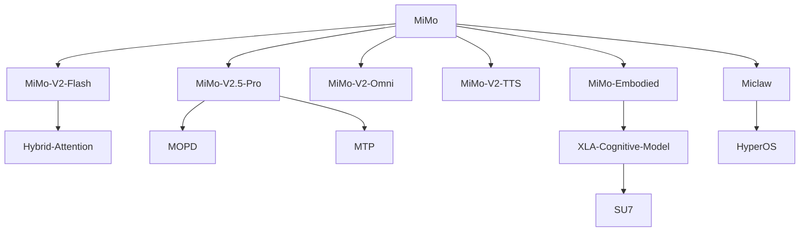

# MiMo — Familia de Modelos Fundacionales de Xiaomi

## Descripción General

**MiMo** (Xiaomi MiMo) es la familia de modelos fundacionales de inteligencia artificial de [[xiaomi|Xiaomi]]. Lanzada oficialmente en 2025-2026, comprende desde modelos de lenguaje livianos hasta sistemas multimodales, agentes autónomos y modelos embodied para vehículos y robótica.

La familia MiMo se distingue por:

- **Arquitectura MoE** (Mixture of Experts) en todos los modelos de lenguaje
- **Licencia MIT** en la mayoría de modelos (open-weight)
- Integración profunda con [[HyperOS]] y vehículos [[xiaomi-su7|Xiaomi SU7]]
- **Rendimiento #1 open-source** en benchmarks de agente (V2.5-Pro)
- **Multi-Token Prediction (MTP)** como técnica nativa de speculative decoding

## Modelos en la Familia

| Modelo | Tipo | Params | Activos | Licencia | Especialidad |
|--------|------|--------|---------|----------|-------------|
| [[MiMo-V2-Flash]] | LLM MoE | 309B | 15B | MIT | Texto, razonamiento general |
| [[MiMo-V2.5-Pro]] | LLM MoE | 1.02T | 42B | MIT | Agente, código, #1 open-source |
| [[MiMo-V2-Omni]] | Multimodal | — | — | MIT | Texto + imagen + video + audio |
| [[MiMo-V2-TTS]] | TTS | — | — | Propietaria | Síntesis de voz |
| [[MiMo-Embodied]] | Embodied | — | — | Propietaria | Robótica, vehículos |

## Técnicas Clave

- [[Hybrid-Attention]] — SWA+GA con attention sink bias
- [[MOPD]] — Multi-Teacher On-Policy Distillation
- [[Multi-Token-Prediction-MTP]] — Speculative decoding nativo

## Productos Derivados

- [[Miclaw]] — Agente autónomo AI de HyperOS
- [[XLA-Cognitive-Model]] — Modelo de conducción autónoma para SU7

## Posicionamiento Estratégico

```
Benchmark de Agente (OpenSource)
        ▲
        │
   1.0T │      MiMo-V2.5-Pro ● (1.02T/42B, #1)
        │
   300B │      MiMo-V2-Flash ● (309B/15B)
        │
        │      Kimi ● (Moonshot, propietario)
        │      DeepSeek ● (V4, propietario)
        └─────────────────────────────────► Costo/Token
              MIT            Propietario
```

MiMo representa la apuesta más agresiva de Xiaomi en IA: modelos open-weight (MIT) compitiendo directamente con DeepSeek y Kimi, con integración vertical en hardware (HyperOS, SU7).

## Ecosistema



## Fuentes
- [MiMo Pricing](https://www.mimo-v2.com/docs/pricing) — precios y specs
- [HuggingFace Xiaomi](https://huggingface.co/Xiaomi) — modelos open-weight
- Papers técnicos de Xiaomi AI Lab (2025-2026)

## Relaciones

- [[kimi]] — Competidor directo en el espacio de modelos LLM
- [[DSOL]] — Potencial integración como modelo en el router (go-mimo)
