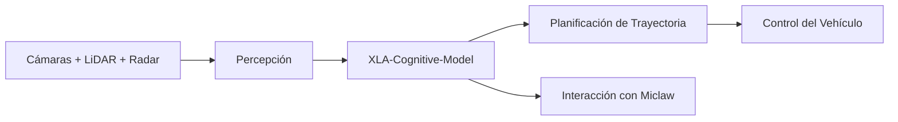

# XLA Cognitive Model — Conducción Autónoma para SU7

## Descripción

**XLA Cognitive Model** es el modelo de conducción autónoma de Xiaomi para el vehículo eléctrico [[xiaomi-su7|Xiaomi SU7]]. Forma parte del subconjunto [[MiMo-Embodied]] de la familia [[MiMo]], especializado en percepción, planificación y control en tiempo real.

## Arquitectura

### Componentes

1. **Percepción**: Procesamiento visual en tiempo real de múltiples cámaras (vía principios de [[MiMo-V2-Omni]])
2. **Predicción**: Anticipación de movimientos de otros actores en la vía
3. **Planificación**: Generación de trayectoria óptima
4. **Control**: Señales de control directo al vehículo

## Capacidades

- Conducción autónoma L2+ / L3 (según regulación)
- Percepción 360° con fusión multimodal
- Toma de decisiones en tiempo real (<100ms latencia)
- Integración con [[Miclaw]] para interacción por voz

## Relaciones

- [[MiMo-Embodied]] — Sub-familia a la que pertenece
- [[MiMo-V2-Omni]] — Base de procesamiento visual
- [[Miclaw]] — Asistente que interactúa con el conductor
- [[xiaomi-su7|Xiaomi SU7]] — Vehículo donde se implementa

## Fuentes
- Anuncios oficiales Xiaomi SU7 (lanzamiento y actualizaciones)
- Xiaomi EV Technology Day (2025-2026)
