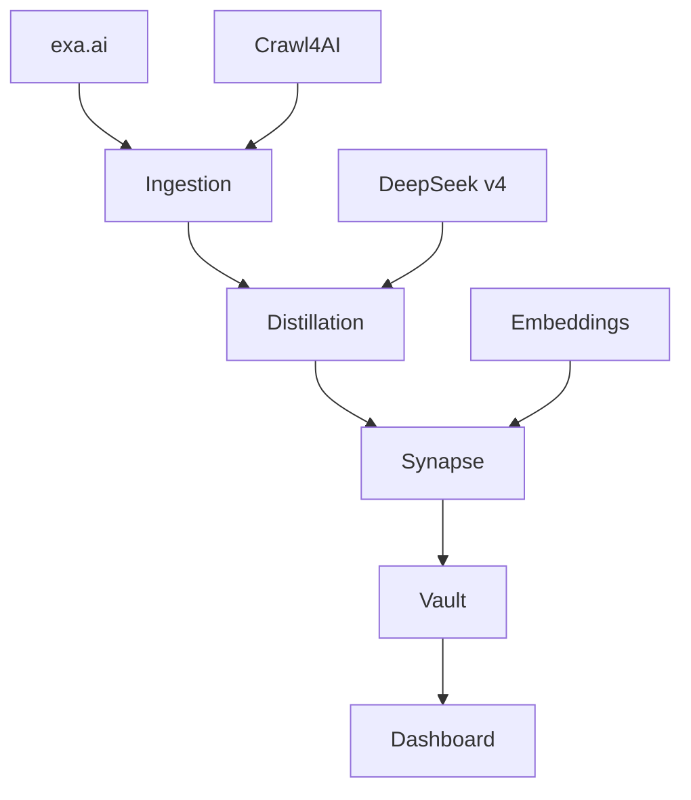

## Executive Summary

KAOS is a Multi-Agent Ingestion & Distillation (MAID) pipeline for knowledge management.

- **Version:** MAID Pipeline v2
- **Quality Score:** {{QUALITY_SCORE}}/100
- **Total Pages:** 137 markdown files
- **Wikilinks:** 115 valid, 1 broken
- **DSOL API Calls:** {{DSOL_CALLS}}
- **Total Cost:** \${{DSOL_COST}} USD

## System Architecture

## Pipeline Status

| Component | Status | Metrics |
|-----------|--------|---------|
| Ingest | Active | 13 files ingested |
| Distill | Active | 33 concepts extracted |
| Synapse | Active | 115 cross-links |
| Quality | Active | {{QUALITY_SCORE}}/100 |
| DSOL | Active | {{DSOL_CALLS}} calls |

## Key Metrics

- **Lint Issues:** 0
- **Tests Passing:** 29/29
- **Confidence Matrices:** {{CONFIDENCE_MATRIX_COUNT}}/{{TOTAL_INVESTIGATIONS}}
- **Embeddings Coverage:** {{EMBEDDED_PAGES}}/{{TOTAL_PAGES}}

## MCP Servers

- exa-search: Connected
- gptr-deep-research: Connected
- vault: Connected
- sequential-thinking: Connected
- excalidraw: Connected
