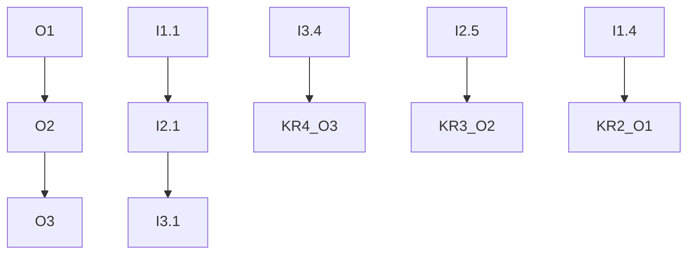

# KAOS OKRs — Q2 2026

## O1: Consolidar la base de conocimiento del sistema

**Objective**: Establecer un vault de conocimiento unificado, curado y trazable que cubra el 90% de los conceptos activos del sistema.

| KR | Target | Due | Owner |
|----|--------|-----|-------|
| KR1: Reducir duplicación de entradas wiki | < 10% entradas duplicadas | 2026-06-15 | Mnemosyne |
| KR2: Aumentar cobertura de wikilinks entre agentes | ≥ 80% de entidades con backlinks válidos | 2026-06-30 | Mnemosyne |
| KR3: Establecer ADRs para todas las decisiones arquitectónicas activas | 100% de ADRs con estado "active" o "superseded" | 2026-07-15 | Kosmos |
| KR4: Completar mapeo de entidades del sistema (agentes, MCPs, herramientas) | ≥ 95% de entidades documentadas | 2026-07-30 | Metis + Mnemosyne |

### Initiatives
- I1.1: Auditoría semanal de duplicados en el vault (Mnemosyne curation pipeline)
- I1.2: Migración de documentación legacy al formato wiki estandarizado
- I1.3: Creación de guía de estilo para wikilinks y frontmatter
- I1.4: Automatizar detección de entidades huérfanas (sin backlinks)
- I1.5: Sesión semanal de revisión de ADRs con Kosmos

---

## O2: Automatizar la cadena de calidad del sistema

**Objective**: Reducir a < 30 minutos el tiempo entre generación de output y reporte de calidad completo.

| KR | Target | Due | Owner |
|----|--------|-----|-------|
| KR1: Smoke check post-output en < 2 minutos | ≤ 2 min por ejecución | 2026-06-01 | Kronos |
| KR2: Functional test automatizado con score compuesto | ≥ 70/100 score promedio | 2026-06-15 | Kratos |
| KR3: Audit semanal con reporte PPTX generado automáticamente | 100% semanas con reporte | 2026-07-01 | Metis |
| KR4: Verification chain cross-agent ejecutable en un comando | ≤ 10 min por ciclo completo | 2026-07-15 | Kronos + Metis |

### Initiatives
- I2.1: Implementar `session_runner.py` con perfiles smoke/functional/audit
- I2.2: Integrar `verification_chain.py` con el pipeline de CI
- I2.3: Template de reporte PPTX semanal con PaperJSX
- I2.4: Dashboard de calidad en vivo con scores agente por agente
- I2.5: Alertas automáticas cuando score compuesto < threshold crítico

---

## O3: Integración profunda de agentes y herramientas

**Objective**: Lograr que el 100% de los flujos cross-agent se ejecuten sin intervención manual.

| KR | Target | Due | Owner |
|----|--------|-----|-------|
| KR1: Flujo completo Aletheia → Kosmos → Metis → Kratos sin breaks | ≥ 90% tasa de éxito end-to-end | 2026-06-30 | Kronos |
| KR2: Routing adaptativo DSOL implementado para todos los agentes | 100% agentes con DSOL | 2026-07-15 | Kronos |
| KR3: Test suite de integración cross-agent | ≥ 20 tests con ≥ 80% pass rate | 2026-07-30 | Kratos |
| KR4: Herramientas MCP sincronizadas entre opencode.json y documentación | 100% sync score = 6/6 | 2026-06-01 | Mnemosyne |

### Initiatives
- I3.1: Pipeline de integración continua con gatillos por agente
- I3.2: Estandarización de contratos de output entre agentes
- I3.3: Implementar agy-bridge como gateway único de routing
- I3.4: Script de verificación de consistencia de herramientas (`metis_sync_check.py`)
- I3.5: Documentar contratos de integración en ADRs

---

## Risk Matrix

| Riesgo | Probabilidad | Impacto | Mitigación |
|--------|-------------|---------|------------|
| Duplicación de esfuerzo entre Mnemosyne y Metis en curación | Media | Alto | OKR O1 asigna dueños claros por iniciativa |
| Smoke check demasiado lento para ser útil | Alta | Medio | KR1 de O2 tiene target explícito de 2 min; iterar si no se cumple |
| Agentes no adoptan DSOL routing | Media | Alto | KR2 de O3 exige 100%; Kronos hace migración forzada por agente |
| Herramientas documentadas difieren de las reales | Alta | Medio | KR4 de O3 + script metis_sync_check como gatekeeper |
| Falta de adopción de calidad por parte del equipo | Media | Alto | Reportes semanales visibles; OKR O2 hace calidad medible y automática |

## Dependencies

## Review Schedule

- Weekly sync: Lunes 10:00 — revisión de KRs en progreso
- Monthly OKR health check: Último viernes del mes
- Mid-quarter review: 2026-06-15
- Final review: 2026-07-30
